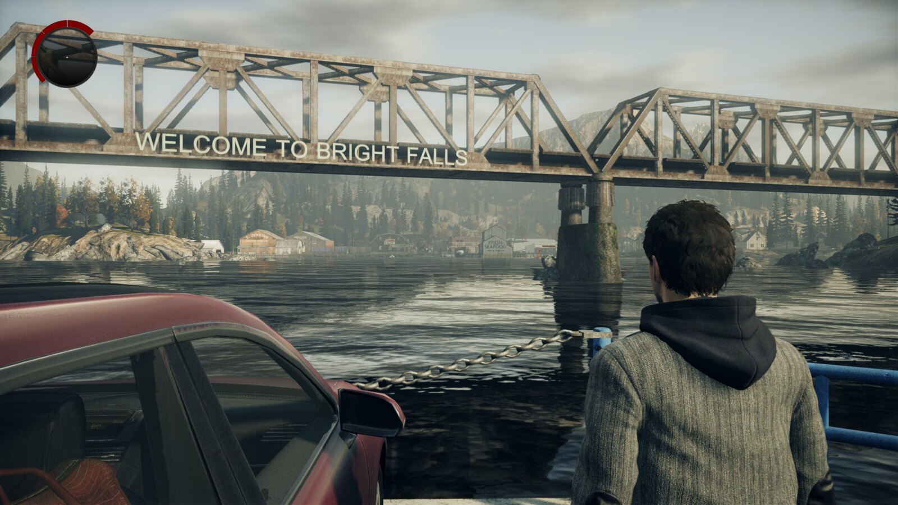
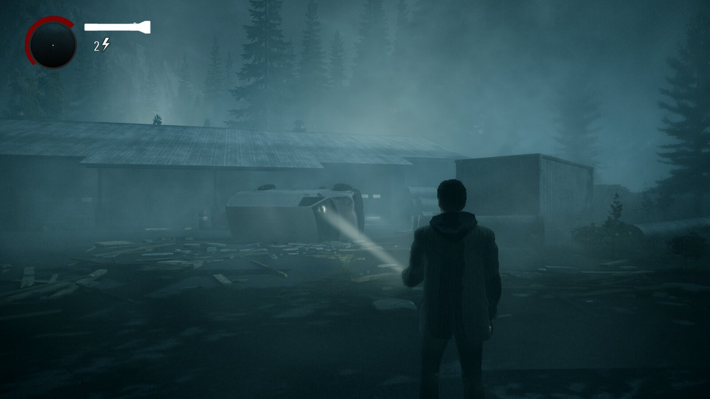
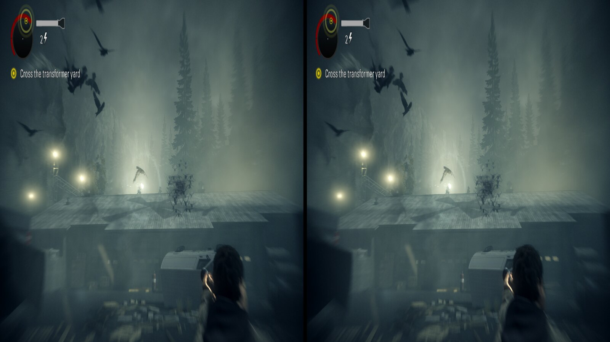
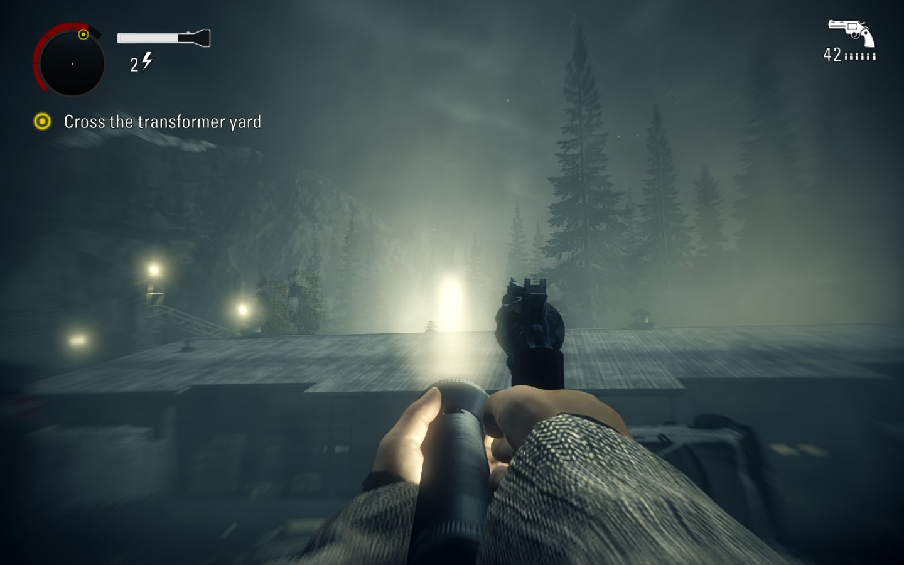

# Torchbearer

Torchbearer is a quality-of-life, stereoscopic-3D, first-person, and experimental
ray-tracing mod for the Epic version of **Alan Wake Remastered**. It is packaged for
[Quiver](https://github.com/AndrewGaspar/quiver) and exposes the game's own settings plus
Torchbearer's settings through Quiver Options.



> **Current version:** 0.6.9. Torchbearer hooks a specific game build by verified code
> signatures. If a game update no longer matches, affected features should log the mismatch
> and disable themselves rather than patch blindly, but crashes or visual regressions remain
> possible. Back up saves before using experimental features, especially ray tracing.

## Screenshots

| Flashlight and ray-traced graphics | Stereoscopic side-by-side output |
|---|---|
|  |  |
| Experimental first-person camera | Bright Falls ferry |
|  |  |

The screenshot set is maintained under [`docs/screenshots/`](docs/screenshots/). See its
[maintenance notes](docs/screenshots/README.md) before replacing an image: screenshots are part
of the public feature description and should be refreshed whenever a release materially changes
the visuals, defaults, or features they illustrate.

## Features

### The game's settings, live in Quiver

Torchbearer exposes 107 options through Quiver:

- Display mode, resolution, HDR, VSync, field of view, brightness, DLSS, and graphics quality.
- Audio, subtitle, control, gamepad, and key-binding settings.
- Startup-video and warning-screen skips.
- Settings are applied through the game's own code where possible. Changes made in the game's
  menu are reported back to Quiver, and unsetting a Torchbearer value leaves the game's value
  alone. See [`docs/settings.md`](docs/settings.md).

### Graphics beyond the game's menu

- **Ambient occlusion choices:** the remaster's HBAO, the original 2010 SSAO that the remaster
  ships but never enables, or experimental ray-traced ambient occlusion.
- **Ray-traced ambient occlusion (RTAO):** builds acceleration structures from the game's actual
  drawn geometry, including alpha-tested foliage and fences, moving/skinned meshes, terrain,
  and grass. Version 0.6.9 adds per-instance motion so temporal history survives moving
  platforms such as the Bright Falls ferry.
- **Ray-traced flashlight shadows:** replaces only the flashlight's shadow-map test with rays
  toward a bulb-sized disc, producing crisp contact shadows that soften with distance. Other
  spot lights keep the game's shadow map.
- Ray-traced sun/moon shadows remain a developer prototype and are not exposed as a normal
  option yet.

Ray-traced options require a DXR-capable GPU and are selected before launch. The implementation
and validation measurements are documented in [`docs/raytracing.md`](docs/raytracing.md).

### True same-frame stereoscopic 3D

- Both eyes are rendered from the same game update and composed side by side; this is not
  frame-sequential stereo.
- Full side-by-side, half side-by-side for HypXRland, and automatic output selection on supported
  stereo displays.
- Independent per-eye TAA, object-velocity, and DLSS temporal state.
- Adjustable separation, convergence, eye swap, and Hyprland/HypXRland window tagging.

See [`docs/stereo.md`](docs/stereo.md) and [`docs/stereo-output.md`](docs/stereo-output.md).

### Experimental first-person camera

- First-person rendering with visible body/arms options and RE-style close framing.
- Aiming and flashlight direction from the eye, deliberate-draw controls, configurable gamepad
  and keyboard actions, hand placement, sway, and eye-position controls.
- The game still simulates and animates Alan in third person; this is explicitly a prototype and
  can expose animation or interaction edge cases.

See [`docs/first-person.md`](docs/first-person.md).

## Requirements

- **Alan Wake Remastered** from Epic (`epic:7315f614b0504081bcdceef138075c9c`), using
  `Game_f_x64_EOS.exe`.
- **Quiver** on Linux with the game installed and launched through Proton.
- A Direct3D 12 / vkd3d-proton runtime supplied by the Quiver/Proton setup.
- For `ao = rtao` or `flashlight_shadows = rt`, a GPU and driver with DXR ray-query support.
- For stereoscopic output, compatible 3D glasses/display and, for HypXRland modes, the setup
  described in [`docs/stereo-output.md`](docs/stereo-output.md).

Torchbearer is developed and tested against the Epic build above. Other stores, game updates,
Windows-native execution, and arbitrary Proton builds are not currently tested targets.

## Install with Quiver

Build the mod, then install the generated Quiver package:

```sh
git clone https://github.com/AndrewGaspar/torchbearer.git
cd torchbearer
scripts/build
quiver mods "Alan Wake Remastered" install build/package
```

Then enable **Torchbearer** in the Quiver profile you use for the game and review its options
before launching. Options with `apply = "restart"` in Quiver—notably stereoscopic output,
ray-traced AO, and ray-traced flashlight shadows—must be selected before the game starts.

## Configuration

Most users should configure Torchbearer from **Quiver → Alan Wake Remastered → Torchbearer
options**. Quiver writes [`dist/torchbearer.ini`](dist/torchbearer.ini)'s format into the active
profile; advanced and developer-only settings also live there.

Useful starting points:

| Setting | Values | Effect |
|---|---|---|
| Ambient occlusion | `game`, `ssao`, `rtao` | HBAO, original SSAO, or ray-traced AO |
| Flashlight shadows | `game`, `rt` | Shadow map or ray-traced flashlight shadows |
| 3D mode | `off`, `left`, `right`, `alternate`, `sbs`, `auto` | Stereoscopic rendering mode |
| 3D output | `auto`, `full`, `hsbs`, `sbs`, `none` | How eye images are packed for the display |
| Camera mode | third-person or first-person options | Experimental first-person prototype |

The default configuration is intentionally conservative: ray tracing is off, first-person is a
prototype, and stereoscopic mode is automatic only on a detected stereo display.

## Build from source

Prerequisites on Linux:

- CMake 3.24 or newer
- Ninja
- MinGW-w64 x86-64 GCC/G++ (`x86_64-w64-mingw32-gcc` and `x86_64-w64-mingw32-g++`)

Build:

```sh
scripts/build
```

Outputs:

- `build/mod/` — `dxgi.dll`, `torchbearer.ini`, and the Quiver manifests in a flat mod folder.
- `build/package/` — the installable Quiver package, with the same payload under `files/`.

The build produces a `dxgi.dll` proxy. Proton loads that native DLL from the game folder first;
Torchbearer forwards DXGI exports to the system implementation and installs only the hooks each
enabled feature needs.

### Rebuilding embedded shaders

The ray-tracing compute shaders and spotlight shader are checked in as generated DXIL headers.
Only rebuild them after editing files under `src/features/rt/shaders/`:

```sh
scripts/build_shaders
scripts/build
```

That requires Microsoft DirectXShaderCompiler 1.9 at `build/tools/dxc/bin/dxc` (or set `DXC`).
Use the script as checked in: its `-validator-version 1.5` flag is required for the current
vkd3d-proton path.

## Documentation

- [Live game settings](docs/settings.md)
- [Stereoscopic 3D design and measurements](docs/stereo.md)
- [Stereo output and HypXRland](docs/stereo-output.md)
- [First-person camera prototype](docs/first-person.md)
- [Ray tracing, RTAO, and flashlight shadows](docs/raytracing.md)
- [Level loading and test fixtures](docs/levels.md)
- [Agent/project working notes](CLAUDE.md)

The research notes distinguish static analysis, live lab observation, and measured results.
They are intentionally kept with the code because many features depend on exact game-build
behavior.

## Development and testing

Torchbearer is developed against Quiver Lab instances so the installed game and real prefix are
not modified during testing. The usual loop is:

```sh
scripts/build
QUIVER_SOURCE=agent:<name> quiver lab launch awr --mod build/mod --wait frame
QUIVER_SOURCE=agent:<name> quiver lab logs awr
```

Before landing a change, verify the affected behavior in the lab at 1920×1080@60 unless the
feature specifically needs another resolution or instance. Features must remain inert when
their configuration is off. Code that resolves game addresses must verify a byte signature,
log a mismatch, and disable that feature instead of patching blindly.

### Keeping screenshots current

README screenshots are release documentation, not one-off debug captures. When a change
materially affects a pictured feature, its defaults, its visual quality, or the version shown:

1. Recapture the affected image from the current build at a named scene and resolution.
2. Replace the corresponding file in `docs/screenshots/`; keep the descriptive filename unless
   the subject itself changed.
3. Update [`docs/screenshots/README.md`](docs/screenshots/README.md) with the game location,
   relevant settings, and mod version.
4. Check the rendered GitHub README on desktop and mobile widths.

## Repository layout

- `src/proxy.cpp` — DXGI proxy and entry point.
- `src/core/` — configuration, logging, hooks, Quiver SDK glue, lab channel, and camera filters.
- `src/features/` — settings, stereo, first-person, graphics, levels, and ray tracing.
- `dist/` — shipped defaults, Quiver mod manifest, and the Quiver Options schema.
- `docs/` — user-facing design notes, measurements, and screenshots.
- `re/` — reverse-engineering notes and analysis scripts. The analyzed Ghidra project is local
  state and is not tracked.
- `scripts/` — build and shader-regeneration scripts.
- `third_party/` — vendored dependencies with their own licenses.

## Known limitations

- The mod is build-specific. A game patch can disable individual features until signatures and
  offsets are refreshed.
- Ray tracing is experimental. Distant foliage uses point-sampled alpha at mip 0 while the game
  rasterizes with mipmapped, derivative-sharpened tests, and wind animation is not in the
  captured acceleration structures.
- Ray-traced sun/moon shadows remain a developer prototype; their off-screen casters are not
  placed reliably enough for a user option.
- First-person mode is a prototype layered over the third-person simulation and animation.
- Experimental stereo shadow reuse can drop the flashlight spot in the right eye with game
  shadows. The RT flashlight preserved it at the level 15 wall where this occurs.
  [Full-SBS comparison](docs/raytracing.md#full-sbs-at-the-transformer-yard-wall)

## License and trademarks

Torchbearer's own source code is licensed under the [MIT License](LICENSE).

Third-party code under [`third_party/`](third_party/) remains under its respective licenses,
including MinHook and the dev-only vkd3d-proton ray-query test material. The optional
`TB_RT_RAYQUERY_TEST` build embeds LGPL test material and is off by default; do not redistribute
a build with it enabled unless its license obligations are satisfied.

Torchbearer is an unofficial fan mod. It is not affiliated with or endorsed by Remedy
Entertainment, Epic Games, or the Alan Wake rightsholders. Screenshots show Alan Wake Remastered
and remain subject to the game's copyrights and trademarks; the MIT license above does not grant
rights in the game or its assets.

