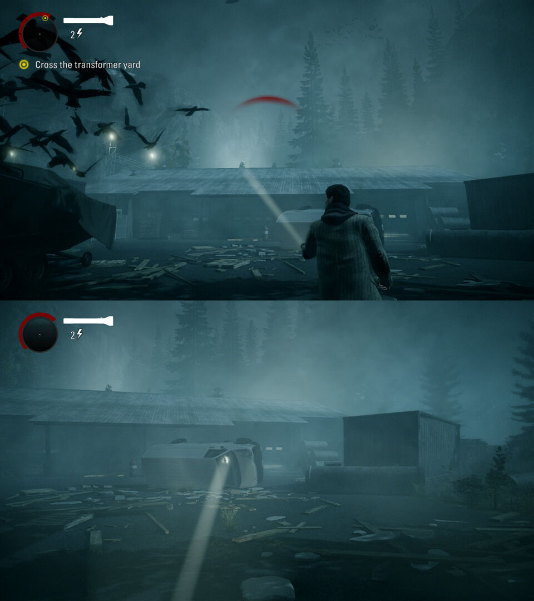
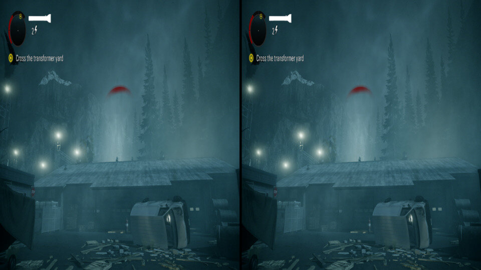
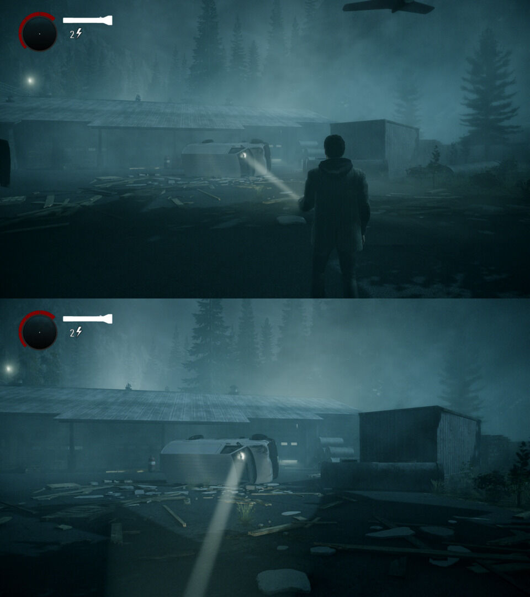
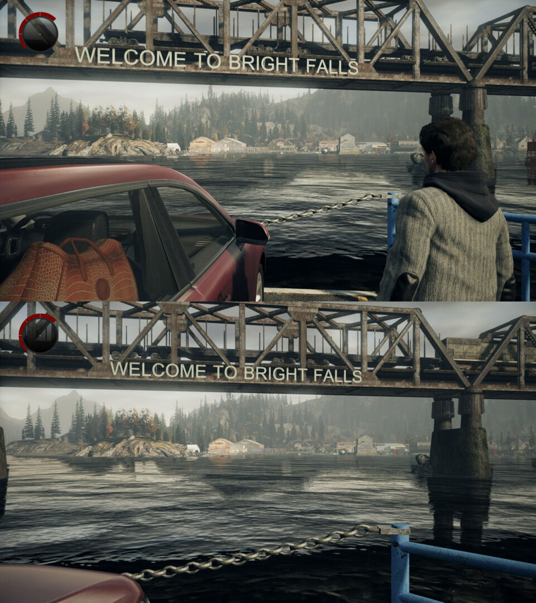

# First-person camera (prototype)

Goal: play Alan Wake Remastered in first person, including in stereo 3D (XReal glasses, the
stereo feature's `sbs` mode). This note is the investigation (camera system, player, aiming) and
the prototype `[camera] mode = first_person` (`src/features/firstperson.cpp`, extension point in
`src/core/camera.h`).

Status in one paragraph: **it works as a render-side first-person view.** During normal gameplay
the rendered camera sits at Alan's eyes (his animated head slot plus a small offset), looks where
the game's own third-person camera looks (converged on that camera's centre ray at 15 m), his
body, flashlight and gun meshes are hidden with the engine's render-object "hidden" flag while the
flashlight's beam stays on (not with the per-character hide mask, which stops "use" working:
section 5), and the game is unchanged underneath: walking, mouse look, aiming the
flashlight, focusing it on the Taken birds all play as before because every gameplay system still
reads the third-person camera. Cutscene, free, death and vehicle cameras and scripted shots inside
the player camera fall back to the game's camera (and the body comes back). It composes with
stereo: first person is a camera filter that runs before the stereo eye offset, so `sbs` renders
both eyes around the first-person eye point (measured depth-dependent disparity). What it is not
yet: a first-person game (no arms/viewmodel, aim parallax at close range, DOF focus and sound
listener still at the third-person camera, head bob only low-passed).

Addresses are RVAs (image base 0x140000000) of `Game_f_x64_EOS.exe` (Epic, 2026-11). "static" =
read in Ghidra (`re/scripts/Serve.java`), "live" = observed in the lab (instance `awr-fp`,
1920x1080, fixtures `awr-forest-night`, level 01/02 starts), "measured" = numbers from the lab.



## Quick use

```ini
[camera]
mode = first_person   ; third_person = the game's camera (inert)
fov = 0               ; horizontal degrees at 16:9 in first person, 0 = the game's (game.fov)
hide = all            ; all | body (keep held flashlight/gun) | none
anchor = head         ; head (animated) | body (root + eye_height)
smooth = 0.1          ; s, low-pass on the head's motion relative to the body
eye_up = 0.05         ; m above the head slot
eye_forward = 0.10    ; m ahead of it (camera's horizontal forward)
aim_distance = 15     ; m, look at this point of the game camera's centre ray (0 = parallel)
```

All live (`quiver lab call <i> cfg camera.mode first_person`). Lab verb: `quiver lab call <i> fp`
(status: active or why not, eye/head/root/game-camera positions), `fp slots N` (census of the
player's slots), `fp freecam on|off` (test aid: the debug free camera and back), `fp use` (the
game's current use target, i.e. what the interaction prompt is for, the game's hide mask on the
player and whether ours is applied), `fp usables [mask] [radius]` (game objects of a type mask near
the player: 4 = pickups, 0x40 = triggers incl. use triggers, 0x4d = everything "use" considers;
for finding pickups to test with), `fp hidetest on|off` (test aid: first person's hiding of the
player in third person too).

---

## 1. The camera system (static unless marked)

### CameraManager

Globals next to the getter `0x1d2540` (`mov eax,[0xb05e28]; ret`), created in `0x1d2580`:

| global | object | class / size |
|---|---|---|
| `0xb05e28` | camera **mode** (int) | 0 player, 1/2/6 free, 3 cinematic, 4/5 animation preview, 7 death |
| `0xb05df0` | "Player camera" (getter `0x1d2570`) | `PlayerCamera`, 0xee8 (ctor `0x29ade0`) |
| `0xb05e10` | "Cameraman camera" | plain `BaseCamera` 0xd00 (ctor `0x15d810`, vtable `0x752ad0`) |
| `0xb05e00` | "Free camera" | `FreeCamera` 0xd18 |
| `0xb05e08` | "Cinematic camera" | `CinematicCamera` 0xd00 |
| `0xb05e18` | "Death camera" | `DeathCamera` 0xd30 |
| `0xb05df8` | "Animation preview camera" | 0xd20 |
| `0xb05e20` | sound listener | `snd::Listener` |

- `CameraManager::update` `0x1d2c90` (from `GameMode` `0x34d200`): velocity for the listener, then
  `0x1d2fe0` updates the cameras of the current mode, then the sound listener is placed at **the
  mode's camera** (`0x5462b0`/`0x546300`: in mode 0 the PlayerCamera, i.e. third person).
- `0x1d2fe0`, mode 0: `PlayerCamera::update` (`0x29d380`), then the Cameraman camera gets the
  CameraMan effects transform (shake and recoil, global `0xaf8a00`) via `BaseCamera::setTransform`
  `0x15e210`, plus the PlayerCamera's FOV (`0x463c70`) and zoom (`0x463cb0`). Mode 3: the
  Cinematic camera (updated by `0x191940` whenever `0x191530` returns a running cinematic). 1/6:
  PlayerCamera still updated, plus the free camera. 7: death camera.
- `CameraManager::active(bool withEffects)` `0x1d2400` (about 100 callers: gameplay, AI, audio,
  renderer): mode 0 returns the PlayerCamera (false) or refreshes and returns the **Cameraman
  camera** (true); other modes return their camera. **The Cameraman camera is the view rendered in
  gameplay** (live: renderFrame's view is it in mode 0, a different View in mode 1 -> log lines
  "rendering the Cameraman camera" / "rendering another camera").
- `BaseCamera::setTransform(float[12])` `0x15e210` stores the float transform at **+0xcc8**
  (rows right, up, forward, position; getters `0x15d9f0` = +0xcc8, `0x15da00` = position +0xcec)
  and calls `0x15e650`, which widens it to doubles and calls `View::setViewToWorld` `0x15e2f0`
  (docs/stereo.md section 1). Gameplay reads the floats at +0xcc8; only the renderer reads the
  View's doubles (+0x248). That split is what the prototype relies on.

### PlayerCamera (the third-person camera)

Layout (ctor `0x29ade0`, update `0x29d380`):

| offset | content |
|---|---|
| +0xd08 | `CameraMan` (0x70, ctor `0x1728a0`): three `CameraShake`s and a `CameraRecoil`; its transform (first 12 floats) is the global `0xaf8a00` (getter `0x172bf0`); applied by `0x172db0` |
| +0xd10 | `TailCamera` (0x1b0, ctor `0x2ed2b0`): **the player-follow camera**, the base "camera mode" |
| +0xd20 | 8 x `AttachedCamera` (camera attached to an entity / bone) |
| +0xd60 | 8 x `RailCamera` |
| +0xda0 | 8 x `PathCamera` |
| +0xde0 | `RevealCamera` |
| +0xde8 / +0xdf0, +0xe08 / +0xe10 | two stacks (array, count) of active camera modes, blended in order |
| +0xe28 / +0xe2c | entity handle / bone index for a blend towards an attached pose (`0x179e30`) |

`PlayerCamera::update`: each camera mode's vtable +0x18 is `update(float xform[12]*, float*
fov, float* zoom)`; the TailCamera and the RevealCamera run first, then the two stacks (a mode
that reports "done" (vtable +0x20) is popped), an optional blend to the attached pose, the FOV
blended to the aspect (`0x463be0`), zoom clamped to 0.01..1, then the CameraMan adds shake and
recoil and `setTransform` is called. "Camera:*" tweakables (FOV 88, Zoom Factor 0.9, Near 0.2,
High/Mid/Low/Safe Pos, Switch Side Speed, Modern Central Offset Scale, Aim Speed Multiplier...),
"Camera:Collision *" and "Vehicle Camera:*" are its parameters (live: `tweak list Camera`).
`Aim:Max/Min Vertical Angle` = +/-60 deg is the pitch clamp.

- **Aim / zoom**: aiming (right mouse) pulls the TailCamera in over the shoulder and lowers zoom;
  both reach the Cameraman camera each update (static), so the game's aim zoom applies in first
  person too.
- **Cinematic moments** (slow-motion dodges and the bird attacks, sepia grade): stay in mode 0
  (live: first person stays active through them, `fp-focus-birds.jpg`).
- **Scripted shots while the player has control** (RailCamera / PathCamera / RevealCamera /
  AttachedCamera in the stacks): mode 0, but the game camera leaves the player. Live: the
  helicopter fly-by in level 15 put the game camera 13 m above Alan
  (`game_camera` y 59.8 vs head 46.9) for 2.4 s.
- **Cutscenes**: Bink videos (ModeSwitch's VideoMode, docs/levels.md) and in-engine cinematics
  (mode 3, Cinematic camera).
- **Vehicles**: the player's `Character +0x218` is a vehicle link (`0x159d60` = has a vehicle,
  `0x159dc0` = driving; used by the trigger code `0x153260` for OnPlayerEnterInVehicle). The
  vehicle camera itself ("Vehicle Camera:*" tweakables, CONTROLLER_DRIVE_*_CAMERA) was not traced:
  first person falls back while the link is set (static only; no driving section was reached).
- No first-person mechanism exists in the engine (no strings, no camera class for it). The debug
  free camera does (TOGGLE_FREECAMERA, `0x1d2b40`, "Free Camera:*" tweakables).
- `Renderer::renderView` `0x2ae2f0` places the focus/DOF from `CameraManager::active(false)`, the
  PlayerCamera's position (static): in first person the DOF focus is computed from the
  third-person camera.

## 2. The player

- Player manager `0x1873a0` -> +0x50 the `Character*` (docs/levels.md); +0x1c9 player flag.
  `Character` world transform at +0xbc (`0x2652c0`): its position is **1.08 m above the feet**
  (live: slot 30 sits at (0, -1.079, 0) below it).
- **Bone slots**: `Character::slotTransform(this, float out[12], int slot)` `0x179f10` (virtual):
  if the character is animated (vtable +0x2c8) it reads the pose (`+0x1b8 -> +8`): the slot table
  at pose+0x50 (int joint per slot, -1 = none; `0x184160`, `0x414a30`) and the slot's model-space
  transform at pose+0x160 + slot*0x30 (`0x414d10`), subtracts the controller's height (+0x1c0 ->
  +0xd0) and multiplies by the character transform. Otherwise it returns the character transform.
  `0x179e30` is the same by joint index. **Slot 0x1d = the head**: the "head heading" getter
  `0x17a420` and the Taken head-shot test `0x340580` both use it (static); live census
  (`fp slots 48`, Alan standing): slot 29 is the highest, (0.005, +0.569, 0.005) from the root,
  i.e. ~1.65 m above the feet; 27/28 just below it (+0.516/+0.465, neck), 32/33 (+0.62)
  shoulder-height attachments, 30 ground (-1.079), 19-26 legs, 4-18 arms and hands.
- **Head motion** (measured, head - root while walking on the ferry, 25 samples in 2.7 s): at rest
  +0.58 m; the first steps dip the head to +0.33 m and push it 0.3 m ahead of the root; steady
  walking bobs about +/-4 cm. Raw it is a lot of motion for a camera, hence `smooth`.
- **Hiding the player**: `Character +0x210` is a `CharacterHide` (+0 Character*, +8 mask, +0xc the
  mask last applied); `CharacterHide::set(this, bool on, u32 bits)` `0x1ef4f0` sets/clears bits and,
  when the mask changed, hides or shows: the character's render objects (render-object flag 8,
  `0x463180`), the weapon (`Character +0x220`, `0x340340`), the flashlight (`+0x230`, `0x22cb60`:
  mesh, and `Flashlight[0]` = hidden, which turns the beam off in `0x22f370`), and attachments
  (`0x308110`, `0x2d8760`, `0x2f1420`). Any low-16 bit hides; a mask other than 0, 2 or 8 also
  disables the character controller (`0x178dc0`, flags at +0x2c0), i.e. removes Alan from
  physics. Bits seen at the call sites: 0x10000 (about 20 script/cutscene sites), 0x40000, 0x10,
  4, 1, and **8 = the debug panel's "Hide character"** (`DebugPanel::AnimationPage` global
  `0xaf5d78` +0x146), which every Character update re-applies (`0x17e716`). Bit 8 hides meshes
  and keeps physics, but **it freezes the player's input reader** (`0x1ef6e0` "low 16 bits are 2
  or 8", read by GameMode `0x34dcb0`), which broke "use" in first person up to 0.6.1: section 5.
  The prototype now sets the render flags itself.
- Near plane: `Camera:Near` 0.2 m. With `hide = none` and the eye 0.1 m ahead of the head joint the
  head is behind the camera; not pursued further (the body is hidden by default).

## 3. Aiming and gameplay in first person

The prototype changes only what is rendered; the game keeps simulating its own third-person
camera. Consequences (live unless marked):

| what | behaviour |
|---|---|
| movement | relative to the (unchanged) game camera's heading, which is the view's heading: W walks into the view (live: 2 s of W moved the player 5.7 m along the view) |
| mouse look | unchanged (it turns the game camera, the view follows); pitch clamped to +/-60 deg |
| flashlight aim / focus | the game aims along its own camera's centre ray; the beam leaves the (hidden) left hand at the lower left and reaches the aimed point; "[F] Focus" works and burns the Taken birds (`fp-aim.jpg`, `fp-focus-birds.jpg`) |
| aim parallax | the game camera is ~2.9 m from the eye (measured: game camera (1383.26, 46.77, 2263.48), head (1385.54, 46.87, 2261.72)), behind and right of Alan. With `aim_distance = 15` the view looks at the 15 m point of that ray: the screen centre is on target at 15 m, off by roughly atan(0.5 m / d) for other distances d |
| gun | not tested (the fixture's Alan has no gun yet); same aiming path as the flashlight (static assumption) |
| dodge / cinematic moments | stay first person (mode 0) |
| interaction prompts, HUD, objective text | screen-space, unchanged; the red world-space threat arc still draws |
| use, pickups (batteries, ammo, supply cases) | the game picks the target from the player's position and facing and its own aim point, as in third person; works with every `hide` setting since 0.6.2 (section 5) |
| scripted shots in mode 0 | fall back to the game camera when it is more than 6 m from the head (live: helicopter fly-by, log "scripted shot" for 2.4 s, then "active") |
| cover | Alan Wake has none |
| sound | the listener stays at the third-person camera (static) |
| DOF / focus | computed from the third-person camera position (static) |

## 4. The prototype

### Where the transform is changed

The renderer's view of the gameplay camera is `View::setViewToWorld` on the Cameraman camera,
which the stereo feature already hooks (MinHook: one hook per function). Instead of a second hook,
`src/core/camera.h` is a small extension point that stereo's hooks call on the game thread,
whatever the stereo mode (off included):

- `camera_filter_add(order, fn(view, double m[12]))`: run for every `setViewToWorld` call, in
  ascending order, **before** the stereo eye offset. Stereo then treats the filtered matrix as "the
  game's" transform: its eye offset (and the per-eye re-application in `render_eye`) is applied on
  top of the first-person pose.
- `camera_prerender_add(fn(view))`: run at the top of each `renderFrame` with the main view, before
  stereo touches it (both eyes of an sbs update then share the projection set here).
- If stereo's signatures do not match, its hooks are not installed and first person reports
  `"hooks": false` (it needs them).

### What first person does (`src/features/firstperson.cpp`)

- Filter: only for the Cameraman camera (the global `0xb05e10`, resolved from `0x1d2430`), only
  while active: camera mode 0, a player character, no vehicle link, the head slot present (else the
  getter returns the root), and the game camera within 6 m of the head. Then the position becomes
  `root + lowpass(head - root) + up*eye_up + horizontal_forward*eye_forward`, computed once per
  presented frame so every set within a frame agrees; with `aim_distance > 0` the orientation is
  rebuilt to look at the game camera's ray point at that distance (world up kept, no roll).
- Pre-render: with `fov > 0`, the Cameraman camera's horizontal FOV (+0xcb0) is set from the 16:9
  value keeping its vertical FOV for the view's aspect (so hsbs's doubled aspect still works), and
  the projection is marked dirty. Rendering another camera clears "active" (the Cameraman camera
  stops being set in other modes, so the filter alone would not notice).
- Hide (since 0.6.2, section 5): the visual half of `CharacterHide::set` applied directly, without
  touching the game's mask: render-object flag 8 on the body, its attachment slots, the inventory's
  linked entity and the held throwable, plus (`hide = all`) on the weapon and flashlight meshes
  only (the flashlight's own hidden flag, which also switches the beam off, is left alone). Not
  while the game's mask hides the character itself (low 16 bits set: scripts, cutscenes). A
  pass-through hook on `CharacterHide::set` puts ours back right after the game re-applies its
  own visibility (its applied-mask cache +0xc changed: e.g. a use animation hides the gun with
  0x10000 and shows everything after), and every main-view set checks the body, gun and
  flashlight flags (a gun drawn later). When first person stops (or `hide` changes),
  `CharacterHide::set` is made to re-apply the game's own mask (its cache invalidated).
- Inert with `mode = third_person`: the filter returns at once, the hide hook passes through
  (nothing of ours applied), the pre-render returns. Every address is behind a byte signature (`kSigs`); a mismatch disables the
  feature with a log line.

### Fallbacks, as established

| situation | how it is detected | established |
|---|---|---|
| loading, no player | player manager +0x50 empty / head slot table missing | live (log at every load) |
| Bink cutscene | VideoMode draws the video; whatever 3D frame is rendered behind it uses the rules here | not tested (the lab runs used `skip_videos = 1`) |
| in-engine cinematic | camera mode 3: a different View is rendered | static; same path as the free camera |
| free camera | camera mode 1 | live (`fp freecam on`: body and flashlight back, `fp-fallback-freecam.jpg`) |
| death camera | camera mode 7 | static |
| scripted shot in mode 0 | game camera > 6 m from the head | live (helicopter fly-by) |
| driving | `Character +0x218` vehicle link set | static |
| menus / pause | nothing special: the world behind the pause menu is whatever the camera rules give | not checked |

## 5. Use and pickups (fixed in 0.6.2)

Bug (user report, 0.6.1): in first person "use" (E, pad B) did nothing: no battery or flashlight
pickup, no supply case opened, although the game's prompt ("[E] Pick up batteries", "B Open") was
shown.

### Cause: the hide mask freezes the player's input reader

- **Reproduced live** (level 03 start area, supply case at (106.8, 118.1, -1721.9) and loose
  pickups found with `fp usables`; `fp use` shows the game's target): the prompt and the selected
  target are the same in third and first person, so targeting is not the problem. Pressing use:
  third person picks up; first person with `hide = all` or `body` does nothing; first person with
  `hide = none` opens the case; **third person with only our hide bit forced (old `fp hidetest`)
  does nothing**. So the hide bit, not the camera, blocks use. (A shotgun-ammo pickup pressed in
  first person was found picked up right after switching back to third person: probably the
  latched press, handled once the reader ran again; not reproduced.)
- **Static** (Ghidra): use is handled by `PlayerInputReader::update` `0x2a0940` (vtable
  `0x1407694b8` +0x18; RTTI "PlayerInputReader", Character +0x1a0): it calls the target selection
  `0x29fa40` -> `0x3220e0` (candidates of type mask 0x4d from `0x1d9190`: 4 pickups, 8, 0x40
  triggers, 1 characters; scored by distance <= 2.5-3 m, the player's facing (45 deg) and the aim
  point (60 deg), plus a ray check `0x321a10` from the camera position) and, when use is pressed,
  starts the use action (Character +0x298: `0x3207a0` pickup, `0x320820` trigger). GameMode's
  per-character pass `0x34dcb0` (from `0x34d200`) runs that reader only when
  `0x1ef6e0(hide mask)` is false, and `0x1ef6e0` is true exactly when the mask's low 16 bits are
  2 or 8: the debug "Hide character" bit freezes the reader, and when it is frozen `0x34dcb0`
  calls `0x29fa40` itself, which is why the prompt kept showing. `0x1ef6c0` ("hidden", used by
  other code) excludes mask 8, and no reader of the mask tests bit 8 for use (the use path only
  tests 0x10000).
- **Bisected live** (a test verb applying each effect of `CharacterHide::set` separately in third
  person): render-object flag 8 on the body (hides Alan), the attachment slots, the inventory's
  linked entity, the held throwable, the weapon and the flashlight hide: with each, use still
  worked. Only the mask value blocks it. No other mask bit both hides the body and keeps the
  player working: any low-16 value other than 0, 2 or 8 disables the character controller
  (`0x1ef4f0` -> `0x178dc0`), and bits >= 0x10000 do not hide the body.

### Fix

Hiding no longer uses the mask: section 4 "Hide". RVAs used (all behind `kSigs`):
`0x463180` RenderObject flags (8 = hidden), `0x2d8760` attachment slots (inventory +0x48),
`0x308110` inventory +0x18 linked entity, `0x2f1420` held throwable (Character +0x240), the
weapon's mesh at holder +0x30/+0x38 and the flashlight's at +0xc0/+0xc8 (from `0x340340`,
`0x22cb60`), the apply sequence of `0x1ef4f0` at `0x1ef602` (pins the offsets), and the getters
`0x17a5c0`, `0x17acb0`, `0x203220`, `0x21cad0`.

### Tested (live, 0.6.2 build, lab `awr-fp`, 1920x1080)

| case | result |
|---|---|
| first person, `hide = all`, level 03 supply case | "Open" -> case opens; Alan, gun and flashlight meshes stay hidden after the animation (`hide_applied` counted the re-apply) |
| first person, `hide = body`, level 03 | batteries picked up |
| first person, `hide = none`, level 03 | revolver ammo picked up, case empty |
| first person, `hide = all`, level 15 (flashlight lit) | "Picked up batteries", HUD 2 -> 4; beam on, no flashlight mesh |
| first person, `hide = body`, level 15 | "Picked up shotgun ammo"; flashlight mesh visible at the lower right |
| third person (control), level 15 | "Picked up revolver ammo", Alan and flashlight visible |
| third person with our hiding (`fp hidetest on`), level 03 | "Picked up shotgun ammo", Alan stays hidden |
| switching first -> third person, and `hide` all -> body -> none live | body, gun and flashlight back as the game has them (`hide_restored`) |
| walking in first person after the change | works (S for 1.2 s moved 2.2 m) |

Not tested: a gamepad (the lab sends keys; the prompt shows E or pad B for the same action, and
the frozen reader handled both), a flashlight pickup proper (the tested pickups were batteries,
ammo and a supply case; every type-4 pickup starts through the same `0x3207a0` call, static), use while a cutscene's mask
hides the character (ours is not applied then, by design).

## 6. Evidence

- Third vs first person, night (`fp-forest-third-vs-first.jpg`, top/bottom, level 15 start; two
  runs at the same spot) and day (`fp-day-third-vs-first.jpg`, level 02 ferry, toggled live).
- Aiming the flashlight (`fp-aim.jpg`, "[F] Focus" prompt, beam from the lower left towards the
  target) and focusing it on the bird swarm in a slow-motion cinematic moment
  (`fp-focus-birds.jpg`).
- Fallback: free camera (top) and back to first person (bottom) (`fp-fallback-freecam.jpg`).
- Stereo: `[stereo] mode = sbs, output = hsbs` with first person (`fp-stereo-hsbs.jpg`). Measured
  disparity between the halves (`re/scripts/stereo_disparity.py`, convergence 4 m): far field
  (trees, mountain) -8.75 px, the car (~5 m) -7.0 px, the ground just ahead -5.9 px, HUD 0:
  depth-dependent, i.e. both eyes are offset around the first-person eye point.
- `fov = 100` widens the first-person view live (checked by eye; not measured).
- Log (`torchbearer.log`): `firstperson: active / no player / head slot unavailable / not the
  player camera / scripted shot`, and `rendering the Cameraman camera / another camera`.





## 7. What works, what doesn't

Works (live): walking, mouse look, aiming and focusing the flashlight, use and pickups (since
0.6.2), the bird fights including cinematic moments, level loads, switching modes live, the free-camera fallback and back, scripted
helicopter shot fallback, stereo sbs (hsbs) around the first-person eye.

Doesn't, or not yet:

- **Aim parallax**: the game aims from its third-person camera; the screen centre matches the
  aim point only at `aim_distance`. Close targets (a Taken at 3 m) will be off by ~10 deg.
- **No arms or viewmodel**: `hide = all` shows only the beam coming out of nowhere at the lower
  left; `hide = body` keeps the flashlight and gun meshes floating where the hands are.
- **Head motion**: the walk-start dip (25 cm) and sway come straight from the animation;
  `smooth = 0.1` softens it but does not remove it; `anchor = body` is steady but ignores
  crouching animations.
- **Pitch** stays clamped at +/-60 deg (the game camera's limit).
- **DOF focus and the sound listener** stay at the third-person camera (static).
- Probably no player shadow while hidden (render-object flag 8; not checked).
- Not tested: guns, driving, Bink and in-engine cutscenes in first person (static reasoning only),
  death, scripts that hide the character for their own reasons while first person is active (ours
  stands aside while the game's mask hides the character, by design).
- A scripted shot that stays within 6 m of the head (a close "look at" camera) is rendered first
  person, looking where that shot looks.

## 8. Next steps (prioritised)

1. **Aim from the eye**: find the game's aim ray (the flashlight/gun target: TailCamera aim
   state, `Aim:*` / adhesion code, "Light:Aim beam" users) and either feed it the first-person
   camera (the float transform at +0xcc8 of the Cameraman camera, read by `0x1d2400(true)`
   callers) or converge the view on the actual hit point each frame instead of a fixed distance.
2. **Head and body**: hide only the head and keep the body (look down and see legs): needs the
   per-mesh/per-part render objects of the character (the render object list behind
   `Character vtable +0x2a0 -> +8`) or a head-bone scale-to-zero in the pose; keep the shadow
   (cast-only flag rather than flag 8).
3. **Viewmodel**: show the flashlight and gun in the hands (`hide = body` already does) with arms:
   either keep the arms of the body mesh (2.) or move the held items to a camera-relative pose.
4. **Cutscenes**: verify mode 3 and Bink fallback in a real in-engine cinematic; blend between the
   game's shot and the eye instead of cutting (a 0.3-0.5 s blend on mode changes); decide per
   scripted-shot type (Reveal vs Attached) instead of the 6 m rule.
5. **Motion comfort** (glasses): stronger vertical smoothing during walk starts, optional
   "horizon lock" (no roll; already none), an option to drop head bob entirely (body anchor with
   a crouch-aware height), keep DOF off or focus it from the eye, and the sound listener at the eye.
6. **Vehicles**: decide whether driving should be first person (cockpit view needs the car's
   interior) or stay third person (current).
7. Gun recoil and camera shake: they are in the game camera's rotation, so they reach first person
   as rotation only; check they feel right.
