# Ray tracing in Alan Wake Remastered: feasibility, RTAO and shadow prototypes

Question from the user: how amenable is the game to replacing its lighting with ray-traced ambient
occlusion, shadows and global illumination? Sections 1-7 are the feasibility study (its
deliverable: `[graphics] ssao`, section 3); sections 8-12 the implementation that followed:
geometry capture and acceleration structures (8), ray-traced AO shipped as `[graphics] ao = rtao`
(9), and the sun/moon (10) and flashlight (11) shadow prototypes, with updated estimates (12). Everything is RVA-based
(`Game_f_x64_EOS.exe`, image base 0x140000000) like the other notes. Tags: **static** = read in
Ghidra or in the game's shader files, **live** = observed in the lab with the probe below,
**measured** = numbers from the lab.

**Verdict, short:** DXR works on the game's own device under both Protons (DXR 1.0 pipelines and
1.1 ray queries, live). The renderer is a *light pre-pass* (deferred lighting) design whose
screen-space shadow buffer already carries the two terms RT would replace (sun shadow in R,
ambient occlusion in A), and whose light-accumulation buffer is read by the material shaders, so
RTAO and RT sun/moon shadows need **no shader swap**. Geometry is friendly (no instancing, per-draw
transforms, pre-skinned vertices in GPU buffers, ~0.7-0.85 M unique triangles drawn per frame); the hard
part is alpha-tested foliage (a quarter of the draws). **Go for RTAO**, then sun/moon shadows; the
flashlight needs a pixel-shader swap; DDGI is possible but large.

**Since (sections 8-12):** the capture validates against the G-buffer depth to 0.2 % on 84-90 % of
geometry pixels (the rest is alpha-tested foliage counted as opaque), RTAO runs in 0.6.8 as an
experimental option at roughly 3-4 ms per frame at 1080p, the sun prototype runs but needs
off-screen casters, and the flashlight's shader swap works with **inline ray queries** against the
same TLAS (verified port, no faults).

Lab: instance `awr-rt` (1920x1080@60), runs r1-r9 (study; r10-r52 for sections 8-11), fixtures `prologue-road`, `awr-forest-night`
(level 15, flashlight lit), `awr-brightfalls-day`. The instance's graphics settings include 4x
MSAA on the colour passes (the census shows 4-sample colour targets).

## The probe (dev only)

`src/features/rt/` (lab verbs `rt …`, inert unless asked; the D3D12 capture needs
`[dev] rt_capture = 1` at launch, otherwise nothing is hooked):

| verb | what |
|---|---|
| `rt dxr` | `CheckFeatureSupport` on the game's device (OPTIONS5 tier, shader model, …), adapter VRAM budget |
| `rt dxr test` | on the game's device, on a queue of its own: BLAS/TLAS, a DXR 1.0 pipeline (`DispatchRays`), a DXR 1.1 ray query, BLAS sizes, build/refit/TLAS times and ray rates (timestamps) |
| `rt census N TAG` | N frames of D3D12 events (pipeline states, render targets, vertex/index buffers, draws, barriers, submissions) plus engine pass markers → `rt-census-TAG.txt`; pipeline states and shader hashes as they are created → `rt-pso.txt` |
| `rt shaders all [disasm]` | the captured DXIL, disassembled with the game's own `dxcompiler.dll` |
| `rt gpu on/status` | GPU timestamps recorded into the engine's own command lists around its passes |
| `rt grab NAME PASS:0/1` | copies an engine render target at a pass boundary to a raw file |
| `rt flag ssao/hbao game/1/0` | forces the SSAO / HBAO branch of the main pass |
| `rt scene on/off/status` | geometry capture, BLAS/TLAS and the ray passes (sections 8-11); needs the capture installed at launch (`[graphics] ao = rtao` or `[dev] rt_scene = 1`) |
| `rt scene validate MASK [img]` | primary rays vs the G-buffer depth: error histogram, colour-coded image (`rt_validate.py`) |
| `rt scene dump N[:PS]`, `buf VA`, `dyn 0-3`, `casters 0/1/atlas`, `budget N`, `reset` | debugging: instance transforms, buffer lookups, per-update BLAS parts, shadow casters, build budget |

Device hooks are MinHook on vkd3d-proton's implementation functions (so they coexist with the
stereo feature's vtable patches); engine markers are hooks on the passes below, each
prologue-checked. Analysis: `re/scripts/rt_shaderbin_index.py` (index of the game's 53 128 shader
permutations), `rt_census.py` (passes, formats, geometry), `rt_pass_psos.py`, `rt_shaders.py`
(alpha test / wind / skinning per pass from the disassembly), `rt_grab.py`, `rt_gpu_ab.sh`,
`rt_ao_shots.sh`.

## 1. DXR availability

| | lab: GE-Proton11-12-x86_64 | user's GE-Proton11-12-hypxr |
|---|---|---|
| vkd3d-proton | 1.1-5687-g8293130eb | same commit (`files/lib/wine/vkd3d-proton/version`); its `d3d12core.dll` is a different build (hash and size differ, rebuilt 2026-11-19), same DXR strings |
| `VKD3D_CONFIG` in the game | empty | empty |
| `D3D12_FEATURE_D3D12_OPTIONS5.RaytracingTier` | **12 = tier 1.2** (live, r1) | **1.2** (live, r8) |
| highest shader model / mesh shaders / sampler feedback | 6.7 (highest queried) / tier 1 / 0.9 | same |
| `ID3D12Device5` | yes | yes |
| DXR 1.0 pipeline: state object, shader table, `DispatchRays` of 4 rays at a triangle | **correct** (hit t = 1, misses -1) | **correct** |
| DXR 1.1 inline ray query (`RayQuery`, cs_6_5) | **correct** (hit, misses) | **correct** |

No `dxr`/`dxr11` switch is needed: this vkd3d-proton enables DXR by default when the Vulkan
driver has the ray-tracing extensions (static: its `d3d12core.dll` carries "DXR support enabled",
"DXR 1.1/1.2 support enabled" and an opt-out path; live: tier reported with `VKD3D_CONFIG`
empty). The Proton script sets nothing DXR-related (static, `proton`). The hypxr build was run
read-only (the instance pointed at it for r8, then back).

Shaders for an RT pass: the game ships **DXC 1.4.1907** (`dxcompiler.dll`, July 2019) and loads it
itself. The probe compiled its `lib_6_3` raygen/closest-hit/miss libraries with it in-process
(live), so DXR 1.0 shaders can be built at run time from HLSL in the mod. That DXC predates
`RayQuery` (compile error, live); the ray-query test used vkd3d-proton's precompiled test DXIL
(`third_party/vkd3d-proton-tests`, LGPL, dev only: compiled in only with `cmake -DTB_RT_RAYQUERY_TEST=ON`, otherwise `rt dxrtest` reports the ray-query part as "not built"). A shipped inline-RT shader would need a
newer DXC in the build (precompiled DXIL embedded in the DLL).

Measured on the game's device (in-world, the game rendering at the same time; `quiver lab gpu`,
three runs, spread < 2 % except the first build):

| | |
|---|---|
| BLAS, 65 536-triangle indexed mesh, fast-trace + compaction | 4.06 MB before, **1.47 MB compacted = 22.4 B/triangle** (62 B uncompacted), scratch 0.94 MB |
| build / fast-build / refit of that BLAS | 1.4-2.3 ms / 2.3 ms / **0.18 ms** |
| TLAS, 1024 instances | 310 KB, 0.11 ms |
| rays, 1920x1080, synthetic field (1024 instances of the mesh, 67 M instanced triangles) | short AO-style rays (3 m, first hit ends): **5.4-5.5 Grays/s** (0.38 ms for 1 ray/pixel, 1.53 ms for 4); long rays, first hit: 1.25 Grays/s; long rays, closest hit: 3.1 Grays/s |

## 2. G-buffer layout and frame order (live)

The frame, in GPU (submission) order, from the census (`rt_census.py`, prologue-road frame 2;
forest-night the same structure). It is a **light pre-pass** renderer: a thin G-buffer, a light
accumulation buffer, then the geometry drawn again with full materials reading it.

| # | pass | targets (format, size) | draws |
|---|---|---|---|
| 1 | sky probe: cube faces, convolution, SH (`g_sAmbientSHTerms` is a **9x1 RGBA16F** texture) | 32x192 … 9x1 RGBA16F | 26 |
| 2 | shadow maps (sun cascades and spot lights in one **8192x4096 atlas**) | R32_FLOAT colour + D24S8 depth | 1245 (prologue), 1764 (forest) |
| 3 | skinning: vertex shaders writing skinned vertices to a UAV (`g_vertexOutputBuffer`) | — | 15 |
| 4 | **G-buffer** | RT0 R32_FLOAT (depth), RT1 `pNormalRT` RGBA16F, RT2 `pGlossinessRT` BGRA8, D32S8 | 3480 / 1274 |
| 5 | occlusion queries; `ConvertToLinearDepth` → `pLinearDepthRT` R32F (metres, far 1000) and half-res | | 225 |
| 6 | HBAO (16 de-interleaved layers, 480x270; normals; blur) → `g_sHBAOBuffer` 1920x1080 **R16G16_FLOAT** | | 22 |
| 7 | **`pShadowRT`** (the "shadow buffer", BGRA8): sun cascades resolved per region (`ShadowBuffer`, RGB, write mask 0x7), SSAO apply (A, if enabled), HBAO apply (A, write mask 0x8, no blend), bilateral blur | | 13 |
| 8 | **`pLightRT`** RGBA16F: `DeferredLight` (stencil volumes, point/spot lights, the flashlight) | | 15 / 33 |
| 9 | two colour passes over all geometry (depth/ambient, then primary with specular): 1920x1080 R11G11B10 (+RGBA16F), MSAA here | | 6924 / 2512 |
| 10 | water, linear depth again, sky, SSS, particles/transparent into `pColorRT`, volumetric light (960x540 R16F), shade, velocity (`pMotionVectorsRT` R16G16_FLOAT), TAA, auto-exposure, bloom, tone map | | ~200 |

Names: the pool targets were named live by reading `RendererX86+0x260…+0x2f8` in the main pass
(`0x506b20`; pool objects are `rend::Texture2DD3D12`, `+0xa8` → `rend::TextureD3D12` holding the
`ID3D12Resource`, static `0x51d180`/`0x4fc830`). Contents (grabs, prologue r3, `rt_grab.py`):

- `pNormalRT` RGBA16F: normal in RGB as `n*0.5+0.5` (all in [0,1], ground ≈ (0.71, 0.99, 0.55)),
  A a material term (1 on foliage).
- `pGlossinessRT` BGRA8: glossiness in A (median 0.33), RGB ≈ 0.
- `pLinearDepthRT` R32F: linear depth in metres (2.1 … 1000).
- `pShadowRT` BGRA8: **R = sun/moon shadow** (the consumers read `.r` and `.a`, static: e.g.
  material PS `0929062170401a52`, `sample(g_sShadowBufferTex)` → components 0 and 3), G and B
  further shadow-resolve terms, **A = ambient occlusion** (cleared to 1, then SSAO and/or HBAO).
- `g_sHBAOBuffer` R16G16F: AO in both channels (identical statistics).
- `pLightRT` RGBA16F: diffuse light accumulation (RGB) and specular (A); read by 25 material
  shaders as `g_sLightBufferTex` (static, disassembly).
- No albedo target exists: albedo is only known inside the material shaders of pass 9.

An RTAO / RT-shadow pass has everything it needs valid **after pass 5** (linear depth, normals,
glossiness), and its result goes into `pShadowRT` (A for AO, R for the sun) **between passes 6
and 8**, where the engine itself writes those terms. The engine records these passes directly into
D3D12 lists on the game thread: the probe's markers land in the same list between the passes'
draws (live), so a mod pass can be recorded into the engine's open list at the right point, as
the stereo feature already does for its copies.

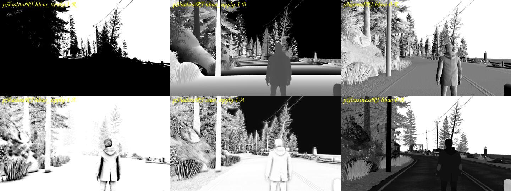

*Prologue-road r3: `pShadowRT` R and B; `pNormalRT` R; `pShadowRT` A with HBAO (the game) and
with SSAO forced (HBAO off); `pGlossinessRT` A. Each channel stretched between its 1st and 99th
percentile.*

## 3. The game's built-in SSAO, and `[graphics] ssao`

(0.6.8: superseded by `[graphics] ao = game | ssao | rtao`; `ssao = 1` still applies while `ao` is
empty or missing, i.e. in configs from before 0.6.8. The Quiver option is now `graphics.ao`.)

Static (Ghidra, main pass `0x506b20`): `rend::SSAO` (RendererX86+0x130) renders at `0x536630`
when "Render SSAO" (u8 `0xd755e0`) is set and applies at `0x536580`; `rend::HBAO` (+0x138) renders
at `0x538160` and applies at `0x537ef0` when "Render HBAO" (u8 `0x955659`, a debug-menu flag, 1)
is set. Every graphics preset writes `0xd755e0 = 0` (`0x242a20`), and the game saves and loads
that global with its settings (`0x1dca80`, `0x1dab40`).

Live (grabs r3, r5): both applies write **`pShadowRT.a`**, SSAO first, HBAO after it with write
mask 0x8 and no blending, so **with both on HBAO overwrites SSAO** (`pShadowRT.a` after SSAO:
mean 0.73; after HBAO: 0.97). Forcing SSAO alone (the old way) costs time and changes nothing on
screen. The material shaders read the AO from there (section 2), i.e. AO darkens the ambient
term only.

Measured GPU time (prologue-road, `rt_gpu_ab.sh` under `quiver lab gpu`, ~410 frames each):

| variant | SSAO | HBAO | shadow buffer (sun resolve) | fps (CPU-bound) |
|---|---|---|---|---|
| game (HBAO) | — | 0.270 ms (+0.019 apply) | 0.137 ms | 141-144 |
| SSAO forced, HBAO on | 0.288 ms (+0.020) | 0.266 ms | 0.137 ms | 137 |
| HBAO skipped | — | — | 0.137 ms | 148 |
| SSAO instead of HBAO | 0.285 ms (+0.019) | — | 0.137 ms | 145 |

SSAO and HBAO cost the same. They look different: the remaster's HBAO is short-range and light
(near contact shading only, mean 0.98 in daylight); the 2010 SSAO is strong, reaches distant
terrain and trees, and has the halos of its era at silhouettes (mean 0.74).


*`pShadowRT.a`, Bright Falls ferry (day, r5); the ferry moves, so the two grabs differ slightly.*


*Level 15 yard (forest-night r4), final frames brightened: HBAO (the game), SSAO instead of HBAO,
no AO. The planks' contact shadows are the difference; fog and grain vary between captures.*

The option (`src/features/graphics.cpp`, shipped in 0.6.5): **`[graphics] ssao = 1`** runs SSAO
and skips HBAO by rewriting the two `jz` pairs of the main pass (`0x5070ed`/`0x507145` → `90 90`,
`0x507102`/`0x50715a` → `eb 0c`, each signature-checked with its `cmp`), as single 16-bit stores at
a frame boundary (present, game thread), so a render and its apply always agree. The globals are
left alone, so nothing the game saves changes; `0` restores the original bytes. Live (r6, r9):
toggled in-world both ways (timestamps show SSAO replacing HBAO and back), the globals stayed 0/1.
In sbs the right eye's SSAO history is per eye (the existing `temporal.cpp`, now told about the
option); not re-measured in sbs here.

**As an RTAO target**: `pShadowRT.a` is clean (cleared to 1, written by one draw, read by the
lighting and the material shaders). `g_sHBAOBuffer` (R16G16F, full res, allocated by the HBAO
render, consumed by its apply) is even easier: run HBAO's render or skip it, write the RTAO result
into a texture of the same format and let the game's own apply put it in place.

## 4. Lighting and shadows (static + live)

- **Sun / moon**: cascades in the 8192x4096 atlas (D24S8, plus an R32F colour copy), resolved into
  `pShadowRT.rgb` by full-screen region draws (`0x52cb40`, one per cascade region, constants
  `g_fRegionStart/End`, `g_mShadowProjection`), PS `3fd4eb73c302e5b7`: **13 comparison-sampler
  (PCF) taps** on `g_sShadowMapTex`. The filter: "Shadow Quality" (`0x955670`) selects the
  resolve variant (`param_1[quality + 1]`), constants `g_fPCFSize`, `g_fCascadePCFSize_d3t`,
  `g_fNumPCFSamples_d3t`, `g_fPCFBias_d3t` (the `_d3t` ones are the port's additions), tweakables
  "Shadow Buffer:Reconstruction Scale/Bias", "Enable Front/Back Clip". Then a bilateral blur.
- **Spot lights, including the flashlight**: `DeferredLight` into `pLightRT`. Forest-night frame:
  6 lighting PSOs (2 stencil, 4 lights). PS `aa17e58e1bd8d853` is the shadowed spot with a
  projected cookie (`g_sLightProjectionMap`) and **11 PCF taps** on the atlas: the flashlight's
  shader (3 draws of it in the frame). Point lights use a **variance cube shadow map**
  (`g_sVarianceShadowMapTex`, PS `0e1da8a9de027a3d`), unshadowed ones `8ef0ef6b36ecaf44`.
- **Ambient**: one global SH (the 9x1 texture, read by 42 shaders) plus up to 8 `g_ambientLights`
  in the constants, times the AO in `pShadowRT.a`. The sun also has a projection map
  (`g_sSunLightProjectionMapTex`, 33 shaders), a cookie that RT sun shadows must keep.
- **Pipeline states**: shaders are **DXIL, shader model 6.0** (all 281-283 captured, validator
  1.4), **precompiled** in `shaders/build/pc_DXIL/*.shaderbin` (74 effect files, 509 MB, 53 128
  containers, static) and turned into pipeline states **on demand**: 334-375 created by the time
  the level runs, ~20 more while playing; all through `CreateGraphicsPipelineState` /
  `CreateComputePipelineState` (no pipeline libraries, no stream descriptions; live). 218-318
  PSOs are used per frame; the lighting ones are few (6 deferred-light, 3 shadow-buffer, 1 HBAO
  apply, 2 blur). A swap by bytecode hash at creation is therefore tractable, and replacement
  shaders can be compiled at run time with the game's DXC (SM 6.0-6.3).

## 5. Geometry (live, census frame 2 of runs r3 and r4; `rt_census.py`, `rt_shaders.py`)

| | prologue-road | forest-night (level 15) |
|---|---|---|
| draws / triangles submitted per frame (all passes) | 12 301 / 5.58 M | 5 947 / 4.33 M |
| G-buffer draws / triangles | 3 480 / 1.18 M | 1 274 / 0.63 M |
| shadow-map draws / triangles | 1 245 / 1.63 M | 1 764 / 2.29 M |
| unique indexed meshes (index range + base vertex + vertex buffer) | 3 640 | 1 622 |
| **unique triangles** drawn | **0.85 M** | **0.69 M** |
| instanced draws | **0** (every draw has 1 instance) | 0 |
| dispatches / ExecuteIndirect | 0 / 0 | 0 / 0 |
| vertex / index buffers bound | 363 resources, 81 MiB (356 default heap, 6 upload) / 186, 40 MiB (182 R16, 4 R32) | 266, 77 MiB / 164, 40 MiB |
| POSITION format | R32G32B32_FLOAT (offset 0) | same |
| alpha-tested G-buffer draws (PS with `discard`, or alpha-to-coverage) | 818 (0.28 Mt; 472 alpha-to-coverage) | 346 (0.17 Mt; 179) |
| alpha-tested shadow casters | 259 (0.34 Mt) | 495 (0.64 Mt) |
| wind-animated draws (VS loads the wind/shake tables) | 312 G-buffer (0.11 Mt) | 88 (0.04 Mt) |
| pre-skinned draws | 78 G-buffer, 138 shadow | 39, 162 |

- **Transforms**: per draw, in the `$Globals` constant buffer (`g_mLocalToView`,
  `g_mLocalToClip`; two root CBVs set per draw, live). No instancing anywhere, so vegetation is
  individual draws too (`Foliage_d3t`, `Grass`, `FoliageBillboard`).
- **Skinning**: done before the passes by vertex shaders of the `Skinning` effect that write the
  skinned vertices to a UAV (`g_vertexOutputBuffer`, bone palette of 64 3x4 matrices); a compute
  variant exists (5 compute PSOs created) but no dispatch ran. The G-buffer/shadow vertex shaders
  of skinned meshes have no palette: they read the pre-skinned buffers. Those buffers are exactly
  what a BLAS refit needs (double-buffered by frame parity, docs/stereo.md section 5).
- **Wind** runs in the G-buffer and colour vertex shaders only; **no shadow-map shader uses
  wind** (11 VS load the tables, none in pass 2), so the game's own shadows are already static
  with respect to wind. A static BLAS for foliage matches what the game does.
- **Alpha test** is the expensive part: a quarter of the G-buffer draws and up to 0.64 Mt of
  shadow casters (foliage, grass, fences) use `discard` with `g_sAlphaTestSamplerTex`. RT through
  them needs any-hit shaders with the material's alpha texture and UVs (per-geometry descriptors),
  or opacity micromaps (vkd3d-proton has the `OMM` paths, DXR 1.2 reported).
- **BLAS memory**: per-frame unique triangles 0.69-0.85 M → **16-19 MB compacted** (22.4 B/tri,
  measured on this driver), 43-53 MB uncompacted. Upper bound for everything loaded: the bound
  index buffers hold at most 40 MiB of 16-bit indices ≈ **7 M triangles → ≤ 160 MB compacted**
  (≤ 430 MB uncompacted). VRAM in use by the game (vkd3d budget view): 3.0 GB in prologue-road,
  **4.6 GB in forest-night**, budget 7.1 GB (nvidia-smi: 5.3 of 8.15 GiB with the desktop); the
  headroom is ~2.5 GB.

## 6. Two eyes and the ray budget

- **Shared between eyes** (one update, same objects): every BLAS build/refit and the TLAS
  (built once per update; the second eye's `renderFrame` reuses it), DDGI-style probe updates
  (view-independent), the skinning refits. **Per eye**: every per-pixel ray (AO, shadow, GI
  gather) and its denoiser history (as for SSAO/TAA, docs/stereo.md section 5).
- **Budget**: 1920x1080 is 2.07 M pixels per eye. At the synthetic 5.4 Grays/s (short rays) /
  1.2-3 Grays/s (long rays), 1 ray/pixel costs 0.4 ms (AO) / 0.7-1.7 ms (sun shadow) per eye.
  Real geometry with alpha any-hit and a deeper BVH is plausibly 2-4x slower, so **order of
  magnitude: 1-3 rays/pixel/eye for 2 ms at 1080p; with DLSS Quality (1280x720 per eye, 0.92 MP)
  2.25x that, Performance (960x540) 4x**. For comparison HBAO costs 0.27 ms and the sun resolve
  0.14 ms per eye today; the game is CPU-bound at ~140 renders/s, so there is some GPU slack.

## 7. Go / no-go and estimates (the study; section 12 updates it)

| feature | verdict | why | effort (one person) | risk |
|---|---|---|---|---|
| **RTAO** | **go** | write `pShadowRT.a` (or `g_sHBAOBuffer`) after pass 5; no shader swap; inputs are the game's own linear depth and normals; 1 ray/pixel short rays fit easily | **2-3 weeks** for v1 (geometry capture and BLAS cache 1-1.5 w, ray pass + injection 3-4 d, denoise/temporal per eye 3 d); alpha any-hit +1 w | medium: geometry completeness (only what is drawn: on-screen + shadow casters), transforms |
| **Sun/moon RT shadows** | **go, after RTAO** | write `pShadowRT.r` in place of the cascade resolve; no shader swap; the shadow pass's own draw list is the caster set (includes off-screen casters); keep the sun cookie | +1.5-2 weeks on RTAO's infrastructure; any-hit alpha is mandatory here (trees) | medium: alpha-tested foliage cost, the night/fog levels limit the payoff |
| **Flashlight RT shadows** | **conditional go** | needs a swap of one pixel shader (`aa17e58e1bd8d853`, SM 6.0) re-written in HLSL from its disassembly to read a ray-traced mask instead of 11 PCF taps; identify the flashlight among the shadowed spots; also fixes the stereo shadow-reuse problem (docs/stereo.md section 6) | +2-3 weeks | medium-high: re-implementing a lighting shader exactly (falloff, cookie, specular) |
| **RTGI (DDGI-style)** | **no-go for now** (possible later) | the injection points exist (add irradiance into `pLightRT`, which the material shaders multiply by albedo; neutralise the SH by overwriting the 9x1 SH texture), but probe updates need hit shading: per-geometry albedo textures and UVs (there is no albedo G-buffer), sun shadow and local lights at hit points | 2-3 months | high |

**Recommended first step:** the geometry capture behind a dev verb, on the census code: at each
G-buffer and shadow-map draw (indexed triangle list, R32G32B32 position), key a BLAS by index
range + base vertex + vertex buffer (built from the game's own buffers, compacted, cached; skinned
ones refit from the pre-skin output), take the instance transform from the draw's constants
(local-to-view × view-to-world) or the engine object, build the TLAS once per update, and validate
it by tracing primary rays from the camera and comparing hit depth against `pLinearDepthRT`
(expect < 1 % mismatched pixels outside alpha-tested foliage). Once that matches, RTAO is a
raygen (compiled at run time with the game's DXC) recorded into the engine's list after HBAO's
render, writing `g_sHBAOBuffer`.

## 8. Geometry capture, BLAS cache and TLAS (implemented; `src/features/rt/scene.cpp`)

Lab: instance `awr-rt` runs r10-r52 (1920x1080@60, `VKD3D_CONFIG=single_queue` in the instance
manifest from r18 on: with several other sessions' containers on the GPU, vkd3d-proton's device
creation failed with `VK_ERROR_INITIALIZATION_FAILED` even without the mod, the driver being out of
hardware queues; one queue family fixes it. Our passes run on the game's main queue anyway).

**How the scene is captured.** The D3D12 capture of the probe (`census.cpp`, MinHook on
vkd3d-proton's implementation functions) is installed at launch when `[graphics] ao = rtao` (or
`[dev] rt_scene = 1`). With the scene on:

- Pipeline states are classified as they are created by their targets: G-buffer = R32F + RGBA16F +
  BGRA8 with D32S8, shadow map = R32F with D24S8; their shaders are disassembled with the game's
  DXC on a background thread (VS: `g_mLocalToView` offset in `$Globals`, which differs per shader,
  live: 10 different offsets; a bone palette rejects skinning shaders; PS: alpha test).
  Root signatures are parsed (RTS0) for the root parameter of the VS's `b0`.
- Each command list keeps its PSO, root CBVs, vertex/index views, topology and render targets;
  every `DrawIndexedInstanced` on a reflected G-buffer/shadow pipeline appends a record (position
  VA at the base vertex, stride, vertex count to the view's end, index VA/count/format, the `$Globals`
  VA). Records join the scene when the list is executed, in submission order.
- **The kick** (the multi-list `ExecuteCommandLists` inside the main pass before HBAO; live: exactly
  one, n = 14-15, on the game thread) holds every G-buffer and shadow-map list of the render. Right
  after it, one list of ours is submitted on the same queue: BLAS work, TLAS, then the ray passes.
  In GPU order it runs after the G-buffer and before the lighting.

**Findings that shaped it (live):**

- **Only the `$Globals` rows a shader reads are written per draw.** `g_mViewToWorld` (offset 64,
  the same in every shader) holds stale ring data in G-buffer draws (dumped: different "camera"
  translations per draw, 0, 627, 1383 m), while `g_mLocalToView` (read by the VS) is right (all of
  the player's body parts share one, 3 m ahead of the camera). Matrices are `row_major`, used as
  `mul(M, v)`: rows 0-2 are the DXR 3x4 layout directly. The camera comes from the engine's main
  `rend::View` instead (+0x248 view-to-world, double, row vectors; +0x2a8 view-to-clip including the
  TAA jitter, valid flag +0x4a8; `stereo::main_view()`): the G-buffer draw's own `g_mViewToClip`
  is only valid if that draw's VS reads it (the prologue's first one did not: every pixel failed
  validation until the projection came from the View).
- **Reading those constants costs.** The constant ring is write-combined upload memory: plain loads
  of 96 bytes for ~4000 draws took **37 ms** per update; SSE4.1 streaming loads (`MOVNTDQA`) bring
  the whole capture to **1.0-1.5 ms** per update on the game thread (measured, forest and
  prologue).
- **The terrain and the grass are CPU-written every update.** The terrain is one 22 MB vertex buffer
  in an upload heap (stride 44, 32-bit indices, vertices camera-relative: `g_mLocalToView`
  translation ≈ 0), drawn in ~2-11-triangle pieces; the grass/foliage cards a 3 MB upload ring
  (stride 20, alpha-to-coverage). They go into **one per-update BLAS** (fast build, one geometry per
  draw with its own `Transform3x4`, opaque and alpha-tested apart): forest ~1600 geometries, 15 k
  opaque + 43 k alpha triangles; Bright Falls ~4900 geometries, 21 k + 8.5 k.
- **Every other mesh is cached**: one BLAS per (vertex range, index range), fast-trace + compaction
  (built into a staging pool, compacted size read back four submissions later, copied into a
  sub-allocated pool of 32 MB chunks); meshes whose layout carries `BLENDINDICES` (the pre-skinned
  output, docs/stereo.md section 5) are fast-build + allow-update and **refit** every update. The
  engine creates all its vertex buffers with the UAV flag, so that is not a dynamic signal.
  Invalidation: a buffer created over a cached range or a `CopyBufferRegion` into it (none seen in
  these scenes); eviction after 900 updates unused. Build budget 300 k triangles per update (the
  first frames of a level).
- **Alpha-tested**: `discard` alone is not an alpha test (the standard opaque material discards for
  its dissolve fade; with it the player, rocks and whole trees vanished from an "opaque" TLAS) and
  neither is alpha-to-coverage (the terrain uses it). Alpha-tested = the PS samples
  `g_sAlphaTestSampler` or is a foliage card (`g_sFoliageNoiseMap`). They get their own instance mask
  bits (2 G-buffer, 8 shadow-only); no any-hit alpha yet (section 11).
- **Shadow-map draws** are in light views whose placement isn't in their constants (the shadow VSs
  read only `g_mLocalToView` and `g_mViewToClip`). Each view (draws grouped by their projection rows)
  is placed from a mesh drawn exactly once in the G-buffer and once in that view:
  `ViewToWorld_light = World_gbuffer · inverse(LocalToView_light)`. Live (Bright Falls r47): 158 groups,
  **only 5 placed** (72 shadow-only instances, 0.2 M triangles, 250 duplicates of G-buffer
  instances dropped): the grouping key is unreliable because many shadow VSs don't read their
  projection rows either (stale). Off-screen casters are therefore mostly missing (section 10).
- The TLAS is built once per game update (the stereo view path's second eye reuses it; live sbs
  forest: 107 updates, 214 traced eyes) in world space relative to the update's camera position
  (precision), instances culling-disabled.

**Three GPU faults found on the way** (kernel `Xid 13`, the game wedged): a fresh dynamic BLAS
queued for refit in the same update with its update-scratch size still 0 (scratch overrun); a
TraceRay geometry multiplier of 1 against a 1-record hit-group table, with ~1500-geometry BLAS
("Misaligned PC"); and none since (r33-r52, several hundred thousand traced frames).

**Validation** (primary rays from the camera vs the G-buffer depth, `rt scene validate MASK img`,
`re/scripts/rt_validate.py`; one frame each, all instances, measured):

| scene | geometry px within 0.2 % / 1 % / 5 % of the G-buffer distance | ray nearer / farther | missed |
|---|---|---|---|
| forest-night (level 15 yard) | 83.9 / 85.9 / 88.9 % (r33); 85.6 / 88.7 % within 1 / 5 % (r43) | 4.3 / 5.5 % | 1.4 % |
| prologue-road | 65.1 / 67.3 / 75.5 % | 20.8 / 1.6 % | 1.6 % |
| Bright Falls ferry (day) | 89.5 / 91.6 / 93.5 % | 0.4 / 4.7 % | 1.5 % |

"Nearer" is almost all alpha-tested foliage counted as opaque (prologue: ferns and branches; with
opaque instances only the prologue gives 58 / 61 % and 13 % missed: the cards are then absent);
"farther" are distant tree LOD cards and the moving birds' edges; "missed" sky-adjacent billboards
and the water. The structural error is zero: walls, terrain, debris, the player and the birds
(skinned, refit) match to 0.2 %.

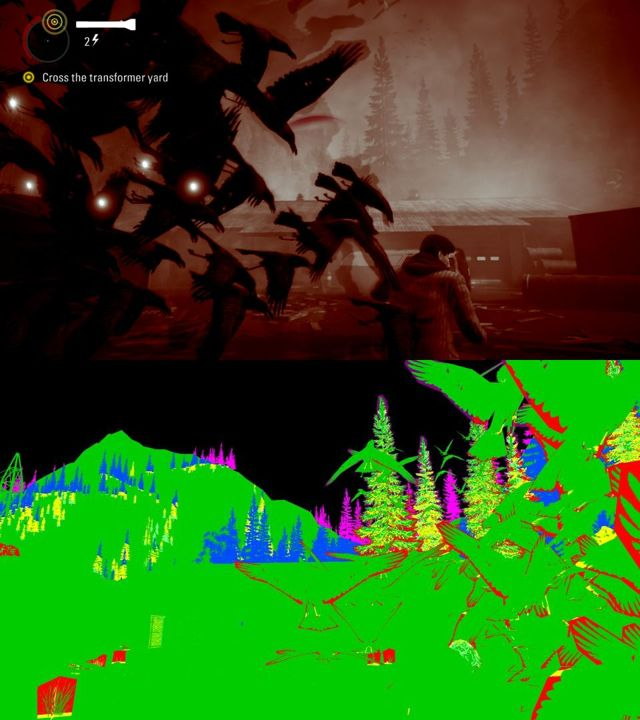

*forest-night r43: the frame and the validation (green < 0.2 %, light green < 1 %, yellow < 5 %,
red ray nearer, blue ray farther, magenta missed, black sky).*

| measured per update | forest-night | Bright Falls |
|---|---|---|
| G-buffer draws / instances / triangles | 1930 / 330 / 0.71 M | 5410 / 446 / 0.51 M |
| per-update BLAS geometries / triangles | 1600 / 58 k | 4960 / 30 k |
| cached BLAS entries (skinned) / memory | 579 (230) / 45 MB (pool reserve 64 MB) | 434 (176) / 26 MB |
| per-update BLAS memory / TLAS | 5.5 MB / 0.19 MB | 3.0 MB / 0.26 MB |
| refits per update | 48 | 61-67 |
| CPU on the game thread (capture → list submitted) | 1.0-1.2 ms | 1.2-1.5 ms |
| GPU, list start → TLAS built | 2.2-2.4 ms (prologue, under the lock but another session rendering) | 0.86 ms (contended) |

## 9. RTAO (`[graphics] ao = rtao`, 0.6.8; `src/features/rt/trace.cpp`)

**Pass.** DXR 1.0 pipeline (raygen/miss/closest-hit in one `lib_6_3`, compute `cs_6_0` denoiser),
**compiled at run time by the game's own DXC 1.4** (no third-party code in the DLL), recorded into
our list after the TLAS:

1. `rg_ao`: per pixel, position from the G-buffer's R32F device depth (RT0; `pLinearDepthRT` is
   only made later, in the second batch) and the jittered `ClipToView`; geometric normal from the
   depth (smallest-step neighbours) for the ray origin and to keep rays above the surface, shading
   normal from `pNormalRT` (view space) for the cosine lobe; 1 ray per pixel, 1.5 m, first hit ends.
   Opaque instances are traced first; alpha-tested ones (no alpha test yet) then occlude with a
   probability (`[dev] rtao_alpha`, 0.4, their average coverage): treated as opaque, leaf cards
   turned the prologue's trees black (AO mean 0.77).
2. `cs_temporal`: per-eye history (2 ping-pong pairs per eye, plus linear depth), reprojected with
   the camera matrices (`W2C_prev · V2W_cur`, doubles: the engine's motion vectors are written after
   the lighting, so they don't exist yet at this point of the frame); rejected on a 4 % linear-depth
   mismatch; up to 24 samples.
3. `cs_atrous` x3 (steps 1, 2, 4), depth- and normal-weighted 5x5; the last writes R16G16_FLOAT
   (AO in R), the format of the engine's `g_sHBAOBuffer`.
4. In the engine's own list, at HBAO's apply (`0x537ef0`, object +0x18): a `CopyResource` of this
   eye's result over `g_sHBAOBuffer`; the engine's apply (PS `5e551338353d5d50`: `.r` to all four
   channels, write mask 0x8) puts it into `pShadowRT.a` as it would HBAO's. The HBAO render itself
   still runs (0.26 ms); skipping it needs its pool target kept alive (not done).

Stereo: per-eye histories and results (`stereo::eye_now()`), TLAS shared by the update (sbs forest:
214 copies for 107 updates, 0 misses). Inert when off: `ao = game` installs nothing (the capture is
only hooked at launch with `rtao`); switching to or from rtao needs a restart (option
`apply = "restart"`; game/ssao stay live from the ini).

**Measured GPU time** (our timestamps; prologue r37 under `quiver lab gpu`, another session's
instance still rendering, so upper bounds):

| | ms per eye |
|---|---|
| acceleration structures (per-update BLAS, refits, TLAS; once per update) | 2.2-2.4 |
| AO rays, 1 ray/pixel 1.5 m | 1.3-1.4 |
| denoise (temporal + 2 à-trous at the time; 3 now: +~0.15) | 0.37-0.40 |
| the game's HBAO, for comparison | 0.26 |
| engine main pass GPU time, rtao off / on | 8.7 / 9.8-10.9 |

Bright Falls r45, contended, no lock: AS 0.86, rays 0.93, denoise (3 passes) 0.54 ms. Order of
magnitude **3-4 ms per frame at 1080p**, dominated by building the per-update BLAS and by the rays;
the study's synthetic 0.4 ms/ray was optimistic by ~3x on real geometry.

**Captures** (final frame top, `pShadowRT.a` bottom; HBAO left, RTAO right; small JPEGs):

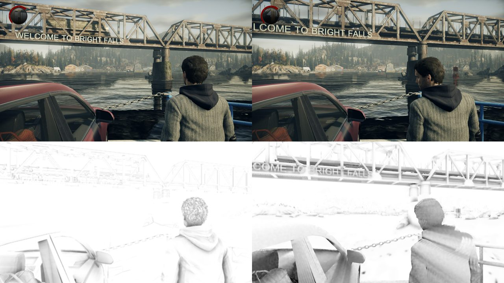

*Bright Falls ferry r42 (day): RTAO occludes under the bridge, inside the car, the player's arm
and the railing; AO mean 0.88 vs HBAO 0.98.*

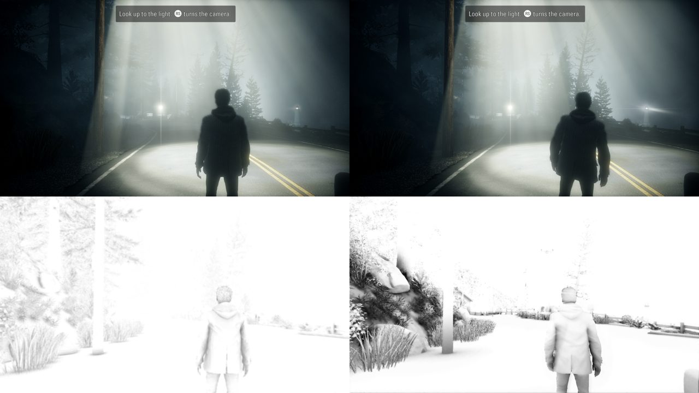

*prologue-road r38: contact under rocks and bushes, the pole's base, the coat; mean 0.91 vs 0.98.
This capture predates the constant-stride fix of r40 (its AO strength was ~0.7 and the foliage
coverage 0), so it is lighter than the shipped pass.*

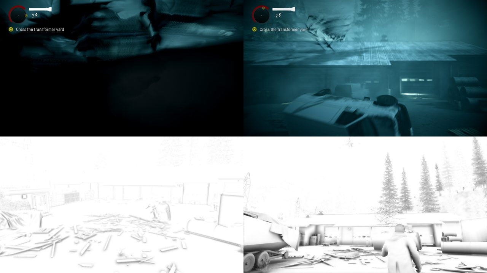

*forest-night r43 (the opening cinematic moved the camera between the two): debris and barrels;
mean 0.92 vs 0.98.*

Known artifacts: noise on a moving platform (the ferry: camera-only reprojection rejects the
history of things moving with the camera; the third à-trous pass hides most of it); banding on
skinned close-ups (the skinned BLAS vs the rasterized surface, partly fixed by a distance-scaled
TMin); leaf cards are approximations.

## 10. Sun / moon shadows (prototype, `[dev] rt_sun = 1`)

- **Light direction**: the sun/moon resolve (`0x52cb40`, PS `3fd4eb73c302e5b7`) is recognised by
  reflection (`g_mShadowProjection` and `g_fRegionStart` in its `$Globals`, BGRA8 target); its
  `g_mShadowProjection` (view → shadow u, v, depth) has the light's forward axis in its depth row;
  towards the light = its opposite, to world through the View (live, Bright Falls: (0.75, 0.47,
  -0.47), above the horizon). One update's latency (the resolve runs after the kick).
- **Pass**: `rg_sun` (rays towards a cone of `[dev] rt_sun_cone` around the light, 1000 m, first hit)
  through the same temporal/à-trous chain, written as B8G8R8A8 (R = visibility; typed UAV stores on
  BGRA8 are supported here) and **copied over `pShadowRT` at the end of the shadow-buffer pass**
  (`0x52d5c0`), where the engine's cascades were resolved. G and B aren't read by the lighting
  (study, static); A is written next by the AO apply. The sun cookie
  (`g_sSunLightProjectionMapTex`) stays in the material shaders.
- **Measured** (Bright Falls r45, contended): 0.61 ms rays + 0.74 ms denoise.
- **State** (captured, below): it runs and gives soft, contact-hardening shadows from on-screen
  casters (the player's shadow on the deck), but **does not match the cascades yet**: the bridge
  overhead (mostly off-screen) casts nothing because shadow-only casters are rarely placed (section
  8), surfaces facing away from the light read grey (sign/elevation of the direction not verified
  against the cascades), foliage is opaque cards.

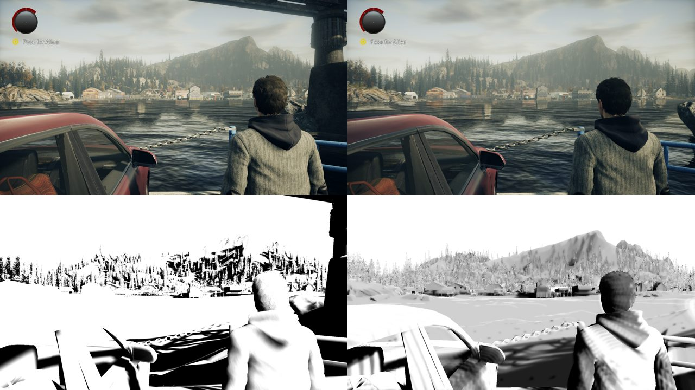

*Bright Falls r47: final frame and `pShadowRT.r`; left the game's cascades (PCF), right ray-traced.*

### Direction and off-screen caster placement

The prototype originally converted the resolve's view-space direction to world space using
bytes 64–111 of its constant buffer. The captured resolve VS and PS
(`f8d92111fa62a9b9`, `3fd4eb73c302e5b7`) both declare that matrix, but neither loads its rows.
On the Bright Falls ferry the reported direction varied even in elevation (r81). The prototype
now uses the validated engine camera basis saved at the scene submission before the resolve.
With horizontal and vertical camera turns in r82, the ferry direction stayed at
(0.7518, 0.4662, −0.4662). On level 03 the moon direction stayed at (−0.7071, 0.5000, −0.5000)
across a horizontal turn, with 1,607 shadow-buffer copies and zero misses (r83).

`rt scene casters atlas` groups shadow draws by their bound depth view and raster viewport,
then uses the existing shared-mesh match to place each group. This reads the tile the game
actually rendered into, even when a shader omitted its projection constants. Use
`rt scene casters 1` for the original projection grouping or `0` to exclude shadow-only casters.
These are single-frame samples. Each cell gives **groups placed / groups found** and the
number of shadow-only instances admitted to the ray-tracing scene.

| Scene | Projection grouping | Atlas grouping |
|---|---:|---:|
| Mirror Peak overlook, level 10 (r82) | 3 / 77, 9 instances | 3 / 5, 9 instances |
| Crashed car, level 03 (r83, before turning) | 5 / 30, 60 instances | 5 / 5, 81 instances |

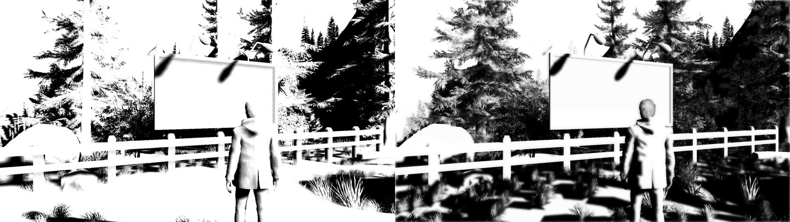

In the Mirror Peak captures the tree shadow on the billboard appears in both masks, but the
RT ground and foliage are darker. Mean absolute difference in `pShadowRT.r` against the first
game capture was 0.296 on a 0–1 scale with either grouping. Two game captures differed by
0.052. These were successive frames with moving foliage. Atlas grouping remains a lab option.
The next comparison is the ferry deck under the off-screen bridge, checking each tile's
transform against a second shared mesh before attributing a shadow to it.

## 11. Flashlight shadows: option (a), the pixel shader swapped (prototype, `[dev] rt_spot`)

The flashlight is the shadowed spot of `DeferredLight`, PS `aa17e58e1bd8d853` ("spotlightPS",
~145 DXIL ops): view-space position from linear depth, exponential falloff, a projected cookie,
**10-tap Vogel-disk PCF** on the shadow atlas (interleaved-gradient noise rotation, `g_fPCFSize_d3t`,
blended by `g_fShadowLOD`), Ward-anisotropic or Phong specular, exposure, clamp 32 (static, read
from the disassembly). The shadow factor multiplies the whole contribution, so a separate mask
(option b) would be equivalent, but the contribution can't be separated after the draw (additive
into `pLightRT`) without changing the pipeline anyway. Option (a) won:

- `src/features/rt/shaders/spotlight.hlsl`: the shader re-written in HLSL, binding-compatible with the
  original (only the `$Globals` rows it reads, via `packoffset`: the same rows 26, 29, 31, 90-93,
  114-123; the same t0-t5/s0-s5), with the shadow term selectable.
- Swapped **at pipeline creation by bytecode hash** (`CreateGraphicsPipelineState` hook): a second
  pipeline with our PS, the original kept as a fallback.
- `rt_spot = 1` (PCF port): **verified identical** against the original in the same session
  (live A/B of `pLightRT` with `[dev] rt_spot_on`, forest r50, compiled in-process; r51 with DXC 1.9: light mean 0.0022 vs 0.0022, |diff|
  p99 0.0008, i.e. the noise/temporal differences of two frames).
- `rt_spot = 2` (**inline ray queries**, `ps_6_5`, built at dev time with DXC 1.9.2609 by
  `scripts/build_shaders` and embedded; the DLL contains only our DXIL): per lit pixel, 4 rays to a
  4 cm disc at the light's position (`g_vLightPosition`), ending 35 cm short of it (the hand and the
  flashlight model are in the TLAS), against the update's TLAS. The TLAS and a constant buffer need
  root parameters the game's root signatures don't have: **every root signature the game creates
  gets two appended** (root SRV t0 space 9, root CBV b0 space 9, pixel visibility; deserialised and
  re-serialised with vkd3d-proton's versioned (de)serializer) and they are set right before each
  swapped draw; frames without a TLAS fall back to the original pipeline. Live (forest r52): 1024
  spot draws with ray queries, 81 fallbacks (loading), no faults; the spot keeps its shape and the
  planks get crisper contact shadows than the atlas gives (crop below).
- **Pitfall**: DXC 1.9's default output (validator 1.8 metadata) produced **no light at all** under
  this vkd3d-proton (no error logged); the same HLSL compiled by the game's DXC 1.4 worked, and so
  does DXC 1.9 with `-validator-version 1.5`.

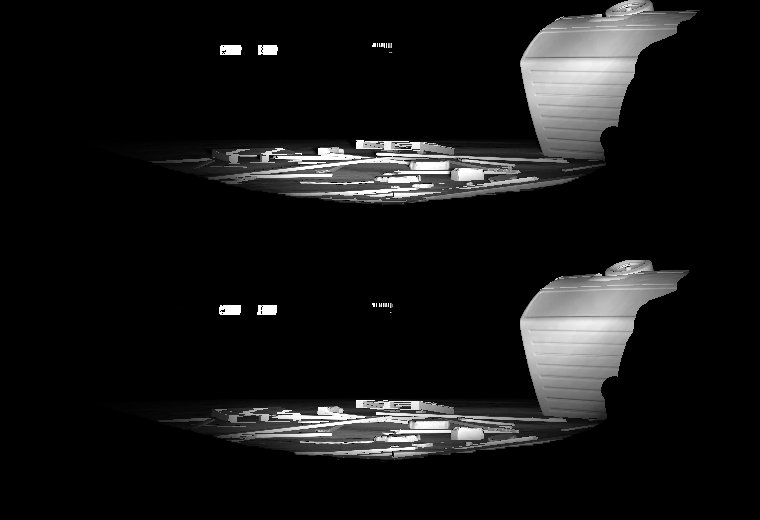

*forest-night r52, `pLightRT` (diffuse light) around the flashlight's spot: top the game's atlas
PCF, bottom the ray-traced shadow (the camera swayed between the two grabs).*

Not done: the shadowed spots other than the flashlight use the same shader and get the same
treatment (fine, but their shadow-map rendering still runs: skipping it is the real saving);
light radius/bias tuning; cost not isolated (the deferred-light pass has no marker); the stereo
second eye with `skip_shadows` (the lost spot, docs/stereo.md section 6) not tested: the ray-query
shader doesn't need the atlas, but the cause of the lost spot was not identified.

## 12. Go / no-go, updated

| feature | verdict now | state | remaining (one person) | risk |
|---|---|---|---|---|
| **RTAO** | **shipped, experimental** (`[graphics] ao = rtao`, default `game`) | capture validated in three scenes, per-eye histories, inert unless chosen at launch; **v2 in 0.6.9** (section 13): alpha-tested foliage, instance-motion history, precompiled ray-query passes | remaining: cache the per-update BLAS while the camera stands, LOD-aware alpha sampling, skinned close-up check | medium: foliage look at distance |
| **Sun/moon RT shadows** | **go, prototype running** | direction from the cascade resolve, pass + injection over `pShadowRT` work; alpha path applies to it too (section 13) | **1.5-2 weeks**: place the shadow views reliably (off-screen casters), verify the direction, tuning | medium |
| **Flashlight RT shadows** | **shipped, experimental** (`[graphics] flashlight_shadows = rt`, 0.6.9, section 14) | HLSL port swapped by hash, inline ray queries with a bulb disc and the alpha path; other spots keep PCF | cost isolated per light pass, skip the atlas render for the flashlight (checked: keep, other consumers), stereo second-eye spot isolated | medium: the global root-signature change; vkd3d-specific DXIL metadata pitfall (section 11) |
| **RTGI** | no-go for now | unchanged | 2-3 months | high |
## 13. Alpha-tested geometry and RTAO v2 (0.6.9; `census.cpp`, `scene.cpp`, `shaders/rays.hlsl`)

The ray passes moved from runtime-compiled DXR 1.0 ray-generation shaders (the game's DXC 1.4)
to precompiled `cs_6_5` compute shaders with inline ray queries (`shaders/rays.hlsl`, built by
`scripts/build_shaders` like the spotlight; the DLL embeds only our own DXIL), so every pass can
test alpha-tested candidates against their own textures (`shaders/alpha.hlsli`: a candidate loop
committing only where the sampled alpha passes). The probabilistic `rtao_alpha` coverage of 0.6.8
is gone (`[dev] rt_alpha` toggles the real test live).

**What the capture records (static + live).** Per alpha-tested PSO, reflection (the background
thread, from the DXIL disassembly) now also extracts: the alpha texture's register
(`g_sAlphaTestSamplerTex`, else `g_sColorMapTex` for foliage cards) and its constant threshold —
the sampled alpha shifted by a constant before the discard compare: 0.2 in the shadow depth
shaders, derivative-scaled 0.5 in the G-buffer alpha-test shaders, 0.65 for foliage/grass
(measured forms; one shader family thresholds from `$Globals` instead and stays opaque). The
UV form is classified from the input layout plus the vertex shader (the forms found by
tracing the captured shaders' sample coordinates back to their vertex inputs): mode 1,
`R16G16_SINT` texcoords scaled by
1/4095 (the VS constant `0x3F30010020000000`); mode 2, `COLOR0.xy` directly (terrain cards);
mode 3, grass atlas cards (`int(TEXCOORD0.x*255+0.1)` indexing a `$Globals` table of
(offset, scale) float4s, 2 rows per entry from row 142 — the row whose load extracts components
2 and 3; the neighbouring table at 141 is not the UV one). Anything unrecognised stays opaque.

The game's root signature is bindless-style (live): two whole-heap SRV tables at `t0` (vertex
and pixel visibility; the pixel one is parameter 3), the table handle slid per material batch,
descriptors rewritten per draw into a 264192-slot heap. So the draw record resolves its texture
**at record time**: `SetDescriptorHeaps` and graphics descriptor tables are tracked per list,
root-signature SRV ranges are parsed at creation (pixel-visibility match), and
`CreateShaderResourceView`/`CopyDescriptors` destinations map CPU handles to resources. Copying
the CPU descriptor later (at the kick) demonstrably names another draw's texture (live, r60).

**Per update (scene.cpp `build_alpha`).** Alpha geometries are non-opaque in their BLAS
(alpha meshes key the cache apart; the per-update BLAS keeps its alpha bucket non-opaque).
`InstanceID` is the instance's first alpha record (`CandidateInstanceID() +
CandidateGeometryIndex()` in the shader). Records (UV offset, texture in the mod's heap region,
texture by game-heap index for the spotlight, threshold) and gather jobs go through an upload
buffer; `cs_gather` reads the game's own vertex/index/constant buffers through raw views and
writes every alpha triangle's UVs; then the AO/sun/validation rays and the spotlight test
against them. About 420 jobs and 8 MB of UVs per update in the forest (live, r64).

**Motion.** History reprojection now goes through each receiver pixel's TLAS instance:
`cs_ao` also writes the receiver's instance index (a short primary ray, whose hit surface is
optionally the ray origin — the skinned close-up banding mitigation), and `cs_temporal` maps the
surface point through that instance's previous × inverse(current) transform (matched across
updates by BLAS + occurrence; per-update-BLAS instances keep identity) before the previous
camera. The eye's absolute world→clip (doubles) feeds it — the ray-query rewrite initially left
it unwritten, which silently rejected all history. On the ferry (`awr-brightfalls-day`, live
r78, `quiver lab bench` A/B of `dev.rtao_motion`, deck/car crop): temporal noise 18.68 ± 0.40
with motion vs 22.17 ± 1.42 without (3 rounds × 6 samples, equal mean level), about 16% lower —
history now survives the moving platform instead of being rejected every frame.

**Validation (measured, lab r64, interleaved A/B ×3 at fixed views, `validate noalpha` is the
forced-opaque baseline).** Gameplay view: exact primary hits 1,268,572 → 1,289,435; too-near
(solid cards) 42,256 → 21,839. Foliage-heavy view: exact 1,122,194 → 1,235,451; too-near
264,363 → 118,870; foliage-material pixels exact 3,642 → 4,396, nearer 5,982 → 4,624. The cost
is more too-far/missed rays (+76k/+14k in the foliage view): LOD0 point sampling of distant
cards (the rasterizer samples a mip with derivative sharpening) and wind animation, which the
bind-pose BLAS does not have. GPU (timestamps, uncontended): AS done 1.27 ms, gather included
before it, AO rays +0.85 ms, denoise to 2.7 ms total at 1080p.

HBAO's render is **not** skipped for RTAO: tried (render branch off, apply kept) — every AO
copy missed (142/142, live r68), because the apply's source buffer is the render's pick
(`obj+0x18`). Both branches stay the game's; the branch writes are split so a future delivery
path could still split them.

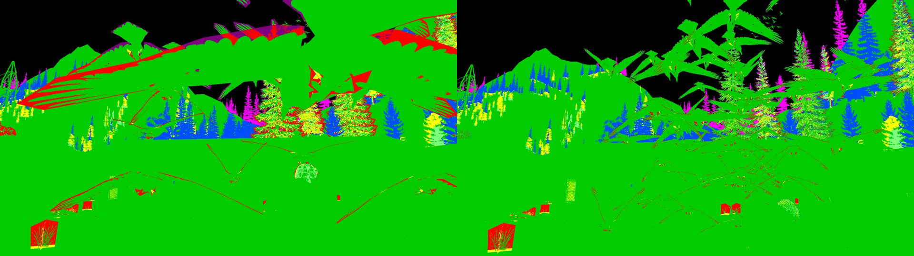

*forest-night: primary rays vs G-buffer depth (green exact, red too near, blue too far, magenta
missed). Left forced-opaque, right alpha-tested; frames differ (wind/birds), bins in the text.*

## 14. Flashlight shadows as an option (`[graphics] flashlight_shadows = rt`, 0.6.9)

Section 11's prototype, finished. The ray-query spotlight now also binds the alpha buffer
(`t1 space9`), the game's own descriptor heap (`t0 space10`, textures by game-heap index — the
spotlight runs inside the game's lists, whose bound heap is the game's) and a wrap sampler
(`s0 space9`), all appended by `rs_extend` next to the prototype's TLAS/constants. Only the
flashlight traces: near the eye and aimed along the view (`is_flashlight()`, constants `tb_q`;
`[dev] rt_spot_all = 1` forces every shadowed spot for debugging); every other spot keeps the
ported PCF bit-exactly. Shadows are rays to a disc the size of the bulb (crisp near, softer
far), alpha-tested, with the prototype's bias/clear tuning now live keys (`dev.rt_spot_*`).

With `ao = game` the scene capture runs for the TLAS alone (the AO chain and its copy stay off;
live r67: swap and draws bound, `ao_copies` 0). The flashlight's atlas view still renders:
`g_sShadowMapTex` is also read by `raymarchSunlight`, `downsample_shadow_map_PS` and the sun
resolve (static), so skipping it is not the free saving it looked like. Stereo: runs in
sbs/hsbs with `skip_shadows = 1` (live r73/r76, both eyes rendered, draws bound in both); with
the flashlight aimed (lab pad LT), the two eyes' centre luminance matches in RT (131.0 vs 130.8
mean) as in the game's mode, i.e. no second-eye darkness was observed — but the aimed captures
were taken during the bird encounter with floodlights dominating, so the lost-spot fix
(docs/stereo.md section 6) is **consistent with, not isolated by**, this test. (The quiet indoor
fixture in r77 did not isolate it either: Alan starts without a flashlight in the apartment dream — eyes
match there trivially.) Cost is inside the game's deferred-light pass and not isolated by our
timestamps.

### Aimed flashlight in stereo on a dark rock face

In `awr-rt` r80 (0.6.9), switching the aimed flashlight off and on isolated its spot in both
eyes. At the start of level 03, the rock face stays dark without the flashlight. The camera and
player stayed in place for all captures. The table gives the mean 8-bit grayscale value in the
same 135×120 patch of rock in each 960×1080 eye (top-left at x=390, y=315, before resizing).

| Spotlight shader | Reuse shadows on eye 2 | Flashlight off, L / R | Flashlight on, L / R |
|---|---|---:|---:|
| Ray queries | On | 0.1 / 0.1 | 138.9 / 132.9 |
| Game | On | 1.1 / 1.1 | 139.4 / 138.3 |
| Game | Off | 0.5 / 0.5 | 139.5 / 138.2 |

A second RT capture measured 141.0 / 140.7. Across that capture, `stereo status` counted
585 additional shadow skips and zero additional fallbacks. The right eye retained the spot
while shadow reuse was active. The game shader also passed in this scene, so it cannot
establish whether RT fixes the near-wall loss seen in full SBS in [the earlier level 15
test](stereo.md#open-issues).

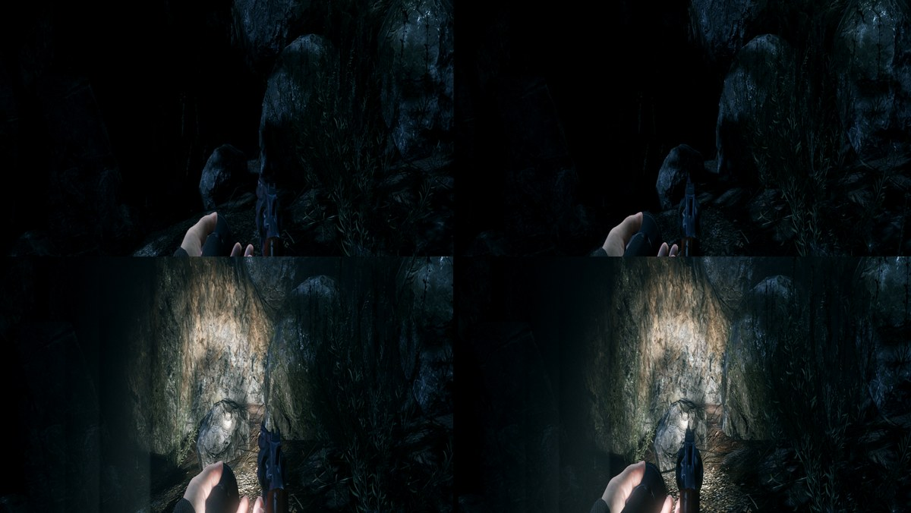

To repeat, use `mode = sbs`, `output = hsbs`, `skip_shadows = 1`, `flashlight_shadows = rt`
and first-person deliberate controls. Load level 03 and leave the camera at the spawn point.
Use the lab verbs `fp give weapons` and `fp give flashlight`, hold pad LT, and check that
`fpc` reports `aim_raw` and `drawn` true. Toggle the flashlight with D-pad up, checking
`flashlight_off_by_us`, and capture each state with a one-second settle. For the game-shader
control set `dev.rt_spot_on = 0` live, then repeat with `stereo.skip_shadows = 0`.

### Full SBS at the transformer-yard wall

In `awr-wide` r16, the RT flashlight restored the right-eye spot where the game shader
lost it in r15. The third-person camera faced the corrugated wall on level 15, at player
position (1414.365, 45.784, 2237.568), yaw 178.8°. The settings were full SBS, 1920×1080
per eye, and `flashlight_shadows = rt`. Switching `dev.rt_spot_on` live selected the game or
RT shader without moving the camera. The figures are mean grayscale (0–255) in the same
90×195 rectangle per eye, with top-left at (1030, 680).

| Shader | Reuse on eye 2 | Left / right brightness |
|---|---|---|
| Game | Off | 95 / 101 |
| Game | On, two repeats | 93 / 13 and 92 / 14 |
| RT | On, three captures | 89 / 95, 94 / 82 and 94 / 94 |
| RT | Off | 99 / 95 |

One additional game/reuse capture coincided with a bird hit that moved Alan's arm and darkened
both eyes. It was excluded from the comparison. Shadow reuse stays opt-in because the game
shader still exhibits the loss at this wall.

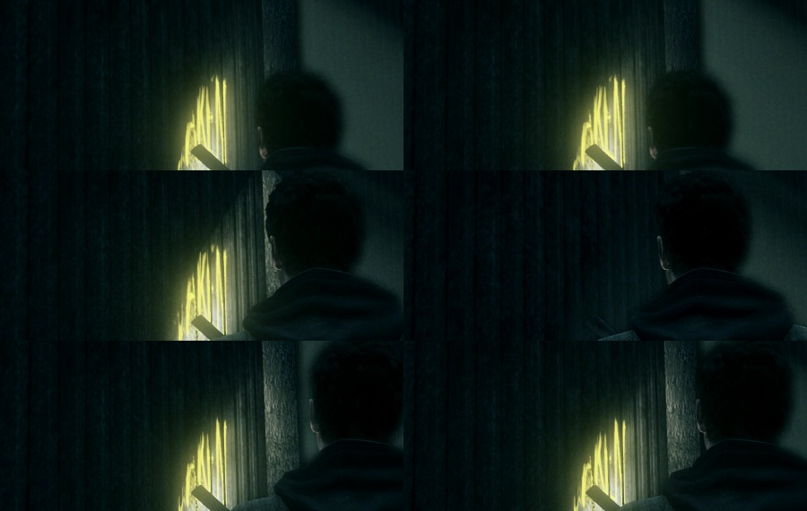

## Reproducing

RTAO, validation and the prototypes (sections 8-11; helper scripts of the sessions were
`relaunch`, `val`, `aoshots`, `spotab`: they are the commands below):

```sh
scripts/build && cp -r build/mod build/mod-rt          # [graphics] ao = rtao in its torchbearer.ini
quiver lab edit awr-rt env.VKD3D_CONFIG=single_queue   # only if device creation fails (GPU queues exhausted)
quiver lab launch awr-rt --mod build/mod-rt --wait frame && quiver lab wait awr-rt in-world
quiver lab call awr-rt rt scene status
quiver lab call awr-rt rt scene validate 0xf img && sleep 2 && quiver lab call awr-rt rt scene status > st.json
python3 re/scripts/rt_validate.py st.json <run>/rt-validate.raw val.jpg
quiver lab call awr-rt cfg dev.rtao_ao 0|1               # RTAO result copied or not (A/B)
quiver lab call awr-rt rt grab pShadowRT hbao_apply:1 TAG  # the AO channel
# sun prototype: [dev] rt_sun = 1 (live); flashlight: [graphics] flashlight_shadows = rt (or
# [dev] rt_spot = 1 PCF port / 2 ray queries), read at launch; A/B live with
# `cfg dev.rt_spot_on 0|1`, alpha A/B with `cfg dev.rt_alpha 0|1`, validator baseline with
# `rt scene validate 0x0f noalpha`
scripts/build_shaders                                   # after editing src/features/rt/shaders/spotlight.hlsl
```

The study's census and grabs:

```sh
scripts/build && cp -r build/mod build/mod-rt
sed -i 's/^rt_capture = 0/rt_capture = 1/; s/^start_level =$/start_level = continue/; s/^skip_videos = 0/skip_videos = 1/' build/mod-rt/torchbearer.ini
quiver lab fixture install awr-rt awr-forest-night
quiver lab launch awr-rt --mod build/mod-rt --wait frame && quiver lab wait awr-rt in-world
quiver lab call awr-rt rt dxr test
quiver lab call awr-rt rt census 3 forest && quiver lab call awr-rt rt shaders all disasm
python3 re/scripts/rt_shaderbin_index.py <install>/shaders/build/pc_DXIL build/rt-shaderbin-index.json
python3 re/scripts/rt_census.py <run> forest build/rt-shaderbin-index.json --frame 2 --passes
python3 re/scripts/rt_shaders.py <run> forest build/rt-shaderbin-index.json 2
quiver lab gpu --for awr-rt -- re/scripts/rt_gpu_ab.sh awr-rt 400
quiver lab call awr-rt rt grab pShadowRT hbao_apply:1 && python3 re/scripts/rt_grab.py <run>/rt-grab-pShadowRT-hbao_apply-1.raw out
```

Use census frame 2 or later: the engine resets (opens) its command lists a frame or more before
it fills them, so the first census frame misses the lists opened before the census began.
