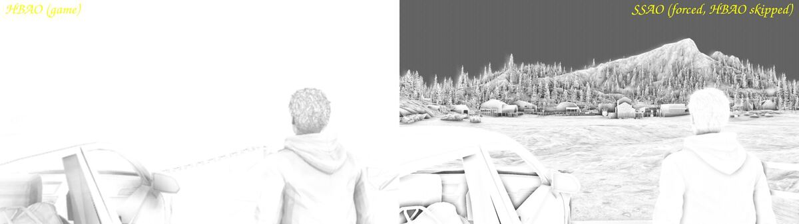
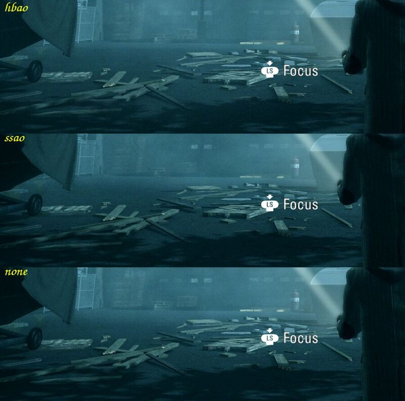

# Ray tracing in Alan Wake Remastered: feasibility

Question from the user: how amenable is the game to replacing its lighting with ray-traced ambient
occlusion, shadows and global illumination? This note answers it with evidence; the one
implementation deliverable is `[graphics] ssao` (section 3). Everything is RVA-based
(`Game_f_x64_EOS.exe`, image base 0x140000000) like the other notes. Tags: **static** = read in
Ghidra or in the game's shader files, **live** = observed in the lab with the probe below,
**measured** = numbers from the lab.

**Verdict, short:** DXR works on the game's own device under both Protons (DXR 1.0 pipelines and
1.1 ray queries, live). The renderer is a *light pre-pass* (deferred lighting) design whose
screen-space shadow buffer already carries the two terms RT would replace (sun shadow in R,
ambient occlusion in A), and whose light-accumulation buffer is read by the material shaders, so
RTAO and RT sun/moon shadows need **no shader swap**. Geometry is friendly (no instancing, per-draw
transforms, pre-skinned vertices in GPU buffers, ~0.7-0.85 M unique triangles drawn per frame); the hard
part is alpha-tested foliage (a quarter of the draws). **Go for RTAO**, then sun/moon shadows; the
flashlight needs a pixel-shader swap; DDGI is possible but large.

Lab: instance `awr-rt` (1920x1080@60), runs r1-r9, fixtures `prologue-road`, `awr-forest-night`
(level 15, flashlight lit), `awr-brightfalls-day`. The instance's graphics settings include 4x
MSAA on the colour passes (the census shows 4-sample colour targets).

## The probe (dev only)

`src/features/rt/` (lab verbs `rt …`, inert unless asked; the D3D12 capture needs
`[dev] rt_capture = 1` at launch, otherwise nothing is hooked):

| verb | what |
|---|---|
| `rt dxr` | `CheckFeatureSupport` on the game's device (OPTIONS5 tier, shader model, …), adapter VRAM budget |
| `rt dxr test` | on the game's device, on a queue of its own: BLAS/TLAS, a DXR 1.0 pipeline (`DispatchRays`), a DXR 1.1 ray query, BLAS sizes, build/refit/TLAS times and ray rates (timestamps) |
| `rt census N TAG` | N frames of D3D12 events (pipeline states, render targets, vertex/index buffers, draws, barriers, submissions) plus engine pass markers → `rt-census-TAG.txt`; pipeline states and shader hashes as they are created → `rt-pso.txt` |
| `rt shaders all [disasm]` | the captured DXIL, disassembled with the game's own `dxcompiler.dll` |
| `rt gpu on/status` | GPU timestamps recorded into the engine's own command lists around its passes |
| `rt grab NAME PASS:0/1` | copies an engine render target at a pass boundary to a raw file |
| `rt flag ssao/hbao game/1/0` | forces the SSAO / HBAO branch of the main pass |

Device hooks are MinHook on vkd3d-proton's implementation functions (so they coexist with the
stereo feature's vtable patches); engine markers are hooks on the passes below, each
prologue-checked. Analysis: `re/scripts/rt_shaderbin_index.py` (index of the game's 53 128 shader
permutations), `rt_census.py` (passes, formats, geometry), `rt_pass_psos.py`, `rt_shaders.py`
(alpha test / wind / skinning per pass from the disassembly), `rt_grab.py`, `rt_gpu_ab.sh`,
`rt_ao_shots.sh`.

## 1. DXR availability

| | lab: GE-Proton11-12-x86_64 | user's GE-Proton11-12-hypxr |
|---|---|---|
| vkd3d-proton | 1.1-5687-g8293130eb | same commit (`files/lib/wine/vkd3d-proton/version`); its `d3d12core.dll` is a different build (hash and size differ, rebuilt 2026-11-19), same DXR strings |
| `VKD3D_CONFIG` in the game | empty | empty |
| `D3D12_FEATURE_D3D12_OPTIONS5.RaytracingTier` | **12 = tier 1.2** (live, r1) | **1.2** (live, r8) |
| highest shader model / mesh shaders / sampler feedback | 6.7 (highest queried) / tier 1 / 0.9 | same |
| `ID3D12Device5` | yes | yes |
| DXR 1.0 pipeline: state object, shader table, `DispatchRays` of 4 rays at a triangle | **correct** (hit t = 1, misses -1) | **correct** |
| DXR 1.1 inline ray query (`RayQuery`, cs_6_5) | **correct** (hit, misses) | **correct** |

No `dxr`/`dxr11` switch is needed: this vkd3d-proton enables DXR by default when the Vulkan
driver has the ray-tracing extensions (static: its `d3d12core.dll` carries "DXR support enabled",
"DXR 1.1/1.2 support enabled" and an opt-out path; live: tier reported with `VKD3D_CONFIG`
empty). The Proton script sets nothing DXR-related (static, `proton`). The hypxr build was run
read-only (the instance pointed at it for r8, then back).

Shaders for an RT pass: the game ships **DXC 1.4.1907** (`dxcompiler.dll`, July 2019) and loads it
itself. The probe compiled its `lib_6_3` raygen/closest-hit/miss libraries with it in-process
(live), so DXR 1.0 shaders can be built at run time from HLSL in the mod. That DXC predates
`RayQuery` (compile error, live); the ray-query test used vkd3d-proton's precompiled test DXIL
(`third_party/vkd3d-proton-tests`, LGPL, dev only: compiled in only with `cmake -DTB_RT_RAYQUERY_TEST=ON`, otherwise `rt dxrtest` reports the ray-query part as "not built"). A shipped inline-RT shader would need a
newer DXC in the build (precompiled DXIL embedded in the DLL).

Measured on the game's device (in-world, the game rendering at the same time; `quiver lab gpu`,
three runs, spread < 2 % except the first build):

| | |
|---|---|
| BLAS, 65 536-triangle indexed mesh, fast-trace + compaction | 4.06 MB before, **1.47 MB compacted = 22.4 B/triangle** (62 B uncompacted), scratch 0.94 MB |
| build / fast-build / refit of that BLAS | 1.4-2.3 ms / 2.3 ms / **0.18 ms** |
| TLAS, 1024 instances | 310 KB, 0.11 ms |
| rays, 1920x1080, synthetic field (1024 instances of the mesh, 67 M instanced triangles) | short AO-style rays (3 m, first hit ends): **5.4-5.5 Grays/s** (0.38 ms for 1 ray/pixel, 1.53 ms for 4); long rays, first hit: 1.25 Grays/s; long rays, closest hit: 3.1 Grays/s |

## 2. G-buffer layout and frame order (live)

The frame, in GPU (submission) order, from the census (`rt_census.py`, prologue-road frame 2;
forest-night the same structure). It is a **light pre-pass** renderer: a thin G-buffer, a light
accumulation buffer, then the geometry drawn again with full materials reading it.

| # | pass | targets (format, size) | draws |
|---|---|---|---|
| 1 | sky probe: cube faces, convolution, SH (`g_sAmbientSHTerms` is a **9x1 RGBA16F** texture) | 32x192 … 9x1 RGBA16F | 26 |
| 2 | shadow maps (sun cascades and spot lights in one **8192x4096 atlas**) | R32_FLOAT colour + D24S8 depth | 1245 (prologue), 1764 (forest) |
| 3 | skinning: vertex shaders writing skinned vertices to a UAV (`g_vertexOutputBuffer`) | — | 15 |
| 4 | **G-buffer** | RT0 R32_FLOAT (depth), RT1 `pNormalRT` RGBA16F, RT2 `pGlossinessRT` BGRA8, D32S8 | 3480 / 1274 |
| 5 | occlusion queries; `ConvertToLinearDepth` → `pLinearDepthRT` R32F (metres, far 1000) and half-res | | 225 |
| 6 | HBAO (16 de-interleaved layers, 480x270; normals; blur) → `g_sHBAOBuffer` 1920x1080 **R16G16_FLOAT** | | 22 |
| 7 | **`pShadowRT`** (the "shadow buffer", BGRA8): sun cascades resolved per region (`ShadowBuffer`, RGB, write mask 0x7), SSAO apply (A, if enabled), HBAO apply (A, write mask 0x8, no blend), bilateral blur | | 13 |
| 8 | **`pLightRT`** RGBA16F: `DeferredLight` (stencil volumes, point/spot lights, the flashlight) | | 15 / 33 |
| 9 | two colour passes over all geometry (depth/ambient, then primary with specular): 1920x1080 R11G11B10 (+RGBA16F), MSAA here | | 6924 / 2512 |
| 10 | water, linear depth again, sky, SSS, particles/transparent into `pColorRT`, volumetric light (960x540 R16F), shade, velocity (`pMotionVectorsRT` R16G16_FLOAT), TAA, auto-exposure, bloom, tone map | | ~200 |

Names: the pool targets were named live by reading `RendererX86+0x260…+0x2f8` in the main pass
(`0x506b20`; pool objects are `rend::Texture2DD3D12`, `+0xa8` → `rend::TextureD3D12` holding the
`ID3D12Resource`, static `0x51d180`/`0x4fc830`). Contents (grabs, prologue r3, `rt_grab.py`):

- `pNormalRT` RGBA16F: normal in RGB as `n*0.5+0.5` (all in [0,1], ground ≈ (0.71, 0.99, 0.55)),
  A a material term (1 on foliage).
- `pGlossinessRT` BGRA8: glossiness in A (median 0.33), RGB ≈ 0.
- `pLinearDepthRT` R32F: linear depth in metres (2.1 … 1000).
- `pShadowRT` BGRA8: **R = sun/moon shadow** (the consumers read `.r` and `.a`, static: e.g.
  material PS `0929062170401a52`, `sample(g_sShadowBufferTex)` → components 0 and 3), G and B
  further shadow-resolve terms, **A = ambient occlusion** (cleared to 1, then SSAO and/or HBAO).
- `g_sHBAOBuffer` R16G16F: AO in both channels (identical statistics).
- `pLightRT` RGBA16F: diffuse light accumulation (RGB) and specular (A); read by 25 material
  shaders as `g_sLightBufferTex` (static, disassembly).
- No albedo target exists: albedo is only known inside the material shaders of pass 9.

An RTAO / RT-shadow pass has everything it needs valid **after pass 5** (linear depth, normals,
glossiness), and its result goes into `pShadowRT` (A for AO, R for the sun) **between passes 6
and 8**, where the engine itself writes those terms. The engine records these passes directly into
D3D12 lists on the game thread: the probe's markers land in the same list between the passes'
draws (live), so a mod pass can be recorded into the engine's open list at the right point, as
the stereo feature already does for its copies.


*Prologue-road r3: `pShadowRT` R and B; `pNormalRT` R; `pShadowRT` A with HBAO (the game) and
with SSAO forced (HBAO off); `pGlossinessRT` A. Each channel stretched between its 1st and 99th
percentile.*

## 3. The game's built-in SSAO, and `[graphics] ssao`

Static (Ghidra, main pass `0x506b20`): `rend::SSAO` (RendererX86+0x130) renders at `0x536630`
when "Render SSAO" (u8 `0xd755e0`) is set and applies at `0x536580`; `rend::HBAO` (+0x138) renders
at `0x538160` and applies at `0x537ef0` when "Render HBAO" (u8 `0x955659`, a debug-menu flag, 1)
is set. Every graphics preset writes `0xd755e0 = 0` (`0x242a20`), and the game saves and loads
that global with its settings (`0x1dca80`, `0x1dab40`).

Live (grabs r3, r5): both applies write **`pShadowRT.a`**, SSAO first, HBAO after it with write
mask 0x8 and no blending, so **with both on HBAO overwrites SSAO** (`pShadowRT.a` after SSAO:
mean 0.73; after HBAO: 0.97). Forcing SSAO alone (the old way) costs time and changes nothing on
screen. The material shaders read the AO from there (section 2), i.e. AO darkens the ambient
term only.

Measured GPU time (prologue-road, `rt_gpu_ab.sh` under `quiver lab gpu`, ~410 frames each):

| variant | SSAO | HBAO | shadow buffer (sun resolve) | fps (CPU-bound) |
|---|---|---|---|---|
| game (HBAO) | — | 0.270 ms (+0.019 apply) | 0.137 ms | 141-144 |
| SSAO forced, HBAO on | 0.288 ms (+0.020) | 0.266 ms | 0.137 ms | 137 |
| HBAO skipped | — | — | 0.137 ms | 148 |
| SSAO instead of HBAO | 0.285 ms (+0.019) | — | 0.137 ms | 145 |

SSAO and HBAO cost the same. They look different: the remaster's HBAO is short-range and light
(near contact shading only, mean 0.98 in daylight); the 2010 SSAO is strong, reaches distant
terrain and trees, and has the halos of its era at silhouettes (mean 0.74).



*`pShadowRT.a`, Bright Falls ferry (day, r5); the ferry moves, so the two grabs differ slightly.*



*Level 15 yard (forest-night r4), final frames brightened: HBAO (the game), SSAO instead of HBAO,
no AO. The planks' contact shadows are the difference; fog and grain vary between captures.*

The option (`src/features/graphics.cpp`, shipped in 0.6.5): **`[graphics] ssao = 1`** runs SSAO
and skips HBAO by rewriting the two `jz` pairs of the main pass (`0x5070ed`/`0x507145` → `90 90`,
`0x507102`/`0x50715a` → `eb 0c`, each signature-checked with its `cmp`), as single 16-bit stores at
a frame boundary (present, game thread), so a render and its apply always agree. The globals are
left alone, so nothing the game saves changes; `0` restores the original bytes. Live (r6, r9):
toggled in-world both ways (timestamps show SSAO replacing HBAO and back), the globals stayed 0/1.
In sbs the right eye's SSAO history is per eye (the existing `temporal.cpp`, now told about the
option); not re-measured in sbs here.

**As an RTAO target**: `pShadowRT.a` is clean (cleared to 1, written by one draw, read by the
lighting and the material shaders). `g_sHBAOBuffer` (R16G16F, full res, allocated by the HBAO
render, consumed by its apply) is even easier: run HBAO's render or skip it, write the RTAO result
into a texture of the same format and let the game's own apply put it in place.

## 4. Lighting and shadows (static + live)

- **Sun / moon**: cascades in the 8192x4096 atlas (D24S8, plus an R32F colour copy), resolved into
  `pShadowRT.rgb` by full-screen region draws (`0x52cb40`, one per cascade region, constants
  `g_fRegionStart/End`, `g_mShadowProjection`), PS `3fd4eb73c302e5b7`: **13 comparison-sampler
  (PCF) taps** on `g_sShadowMapTex`. The filter: "Shadow Quality" (`0x955670`) selects the
  resolve variant (`param_1[quality + 1]`), constants `g_fPCFSize`, `g_fCascadePCFSize_d3t`,
  `g_fNumPCFSamples_d3t`, `g_fPCFBias_d3t` (the `_d3t` ones are the port's additions), tweakables
  "Shadow Buffer:Reconstruction Scale/Bias", "Enable Front/Back Clip". Then a bilateral blur.
- **Spot lights, including the flashlight**: `DeferredLight` into `pLightRT`. Forest-night frame:
  6 lighting PSOs (2 stencil, 4 lights). PS `aa17e58e1bd8d853` is the shadowed spot with a
  projected cookie (`g_sLightProjectionMap`) and **11 PCF taps** on the atlas: the flashlight's
  shader (3 draws of it in the frame). Point lights use a **variance cube shadow map**
  (`g_sVarianceShadowMapTex`, PS `0e1da8a9de027a3d`), unshadowed ones `8ef0ef6b36ecaf44`.
- **Ambient**: one global SH (the 9x1 texture, read by 42 shaders) plus up to 8 `g_ambientLights`
  in the constants, times the AO in `pShadowRT.a`. The sun also has a projection map
  (`g_sSunLightProjectionMapTex`, 33 shaders), a cookie that RT sun shadows must keep.
- **Pipeline states**: shaders are **DXIL, shader model 6.0** (all 281-283 captured, validator
  1.4), **precompiled** in `shaders/build/pc_DXIL/*.shaderbin` (74 effect files, 509 MB, 53 128
  containers, static) and turned into pipeline states **on demand**: 334-375 created by the time
  the level runs, ~20 more while playing; all through `CreateGraphicsPipelineState` /
  `CreateComputePipelineState` (no pipeline libraries, no stream descriptions; live). 218-318
  PSOs are used per frame; the lighting ones are few (6 deferred-light, 3 shadow-buffer, 1 HBAO
  apply, 2 blur). A swap by bytecode hash at creation is therefore tractable, and replacement
  shaders can be compiled at run time with the game's DXC (SM 6.0-6.3).

## 5. Geometry (live, census frame 2 of runs r3 and r4; `rt_census.py`, `rt_shaders.py`)

| | prologue-road | forest-night (level 15) |
|---|---|---|
| draws / triangles submitted per frame (all passes) | 12 301 / 5.58 M | 5 947 / 4.33 M |
| G-buffer draws / triangles | 3 480 / 1.18 M | 1 274 / 0.63 M |
| shadow-map draws / triangles | 1 245 / 1.63 M | 1 764 / 2.29 M |
| unique indexed meshes (index range + base vertex + vertex buffer) | 3 640 | 1 622 |
| **unique triangles** drawn | **0.85 M** | **0.69 M** |
| instanced draws | **0** (every draw has 1 instance) | 0 |
| dispatches / ExecuteIndirect | 0 / 0 | 0 / 0 |
| vertex / index buffers bound | 363 resources, 81 MiB (356 default heap, 6 upload) / 186, 40 MiB (182 R16, 4 R32) | 266, 77 MiB / 164, 40 MiB |
| POSITION format | R32G32B32_FLOAT (offset 0) | same |
| alpha-tested G-buffer draws (PS with `discard`, or alpha-to-coverage) | 818 (0.28 Mt; 472 alpha-to-coverage) | 346 (0.17 Mt; 179) |
| alpha-tested shadow casters | 259 (0.34 Mt) | 495 (0.64 Mt) |
| wind-animated draws (VS loads the wind/shake tables) | 312 G-buffer (0.11 Mt) | 88 (0.04 Mt) |
| pre-skinned draws | 78 G-buffer, 138 shadow | 39, 162 |

- **Transforms**: per draw, in the `$Globals` constant buffer (`g_mLocalToView`,
  `g_mLocalToClip`; two root CBVs set per draw, live). No instancing anywhere, so vegetation is
  individual draws too (`Foliage_d3t`, `Grass`, `FoliageBillboard`).
- **Skinning**: done before the passes by vertex shaders of the `Skinning` effect that write the
  skinned vertices to a UAV (`g_vertexOutputBuffer`, bone palette of 64 3x4 matrices); a compute
  variant exists (5 compute PSOs created) but no dispatch ran. The G-buffer/shadow vertex shaders
  of skinned meshes have no palette: they read the pre-skinned buffers. Those buffers are exactly
  what a BLAS refit needs (double-buffered by frame parity, docs/stereo.md section 5).
- **Wind** runs in the G-buffer and colour vertex shaders only; **no shadow-map shader uses
  wind** (11 VS load the tables, none in pass 2), so the game's own shadows are already static
  with respect to wind. A static BLAS for foliage matches what the game does.
- **Alpha test** is the expensive part: a quarter of the G-buffer draws and up to 0.64 Mt of
  shadow casters (foliage, grass, fences) use `discard` with `g_sAlphaTestSamplerTex`. RT through
  them needs any-hit shaders with the material's alpha texture and UVs (per-geometry descriptors),
  or opacity micromaps (vkd3d-proton has the `OMM` paths, DXR 1.2 reported).
- **BLAS memory**: per-frame unique triangles 0.69-0.85 M → **16-19 MB compacted** (22.4 B/tri,
  measured on this driver), 43-53 MB uncompacted. Upper bound for everything loaded: the bound
  index buffers hold at most 40 MiB of 16-bit indices ≈ **7 M triangles → ≤ 160 MB compacted**
  (≤ 430 MB uncompacted). VRAM in use by the game (vkd3d budget view): 3.0 GB in prologue-road,
  **4.6 GB in forest-night**, budget 7.1 GB (nvidia-smi: 5.3 of 8.15 GiB with the desktop); the
  headroom is ~2.5 GB.

## 6. Two eyes and the ray budget

- **Shared between eyes** (one update, same objects): every BLAS build/refit and the TLAS
  (built once per update; the second eye's `renderFrame` reuses it), DDGI-style probe updates
  (view-independent), the skinning refits. **Per eye**: every per-pixel ray (AO, shadow, GI
  gather) and its denoiser history (as for SSAO/TAA, docs/stereo.md section 5).
- **Budget**: 1920x1080 is 2.07 M pixels per eye. At the synthetic 5.4 Grays/s (short rays) /
  1.2-3 Grays/s (long rays), 1 ray/pixel costs 0.4 ms (AO) / 0.7-1.7 ms (sun shadow) per eye.
  Real geometry with alpha any-hit and a deeper BVH is plausibly 2-4x slower, so **order of
  magnitude: 1-3 rays/pixel/eye for 2 ms at 1080p; with DLSS Quality (1280x720 per eye, 0.92 MP)
  2.25x that, Performance (960x540) 4x**. For comparison HBAO costs 0.27 ms and the sun resolve
  0.14 ms per eye today; the game is CPU-bound at ~140 renders/s, so there is some GPU slack.

## 7. Go / no-go and estimates

| feature | verdict | why | effort (one person) | risk |
|---|---|---|---|---|
| **RTAO** | **go** | write `pShadowRT.a` (or `g_sHBAOBuffer`) after pass 5; no shader swap; inputs are the game's own linear depth and normals; 1 ray/pixel short rays fit easily | **2-3 weeks** for v1 (geometry capture and BLAS cache 1-1.5 w, ray pass + injection 3-4 d, denoise/temporal per eye 3 d); alpha any-hit +1 w | medium: geometry completeness (only what is drawn: on-screen + shadow casters), transforms |
| **Sun/moon RT shadows** | **go, after RTAO** | write `pShadowRT.r` in place of the cascade resolve; no shader swap; the shadow pass's own draw list is the caster set (includes off-screen casters); keep the sun cookie | +1.5-2 weeks on RTAO's infrastructure; any-hit alpha is mandatory here (trees) | medium: alpha-tested foliage cost, the night/fog levels limit the payoff |
| **Flashlight RT shadows** | **conditional go** | needs a swap of one pixel shader (`aa17e58e1bd8d853`, SM 6.0) re-written in HLSL from its disassembly to read a ray-traced mask instead of 11 PCF taps; identify the flashlight among the shadowed spots; also fixes the stereo shadow-reuse problem (docs/stereo.md section 6) | +2-3 weeks | medium-high: re-implementing a lighting shader exactly (falloff, cookie, specular) |
| **RTGI (DDGI-style)** | **no-go for now** (possible later) | the injection points exist (add irradiance into `pLightRT`, which the material shaders multiply by albedo; neutralise the SH by overwriting the 9x1 SH texture), but probe updates need hit shading: per-geometry albedo textures and UVs (there is no albedo G-buffer), sun shadow and local lights at hit points | 2-3 months | high |

**Recommended first step:** the geometry capture behind a dev verb, on the census code: at each
G-buffer and shadow-map draw (indexed triangle list, R32G32B32 position), key a BLAS by index
range + base vertex + vertex buffer (built from the game's own buffers, compacted, cached; skinned
ones refit from the pre-skin output), take the instance transform from the draw's constants
(local-to-view × view-to-world) or the engine object, build the TLAS once per update, and validate
it by tracing primary rays from the camera and comparing hit depth against `pLinearDepthRT`
(expect < 1 % mismatched pixels outside alpha-tested foliage). Once that matches, RTAO is a
raygen (compiled at run time with the game's DXC) recorded into the engine's list after HBAO's
render, writing `g_sHBAOBuffer`.

## Reproducing

```sh
scripts/build && cp -r build/mod build/mod-rt
sed -i 's/^rt_capture = 0/rt_capture = 1/; s/^start_level =$/start_level = continue/; s/^skip_videos = 0/skip_videos = 1/' build/mod-rt/torchbearer.ini
quiver lab fixture install awr-rt awr-forest-night
quiver lab launch awr-rt --mod build/mod-rt --wait frame && quiver lab wait awr-rt in-world
quiver lab call awr-rt rt dxr test
quiver lab call awr-rt rt census 3 forest && quiver lab call awr-rt rt shaders all disasm
python3 re/scripts/rt_shaderbin_index.py <install>/shaders/build/pc_DXIL build/rt-shaderbin-index.json
python3 re/scripts/rt_census.py <run> forest build/rt-shaderbin-index.json --frame 2 --passes
python3 re/scripts/rt_shaders.py <run> forest build/rt-shaderbin-index.json 2
quiver lab gpu --for awr-rt -- re/scripts/rt_gpu_ab.sh awr-rt 400
quiver lab call awr-rt rt grab pShadowRT hbao_apply:1 && python3 re/scripts/rt_grab.py <run>/rt-grab-pShadowRT-hbao_apply-1.raw out
```

Use census frame 2 or later: the engine resets (opens) its command lists a frame or more before
it fills them, so the first census frame misses the lists opened before the census began.
