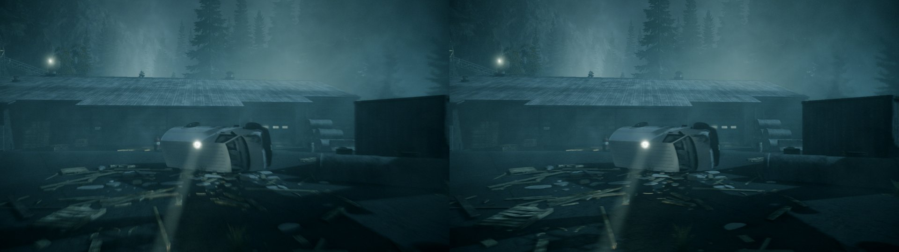

# Stereo output: the 3840x1080 window

How full side-by-side output reaches a 3840x1080 display (XReal Air 2 Ultra in 3D mode) while
the engine renders one 1920x1080 eye. Code: `src/features/stereo/window.cpp`, `src/core/present.cpp`
(swapchain width scale), `src/features/stereo/gpu.cpp` (composition). Addresses are RVAs.
"static" = read in Ghidra, "live" = observed in the lab (instance `awr-wide`, gamescope
3840x1080@60), "measured" = from captures.

## Use

```ini
[stereo]
mode = sbs
output = full        ; read at start-up
[game]
display_mode = borderless   ; or windowed
```

With the glasses in 3D mode the desktop is 3840x1080: borderless gives 1920x1080 per eye in a
3840x1080 window. Windowed at 1920x1080 gives the same on a desktop at least 3840 wide. With
`output = full` and no stereo pair (mode off/left/right/alternate, menus, pause, Bink videos) the
engine's single image is copied into both halves, i.e. 2D in the glasses (live: both halves
identical in captures, `gpu duplicated=` counter).

## The game's window (static)

`app::WindowX86` (vtable `0x77be40`; the object pointer is in the global `0xd0ad38`, set on
WM_CREATE):

| offset | field |
|---|---|
| +0x10 | input object (mouse: +0x10 int, 0 = absolute cursor, else captured/relative) |
| +0x18 | HWND |
| +0x20 / +0x24 | client size the engine renders at |
| +0x30 | mode: 0 fullscreen (popup), 1 windowed, 2 borderless (popup at the monitor origin), 3 maximised |
| +0x138 | resize request (WM_SIZE sets 3 when the size changed) |

- `0x3b4b60` create(this, title, w, h, mode, monitor, flags): `AppWindowClass`, `CreateWindowExA`,
  centres a windowed window, stores w/h at +0x20/+0x24 at the end. vtable slot 9.
- `0x3b50b0` resize(this, w, h, mode, monitor, flags): restyles and `SetWindowPos`, same store.
  vtable slot 27.
- `0x3b39e0` window procedure: WM_SIZE stores LOWORD/HIWORD(lParam) at +0x20/+0x24 and raises
  +0x138; mouse messages 0x200..0x209 go to the input object with client pixels.
- Mouse handlers (`0x3b6ef0` move, `0x3b6bb0` buttons) normalise client pixels by +0x20/+0x24
  (getter `0x3b46d0`); in relative mode the move handler measures the distance from a saved
  screen point and warps back with `SetCursorPos`. `0x3b6b10` returns the cursor normalised by
  `GetClientRect` (real client). `0x3b7160` warps the cursor to a normalised position (+0x20 based).
- Resolution: `Game::Game` (`0x1ce4c0`) logs "Wanted resolution", reads the desktop size with
  `MonitorModes::get` (`0x3b4590`, call at `0x1ce7aa`) and for borderless (Game+0xdc == 2) uses
  it as the resolution (Game+0xd4/+0xd8), otherwise clamps to it. `Game::setDisplay` (`0x1d0e40`)
  does the same for borderless (call at `0x1d0e8b`) and hands w/h to the settings object, whose
  apply (`0x1e0380`) resizes the swapchain and calls the window's resize.

## What the mod does (output = full)

1. Swapchain created 2x wide, `GetDesc`/`GetDesc1` report the game's width (core/present, spike).
2. After create/resize the real window is set to a 2W x H client; the window object keeps W.
   The engine's width is what the game asked for, or half of it when 2W would not fit the screen.
3. WM_SIZE reaches the game as (real/2, h). If something sets the real window to the engine's own
   width it is re-widened on the next Present instead of halving again (the first build halved
   unconditionally and spiralled 3840 → 1920 → 960 → … when a resize to 1920 arrived 9.5 s in;
   live, run r1).
4. Absolute mouse positions reach the game as `x mod W`: over either half the game sees the
   position within that eye, so the OS cursor lines up with the menu in the eye it is over.
   Relative mode (mouse-look) is untouched. `0x3b6b10` gets the same mapping.
5. Borderless: while `Game::Game` (only if Game+0xdc == 2) or `Game::setDisplay` read the desktop
   size, `MonitorModes::get` reports half its width, so the engine's resolution is one eye.
6. All start-up hooks are now enabled in one MinHook batch (`hook_batch_begin/end`): enabling each
   separately suspends every thread, ~12 ms per hook under Proton, and the 13 hooks took 0.22 s,
   only 0.27 s ahead of the boot desktop query. Batched: all enabled 12 ms after load (live, r4).

## Verified (live, `awr-wide`, gamescope 3840x1080, level 15)

- Windowed 1920x1080: `create 1920x1080 mode 1 -> engine 1920x1080`, client 3840x1080, swapchain
  3840x1080 (game sees 1920), stable for the session (`stereo window` verb: engine 1920x1080,
  last WM_SIZE 3840 → 1920).
- Borderless at boot: `borderless at 3840x1080 desktop -> engine resolution 1920x1080`, window
  3840x1080, swapchain created 1920 → 3840. Live switch windowed → borderless (`cfg
  game.display_mode borderless`) before the fix: the game resized its swapchain to 3840 (one eye
  3840 wide); after: 1920.
- Capture of the gamescope output: both eyes side by side over the full 3840 width, near objects
  with visibly larger disparity than far ones; HUD in both.
- Pause menu: hovering "Options" at (2565, 799) — right half — selects Options in both eyes;
  hovering "Statistics" at (645, 841) — left half — selects Statistics (xdotool absolute moves).
- Mouse-look in gameplay (relative mode) still turns the camera.
- `mode = off` with `output = full`: identical halves.

## Not done

- Exclusive fullscreen (mode 0) with a 2x swapchain is untested: DXGI would need a 3840-wide
  display mode. Use borderless.
- Half SBS (`output = half`) still crops the centre of each eye; a proper 2:1 squeeze needs a
  shader pass.
- The OS cursor is drawn by the desktop over one eye only (it is not part of the rendered image).



*The gamescope output (3840x1080, downscaled) of run r2: windowed 1920x1080 per eye, the window
widened to 3840; left eye left, right eye right.*

## HypXRland (the user's compositor) — `output = hsbs` and the window tag

How the glasses are actually driven here: HypXRland (~/code/hypxrland, config
~/.config/hypr/hyprland-xr.lua) runs the XReal's 3D mode as **one 1920x1080 logical monitor**
scanned out at 3840x1080 (`monitor … stereo = "sbs"`), and splits a window *declared* stereo per
eye: it crops the window's **main surface** to the left/right half for each pane and stretches it
over the window's own box (05-configuration.md §8.5-8.6; `applyStereoContentCrop` in
src/render/ElementRenderer.cpp). So the game sees a 1920-wide desktop, and `output = full`
(a 3840 window) does not fit it.

### `output = hsbs` (static + live)

The same machinery as `full`, with the engine at half the window: in borderless the desktop query
is halved (1920 → 960, window.cpp), the window stays 1920 (2 x 960), the swapchain is 1920 with
the game seeing 960, and the eyes are copied 1:1 into the halves. Each eye is made **anamorphic**:
the game keeps its vertical FOV and derives the horizontal one from the aspect (live: 1920x1080 →
fov 1.3823 rad; 960x1080 → 0.7844 = 2·atan(tan(1.3823/2)·0.8889/1.7778)), so before each render
the main camera gets twice its aspect and the matching horizontal FOV (`anamorphic_apply`,
stereo.cpp). Each half then holds the full 16:9 view squeezed 2:1 (captured: same framing as the
1920-per-eye render, everything half as wide), which the compositor's stretch undoes. Convergence
shifts are computed in the squeezed eye's pixels (hit −4/+5 at 4 m, half of full's −9/+10).

Known issue: the game's 2D UI lays itself out for the 960x1080 screen it is told about (element
sizes follow the height, positions the width), so after the 2x stretch menus are twice as wide and
the pause menu's logo overlaps its items (captured). Fix candidate: let the UI lay out at 16:9 and
draw it squeezed into each half (needs the UI's screen size; not found yet).

### The window tag (live, on the real HypXRland session)

HypXRland reads a cooperative xdg-toplevel tag (`stereo:sbs` …), but a Wine game cannot set one:
- GE-Proton 11-12's Wayland driver already sets an xdg tag on every toplevel — hard-coded
  `proton-game` ("This is a game running through proton"), sent once in
  `wayland_surface_make_toplevel` (disassembled from the installed winewayland.so); nothing lets an
  app choose it;
- under the X11 driver the window is an XWayland window, which has no xdg tag at all.

So the mod uses a **Hyprland window tag** instead, set over the compositor's IPC socket from
inside Wine (core/hyprland.cpp): Wine's winsock bridges AF_UNIX, and a Windows program connects to
`Z:\run\user\1000\hypr\<signature>\.socket.sock` like hyprctl (verified: `j/version` reply). In
a Lua-configured session `dispatch X` means `hl.dispatch(X)`, so the request is
`dispatch hl.dsp.window.tag({ tag = "+stereo-hsbs", window = "address:0x…" })` (classic
`dispatch tagwindow +tag address:…` as fallback). Finding our window: the pid cannot be used —
Wine has wineserver open files, so `Z:\proc\self` is wineserver's (live) — so the window's title
briefly carries a random marker until the compositor's client list shows it, then is restored.
`XDG_RUNTIME_DIR` is not in Wine's Windows environment; it is read from `Z:\proc\self\environ`.

Verified end to end with a self-test program (same hyprland.cpp) on the live session under Wine's
Wayland driver, both via bare `wine` and via GE-Proton's `proton run`: tag applied (visible in
`j/clients` tags), then cleared. Not verifiable from the agent shell: the X11 driver (no X
authority there). The user's config maps the tag (hyprland-xr.lua, 2026-11-19: generic
`stereo-<layout>` → `stereo <layout> always`; mpv's float split into its own rule).

### Open: Wine's Wayland driver vs HypXRland's crop

On this machine GE-Proton picks Wine's **Wayland** driver whenever `WAYLAND_DISPLAY` is set (the
`proton run` self-test window was not XWayland; Quiver keeps the variable for real launches). There
a game's Vulkan image is in Wine's *client subsurface* (winewayland wayland_surface.c), and
HypXRland crops only a window's main surface — so a tagged Wine-Wayland game would **not** be
split per eye. Two ways out: run the game on Wine's X11 driver (e.g. `winewayland.drv=d` in the
mod's launch settings; everything in the lab ran X11 under gamescope), or teach HypXRland to crop
a stereo window's covering subsurface (Wine's client surface). Full resolution under HypXRland
additionally needs Wine to allow a swapchain larger than the window (win32u/vulkan.c pins the
Vulkan extent to the client rect; the Wayland driver would then scale it with its viewport).
