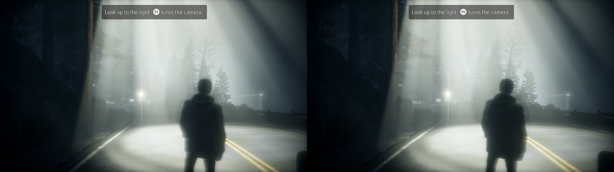

# Stereoscopic 3D: findings, measurements and the road to full SBS

Target: XReal Air 2 Ultra in 3D mode, a **3840x1080 full side-by-side** signal (left half to the
left eye, right half to the right eye, each a 1920x1080 16:9 view), with **both eyes rendered from
the same simulated frame**. Prior art: Ishimura (Dead Space), which alternates eyes on consecutive
engine frames (`ds-decomp/docs/18-stereo.md`, `28-full-sbs.md`, `49-...`).

Status of this spike, in one paragraph: the camera lever is found and verified (eye offset is a
translation, disparity inversely proportional to depth, scales with separation, convergence puts
the screen plane where configured). **Same-update dual rendering works**: in `mode = sbs` the
game's render pass runs twice per game update (left eye, right eye), the first Present is swallowed
after its back buffer is stashed, and the second is composed into a **3840x1080 swapchain with
each eye a 1:1, unscaled 1920x1080 render at the engine's own 16:9 frustum**. Temporal state that
crosses eyes (TAA history, camera and object motion vectors) is handled for the prototype by giving
each eye its own previous-frame camera matrix and switching off TAA and object velocity while sbs
runs. What is not done: window sizing for a real 3840-wide display, per-eye TAA/DLSS history,
HUD depth, and a half-SBS (squeezed) output.

Every address is an RVA (image base 0x140000000), `Game_f_x64_EOS.exe` as shipped on Epic
(2026-11). "static" = read in Ghidra (`re/scripts/Serve.java`), "live" = observed with the
`stereo census` trace or captures in the lab, "measured" = numbers from captured frames.

---

## 1. Frame structure

### One thread does update, render submission and Present

The **"RMD - Game Thread"** (entry `0x347730`, names itself via `0x3c74c0`; reads
`CommandLine.txt` next to the exe; its loop calls `0x1d1900` once per iteration) runs:

```
0x1d1900  Game::tick
  0x263600  ModeSwitch::update     simulation: game modes, camera (setViewToWorld on the main view x4)
  0x262cb0  ModeSwitch::render     the frame:
              spin until >= 4.17 ms since the last frame (240 fps cap)
              0x2aca30  Renderer::beginFrame(g_renderer @0xb18848)   ++frame counter @0xb188d8
              mode->render() for each active mode (vtable +0x38), e.g.
                0x34cdd0  GameMode::render
                  0x2ae2f0  Renderer::renderView(view)  -> focus/DOF params, then tail-jumps to
                  0x508970  RendererX86::renderFrame(view, scene, extra)     [vtable slot 11]
                              TAA jitter -> View::setPostProjection, then
                  0x5090b0      RendererX86::renderWorld: RT pool (pColorRT, pNormalRT,
                                pLinearDepthRT, pMotionVectorsRT, pTAAHistoryRT0/1, ...),
                                shadows, cube-map probe (6 views), G-buffer, lighting, post
                  0x335550, 0x33b180  overlays / HUD
              0x2acb10  Renderer::endFrame   submits, then IDXGISwapChain::Present
```

Established **live** (census, `quiver lab call awr stereo census N`): every event below happens on
one thread id (the one that created the swapchain), in this order per frame:

```
setViewToWorld MAIN x4 (ret 0x15e723)          <- ModeSwitch::update
ModeSwitch::render enter
  ExecuteCommandLists n=1
  Renderer::beginFrame
  setViewToWorld MAIN x2
  renderFrame ret=0x34ce30 view=MAIN fov=1.3823 aspect=1.7778 near=0.2 far=1000
    setPostProjection (jitter)  ret 0x508de3
    setViewToWorld x6 cube faces (static PerspectiveView @0x140dc44f0, ret 0x5124b7)
    setViewToWorld CustomView @0x140e0b480 (ret 0x52e57a) = main camera pose
    setPostProjection x4 (0x5093e2 zero, 0x498602 identity, 0x498a1a / 0x509417 jitter)
    ExecuteCommandLists n=14..15                  <- the scene's command lists, submitted at the
                                                     end of renderFrame (inside it: the sbs census
                                                     marks it IN-RENDERFRAME)
  Renderer::endFrame
    ExecuteCommandLists n=8, n=1
    Present
    GetCurrentBackBufferIndex (ret 0x49b7e5)     <- the engine asks DXGI every frame
```

So there is **no separate render thread consuming a frame packet**: the game thread records D3D12
command lists during `renderFrame` (about 5 ms wall time per call in the prologue scene,
recording plus submission) and submits the scene's lists at the end of `renderFrame`, the
HUD/overlay lists and the frame's end in `endFrame`. (`rend::CommandBufferExecuteThread` exists
in RTTI; with the options seen here all `ExecuteCommandLists` calls come from the game thread, through `0x503184`.) Debug
render options registered in `0x2b0580`: "Multi Thread Rendering" (u8 `0x955632`), "Split Command
Buffers" (`0x955635`), "Late Shadow Pass" (`0xd755d6`), "Combined Post Pass" (`0x95566a`), "VSync
Enabled" (`0x95566c`), "DLSS Mode".

This structure is what makes same-update stereo cheap: **simulation and rendering are separate
calls on the same thread, and `ModeSwitch::render` can be called twice without running the
simulation in between.**

### The camera: rend::View

`rend::View` (vtable `0x751bb8`, 0xcb0 bytes) → `rend::PerspectiveView` (vtable `0x751bd8`, 0xcc8)
→ game `BaseCamera` (vtable `0x752ad0`; the main view object is a BaseCamera). Matrices are
**doubles, row-vector** (`v' = v*M`, translation in the last row), static from the ctor
`0x469ab0`, copy `0x46a4f0` and the methods below:

| offset | field |
|---|---|
| +0x008 | post-projection double[4][4] (TAA jitter in [3][0..1]), set by `View::setPostProjection` `0x46c090` |
| +0x1e8 | world-to-view double[4][3] |
| +0x248 | view-to-world double[4][3]: rows right, up, forward, position |
| +0x2a8 / +0x328 | view-to-clip and inverse (lazy, `0x46c120`: `vtbl[2]` projection × post-projection) |
| +0x3a8 / +0x428 | world-to-clip and inverse (lazy, `0x46c500`) |
| +0x4a8 / +0x4a9 | "projection valid" / "world-to-clip valid" |
| +0x4b0.. | shader uniforms `g_mWorldToView`, `g_mViewToWorld`, `g_mViewToClip`, `g_mClipToView`, `g_mWorldToClip`, `g_mClipToWorld`, `g_vViewPoint`: each 1 header + 4 slots, slot = 1 + a per-thread index at TLS+0x30060 (`0x15e140`) |
| +0xcb0 | PerspectiveView: horizontal FOV (radians), +0xcb4 zoom, +0xcb8 aspect (w/h), +0xcbc near, +0xcc0 far |

`PerspectiveView` projection (`0x4637f0`): `m00 = 1/tan(fov/2)/zoom`, `m11 = m00*aspect`,
`m22 = f/(f-n)`, `m23 = 1`, `m32 = -n*f/(f-n)` (D3D left-handed). Measured main camera in the
prologue: fov 1.3823 rad (79.2 deg horizontal), aspect 1.7778, near 0.2, far 1000, so
`m00 = 1.2088`. Setters: aspect `0x463c30`, far `0x463c50`, fov `0x463c70`, near `0x463c90`,
zoom `0x463cb0` (each clears +0x4a8).

**`View::setViewToWorld(const double m[4][3])` at `0x15e2f0`** is where every camera transform
enters the renderer: it stores the matrix, inverts it into world-to-view, marks world-to-clip
dirty and writes `g_mWorldToView`, `g_mViewToWorld` and `g_vViewPoint`. Everything the GPU sees for
that view (and culling) is derived from it. Callers (static): `0x15e650` (float camera transform at
+0xcc8, used by BaseCamera: the main view, live), `0x477190` (spot-light shadow views),
`0x485390`, `0x50f5f0`, `0x512220` (the 6-face cube probe), `0x52e140` (a CustomView copied from
the main camera each frame).

How it reaches the GPU: the uniforms above are copied into constant buffers when the view is bound
(`UseViewCommand` `0x46cc10` / `UsePerspectiveViewCommand` `0x463cd0` → `0x46c890`); renderWorld
binds the main view three times (`0x506b20`).

### TAA and temporal state (static + live)

- TAA on/off: u8 `0x955636` (and `0x955694`), written by the options code `0x242a20` (forced 0
  when DLSS `0xd75620` is on). `renderFrame` only jitters when it is set.
- Jitter: `renderFrame` builds an identity post-projection with `[3][0..1]` = jitter / resolution
  (patterns Rotated Grid / Halton / Hammersley, tweakables "TAA:Jitter ..."), frame counter `0xd744f8`.
- `TAA::beginFrame` `0x498590` (`*(RendererX86+0x140)`): uses **TAA+0x60, last frame's unjittered
  world-to-clip (double[4][4])** to build current-view-to-previous-clip (camera motion vectors),
  then overwrites it with this frame's.
- History targets `pTAAHistoryRT0/1` and `TAA Mask 0/1` come from the RT pool by name in
  `renderWorld`.

### The tweakable registry

`rend::BaseTweakable` ctor `0x461320(this, name, type)` appends `this` to a global array of at most
0x500 pointers at `0xd386f0`, count at `0xd3aef8`, under a mutex. Layout: +0x00 `char*` name,
+0xa8 type (0 bool, 1 float, 2/3 vectors, 5 list), +0xb0 value, +0xb4/+0xb8 float min/max. Most are
function-local statics, so a tweakable exists only once its code ran. Lookup by name is a linear
scan (the mod's `tweak_find`). Exposed live as `quiver lab call awr tweak list [SUBSTR]` and
`tweak NAME [VALUE]`. Examples present in-world: `Camera:FOV` (88, 15..150; registered `0xfaa0`),
`TAA:Resolve`, `TAA:Enable Camera Velocity`, `TAA:Enable Object Velocity`, `TAA:History Blend
Weight` (0.8), `TAA:Jitter Scale`, `Cinematic Moment:FOV Multiplier`. Cheap levers for stereo:
FOV and the TAA/velocity switches (used below).

Level-related (for the level-loading work): the game thread entry `0x347730` reads
`CommandLine.txt` from the exe folder and parses it with `0x195cf0` (errors: "Command line
errors"); `GameMode::loadWorld` exists (RTTI `InstanceWorldJob@?BE@??loadWorld@GameMode@@`); the
main menu has an "Episodes" item.

---

## 2. Camera bias (mono frame)

Hooks (`src/features/stereo/stereo.cpp`, signatures in `engine.h`):

- `RendererX86::renderFrame` `0x508970`: its `view` argument **is** the main scene camera; it is
  the only View passed there (live: one call per frame, always the BaseCamera). This scopes the
  bias: the mod biases that View only.
- `View::setViewToWorld` `0x15e2f0`: when the game sets the main view's transform, the mod keeps
  the game's matrix and forwards `position += right * offset`. Shadow, light, cube-probe and
  reflection views have their own transforms and never see the offset (the cube probe and the
  CustomView are set inside renderFrame; the CustomView copies the biased main pose, as it should).
- `View::setPostProjection` `0x46c090` (inside renderFrame, main view only): convergence, adds
  `offset * m00 / Zc` to `[3][0]` (an NDC shift that zeroes disparity at `Zc` metres).

Sign: view +x is camera **right** here (`right = up × forward`, left-handed, live census), `m00 > 0`;
the left eye is `-separation`. Measured: with parallel eyes every confident patch has the left
image to the right of the right image, the correct sign.

Because the offset goes into the view transform, everything derived from it moves together:
lighting, shadows (cast from light views, sampled at the biased camera's pixels), fog, SSAO, post.
In the captures shadows, light shafts and the HUD stay coherent; the HUD is drawn in screen space
and is identical in both eyes (zero disparity, i.e. at screen depth).

### Measurements

Scene: fixture **`prologue-road`** (Continue Game → the prologue road, the player standing, camera
behind him, lighthouse and trees in fog). 1920x1080, `m00 = 1.2088`,
`K = 2e*m00*(W/2) = 75.43 px*m` at 32.5 mm per eye. Tool: `re/scripts/stereo_disparity.py`
(32 px patches on a 24 px grid, SSD over integer shifts + parabolic sub-pixel, confidence-gated).

Mono-frame bias (separate left / right captures, run r10, TAA settled 60 frames after each change):

| pair | median | notes |
|---|---|---|
| mono control, consecutive frames | -0.016 px (p5..p95 -0.47..+0.17) | floor |
| player (2-3 m) at 32.5 mm | +29.4 px | implies 2.6 m |
| road in front (≈5 m) | +15.05 px | 5.0 m |
| trees through the fog (≈35-40 m) | +2.08 px | 36 m |

Near over far is 29.4 / 2.08 ≈ 14: not a pan. Disparity scales with separation (per-patch ratios,
patches > 3 px): 16.25 → 32.5 mm ×1.963 (requested 2), 16.25 → 65 mm ×3.890 (requested 4), 32.5 → 65
×1.961. Each eye here is a separate capture ~100 frames after the other, so idle animation and fog
motion between the captures add scatter and pull the medians 2-3 % low. The same-update battery
below removes that between the two eyes of a pair (not between pairs taken at different settings).

### Same-update battery (sbs, full SBS 3840x1080)

Every pair below is **the two halves of one presented 3840x1080 frame**, so both eyes come from
the same game update; no animation or camera drift between the eyes. Run r16, fixture
`prologue-road`, `re/scripts/stereo_battery.sh` + `re/scripts/stereo_analyse.py` (captures in the
lab run folder runs/r16). TAA and object velocity off (forced by sbs), per-eye camera motion vectors.

Control, **separation 0 in sbs** (two renders of the same update with the same camera):
disparity median **+0.009 px** (p5..p95 -0.23..+1.29, 2583 patches); pixel |L-R| mean 0.81/255,
max 14. The halves are not bit-identical: something rendered per pass differs slightly (film
grain/noise or a render-side simulation stepping per pass; the same measure on two consecutive
mono frames is 1.51/255). Bounding that is on the follow-up list.

Separation (per eye) | median of all patches | p95
---|---|---
16.25 mm | +2.62 px | +18.5 px
32.5 mm | +4.64 px | +34.3 px
65 mm | +8.96 px | +61.6 px

Field at 32.5 mm: 423 patches at 20-60 px (1.3-3.8 m: the player, the pole), 364 at 10-20 px
(3.8-7.5 m: the road), 435 at 5-10 px, 769 at 1-5 px (15-75 m: trees in the fog). Per-patch
scaling between captures (separate frames ~100 updates apart, so near moving things add scatter;
by disparity bin 2-5 / 5-10 / 10-20 / 20-60 px): 16.25 → 32.5 mm ×2.00 / 1.89 / 1.95 / 1.84
(requested 2), 16.25 → 65 mm ×3.85 / 3.37 / 3.58 / 3.05 (requested 4). The far bins, where nothing
moves, reproduce the request; the near bins are pulled down by the player's idle motion between
the separate captures. (The cleaner scaling check is the mono-frame table above, ×1.96 / ×3.89.)

**Convergence** 4 m vs parallel, both at 32.5 mm, joined per patch: parallel − converged =
**+19.34 px** median (expected a uniform K/Zc = 18.86 px), recovered **Zc = 3.90 m** for 4.00
configured (-2.5 %). With convergence, patches nearer than 4 m stay positive (median +4.34 px,
n=451) and farther ones cross to negative (median -10.17 px, n=1528); with parallel eyes 100 %
of patches are positive. A pan cannot change sign with depth.

**Same update vs frame-sequential, the measurement this design exists for.** A synthetic camera
yaw of 0.5 deg per game update (`stereo.test_pan`, applied to the main view once per
`ModeSwitch::render`) stands in for a player turning at 30-70 deg/s:

pair | far field (y < 500, trees in fog), median | p5..p95
---|---|---
sbs, halves of one frame (2 frames) | **+1.73 / +1.76 px** | -1.7..+8.8
alternate (frame-sequential), L(n) vs R(n+1) | **+12.69 / +12.35 px** | -3.8..+35.9
static sbs (no pan), for reference | +1.8..+2.1 px |

The frame-sequential pairs carry the camera motion between the two eyes: +10.6 px of false
disparity on the far field, which is what 0.5 deg is at the image centre
(960 × 1.2088 × tan 0.5° = 10.1 px). The same-update pairs carry none: their far-field disparity
is the static value. This is the Ishimura problem (`docs/49`, `19-stereo-motion`), removed by
construction rather than compensated.



*3840x1080 composite (downscaled), run r17: left eye in the left half, right eye in the right half,
each a 1:1 copy of the engine's 1920x1080 render. The HUD hint is drawn in both at zero disparity.*


*Left: first sbs build (r11), the player smeared by motion blur because the eye offset read as
velocity (camera and object motion vectors from the other eye's previous frame). Right: with
per-eye previous world-to-clip and object velocity off (r17).*

### Census of an sbs update (live, r17)

```
setViewToWorld MAIN x4                      <- one ModeSwitch::update
ModeSwitch::render enter
  beginFrame; renderFrame(MAIN)             <- left eye: CustomView copy at (-3101.670, -931.870)
    ExecuteCommandLists n=15 IN-RENDERFRAME
  endFrame: ExecuteCommandLists n=8, n=1; Present   <- swallowed (back buffer index stays 1)
  [mod] ExecuteCommandLists n=1             <- stash copy, queued after the engine's lists
  beginFrame; renderFrame(MAIN)             <- right eye: (-3101.696, -931.810)
    ExecuteCommandLists n=15 IN-RENDERFRAME
  endFrame: ExecuteCommandLists n=8, n=1; Present   <- composed and presented
ModeSwitch::render leave
```

The two eye positions differ by 0.065 m along the camera's right axis (-0.391, 0, 0.920): the
configured 2 × 32.5 mm.

---

## 3. Two eyes from one simulated frame

### Candidates

1. **Re-run the frame's render call per eye** (implemented). `ModeSwitch::render` `0x262cb0` is the
   whole render+present of one game update and the simulation (`ModeSwitch::update` `0x263600`) is
   a separate call. The hook runs it twice: pass 1 with the left eye, pass 2 with the right eye.
2. Call `renderFrame` twice inside one `ModeSwitch::render`. Feasible and the natural next step:
   the scene's command lists are submitted before `renderFrame` returns (live), so a copy queued
   right after the first call is ordered correctly, and the HUD, `beginFrame`/`endFrame` and the
   swallowed Present would all run once. Needs: where the scene's final image lands before the HUD
   is drawn over it (the back buffer or `pColorUpsampleRT`), and the HUD composited into both
   halves. Not done in this spike; (1) was enough to prove same-update pairs.
3. Hold the simulation every other frame (time-frozen alternate frames). Not needed: (1) gets the
   same guarantee without touching the simulation.

### How (1) works

- Present filter (`core/present`): on pass 1 the back buffer (the left eye) is copied to an eye
  texture on the game's own queue and **the real Present is skipped**. Safe because the engine asks
  `GetCurrentBackBufferIndex` after every Present (live), so it simply renders pass 2 into the same
  buffer. GPU order is right: our copy is queued after the engine's submissions for that frame and
  before pass 2's.
- On pass 2 the right eye is copied out and both eyes are written to the back buffer, which is then
  presented.
- Full SBS: with `[stereo] output = full` the swapchain is created **3840 wide** while
  `GetDesc`/`GetDesc1` keep reporting 1920. Live: the engine keeps rendering at its own resolution
  into the left 1920x1080 of the 3840 buffer (captured), so the compositor is two 1:1
  `CopyTextureRegion`s: each eye is exactly the engine's 1920x1080 render with its own 16:9
  frustum, unscaled. No projection change is needed at all. (The lab's 1920x1080 gamescope display
  shows only the left 1920 columns of the 3840 buffer, so `quiver lab shot` sees the left eye; the
  mod's own `stereo shots` read back the whole buffer.)
- Half SBS (`output = half`, 1920 swapchain): the prototype shows the centre half of each eye (a
  crop, not a squeeze); a proper half-SBS needs a 2:1 filtered squeeze (a small pixel/compute
  shader pass) and was not done.

### What breaks, and what the prototype does about it

| state | problem when eyes alternate renders | prototype | proper fix |
|---|---|---|---|
| TAA history (`pTAAHistoryRT0/1`) | eye N resolves against eye N-1's image | TAA forced off (`0x955636/0x955694`) while sbs runs; `stereo.taa = 1` keeps it | per-eye history pair: swap the pool entries / RT pointers at RendererX86+0x2f0/+0x2f8 per eye |
| camera motion vectors (TAA+0x60 previous world-to-clip) | the eye offset reads as camera velocity: motion blur smears the whole frame | per-eye copy of TAA+0x60 swapped around each eye's renderFrame (measured: fixes the background) | same, kept |
| object motion vectors (per-object previous transforms, updated per render) | the eye offset reads as object velocity: the player smears horizontally (captured) | tweakable `TAA:Enable Object Velocity` = 0 while sbs runs | per-eye previous object transforms (find where skinned/rigid objects store last frame's matrices) |
| DLSS (`0xd75620`, nvngx) | one DLSS feature has one history | not handled (DLSS off in the lab) | one DLSS feature per eye |
| frame counters (`0xb188d8`, `0xd744f8`) | advance twice per update: jitter sequence and anything keyed on frame parity runs at 2x | none | harmless so far; pin per-update if something depends on it |
| auto exposure, GPU particles, cloth, foliage repulsion (render-side sims) | step per render, so twice per update and possibly differently per eye | none visible; the separation-0 control leaves a small residual (mean 0.81/255) | audit each `*_update` in renderWorld; skip on pass 2 |
| HUD | drawn per eye at zero disparity | fine | draw once / at chosen depth |
| frame pacing | ModeSwitch::render waits 4.17 ms per call | fine | — |

### Cost (measured, run r17, `quiver lab gpu -- re/scripts/stereo_rate.sh awr`, GPU to itself)

mode | renders/s | displayed frames/s
---|---|---
off (mono) | 140.8 | 140.8
sbs | 140.8-145.5 | 70.2-72.6

Exactly two renders per displayed frame and no other overhead visible at this precision (the
compositor is 3-4 copies on the copy path). On the user's 8 GB laptop GPU this means half the mono
frame rate, as expected for true stereo; the pass-2 shortcuts in section 4 are where it comes back.

---

## 4. Recommended architecture for full SBS 3840x1080

1. **Output**: a 3840x1080 swapchain created by the mod (done: `present_set_width_scale(2)`), the
   engine left at 1920x1080 internal resolution, each eye copied 1:1 into its half. The per-eye
   frustum is then exactly the engine's own 16:9 projection: no FOV or aspect change, unlike
   Ishimura's anamorphic route. The window is made 3840x1080 (2x the engine's size) with the
   engine kept at one eye, menus usable with the mouse over either half: done, see
   [stereo-output.md](stereo-output.md).
2. **Dual render per update**: keep the `ModeSwitch::render` ×2 structure. It reuses every engine
   system unchanged and costs one extra render per update (CPU submit + GPU), which is the
   unavoidable price of true stereo.
3. **Temporal state per eye** (the real work): TAA history pair and TAA+0x60 per eye, then TAA can
   stay on; object previous-transforms per eye so object motion blur and TAA reprojection work;
   DLSS feature per eye if DLSS is to be supported; audit render-side simulations (particles,
   exposure) to step once per update.
4. **Pass-2 shortcut**: skip work that is eye-independent on pass 2 (shadow maps, cube probe,
   GPU sims) by recognising those passes in renderWorld. Shadow cascades are fitted to the view
   frustum, so they are nearly eye-independent; reusing them is a large saving.
5. **HUD**: draw once into the composite (or per eye with a chosen disparity).
6. **Comfort defaults**: separation 32.5 mm per eye with convergence 3-5 m for third person,
   measured on the glasses.

### Risks

- Unknown render-side state stepped per render (particles, cloth, exposure) can differ between
  the two eyes of a pair (retinal rivalry). Detectable with the sbs separation-0 control.
- Cinematics/cutscenes use other cameras and may bypass `renderFrame` (Bink videos do: no 3D).
- The width lie is only on the DXGI side; the back-buffer resource itself reports 3840 (the engine
  did not use it in the tested paths: menu, title, gameplay).

---

## Reproducing

```sh
scripts/build
cp -r build/mod /tmp/modfull
sed -i 's/^output = half/output = full/; s/^start_level =$/start_level = continue/; s/^skip_videos = 0/skip_videos = 1/' \
    /tmp/modfull/torchbearer.ini                     # 3840 swapchain; boot straight to the checkpoint
quiver lab fixture install awr prologue-road        # game stopped
quiver lab launch awr --mod /tmp/modfull --wait frame
quiver lab wait awr in-world                         # ~11 s with the levels feature (docs/levels.md)
# (without [dev] start_level: re/scripts/awr_to_world.sh awr steps warning -> title -> Continue)
re/scripts/stereo_battery.sh awr                     # captures into the run folder
python3 re/scripts/stereo_analyse.py <run folder>
quiver lab gpu -- re/scripts/stereo_rate.sh awr     # renders/s and displayed frames/s per mode
quiver lab call awr stereo census 2                  # frame-structure trace into torchbearer.log
```

Lab verbs: `stereo status | census N | shots N TAG [SKIP] | files`, `tweak list [SUBSTR] | tweak NAME
[VALUE]`, `cfg stereo.<key> <value>`. Ghidra: `re/scripts/Serve.java` (headless query server) and
`re/scripts/ghq` (client).
