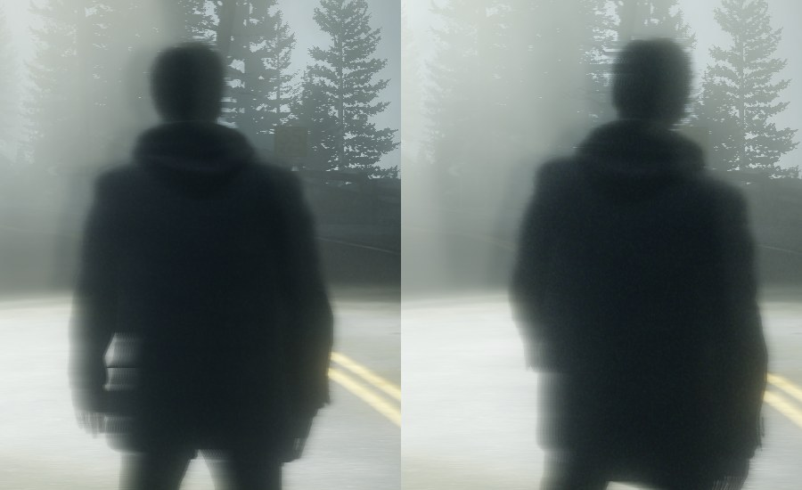
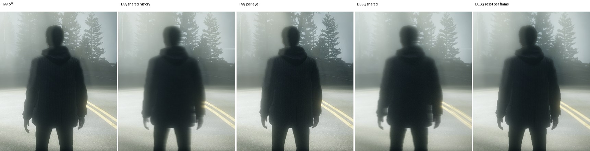
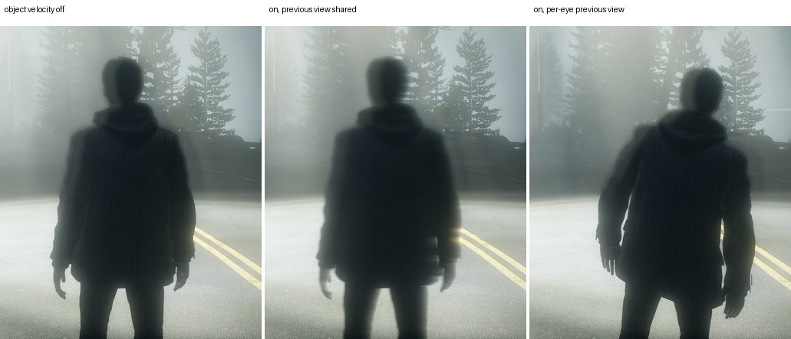
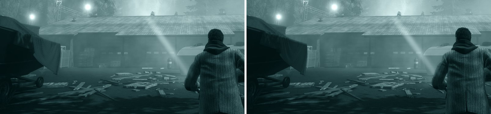
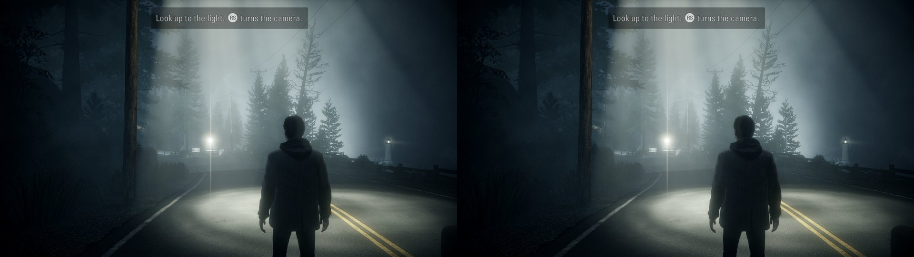

# Stereoscopic 3D: findings, measurements and the road to full SBS

Target: XReal Air 2 Ultra in 3D mode, a **3840x1080 full side-by-side** signal (left half to the
left eye, right half to the right eye, each a 1920x1080 16:9 view), with **both eyes rendered from
the same simulated frame**. Prior art: Ishimura (Dead Space), which alternates eyes on consecutive
engine frames (`ds-decomp/docs/18-stereo.md`, `28-full-sbs.md`, `49-...`).

Status of this spike, in one paragraph: the camera lever is found and verified (eye offset is a
translation, disparity inversely proportional to depth, scales with separation, convergence puts
the screen plane where configured). **Same-update dual rendering works**: in `mode = sbs` the
game's render pass runs twice per game update (left eye, right eye), the first Present is swallowed
after its back buffer is stashed, and the second is composed into a **3840x1080 swapchain with
each eye a 1:1, unscaled 1920x1080 render at the engine's own 16:9 frustum**. Temporal state that
would cross eyes is kept **per eye** (section 5): TAA history pair and ping-pong index, previous
camera matrices (camera and object motion vectors), the TAA jitter phase (one per update, same for
both eyes) and the objects' previous transforms, so TAA and object motion blur stay on in sbs
(measured: the disparity field with TAA on matches the TAA-off one, no cross-eye blending). DLSS has
one feature, so in sbs it is reset every frame (safe, but soft); a DLSS feature per eye is
specified, not built. **Both eyes now render inside one engine frame** by default (`sbs_path =
view`, section 6): `renderFrame` twice inside one `ModeSwitch::render`, beginFrame/endFrame, HUD and
Present once per update, the HUD duplicated into both halves, render-side state that a render
advances rewound for the second eye (separation-0 halves 0.036/255 apart), and optionally the
shadow maps and sky probe reused for the second eye (+10 % fps, `skip_shadows`/`skip_probe`). What
is not done: per-eye DLSS, HUD depth, a half-SBS (squeezed) output, and convergence with TAA on
(section 6, open issues).

Every address is an RVA (image base 0x140000000), `Game_f_x64_EOS.exe` as shipped on Epic
(2026-11). "static" = read in Ghidra (`re/scripts/Serve.java`), "live" = observed with the
`stereo census` trace or captures in the lab, "measured" = numbers from captured frames.

---

## 1. Frame structure

### One thread does update, render submission and Present

The **"RMD - Game Thread"** (entry `0x347730`, names itself via `0x3c74c0`; reads
`CommandLine.txt` next to the exe; its loop calls `0x1d1900` once per iteration) runs:

```
0x1d1900  Game::tick
  0x263600  ModeSwitch::update     simulation: game modes, camera (setViewToWorld on the main view x4)
  0x262cb0  ModeSwitch::render     the frame:
              spin until >= 4.17 ms since the last frame (240 fps cap)
              0x2aca30  Renderer::beginFrame(g_renderer @0xb18848)   ++frame counter @0xb188d8
              mode->render() for each active mode (vtable +0x38), e.g.
                0x34cdd0  GameMode::render
                  0x2ae2f0  Renderer::renderView(view)  -> focus/DOF params, then tail-jumps to
                  0x508970  RendererX86::renderFrame(view, scene, extra)     [vtable slot 11]
                              TAA jitter -> View::setPostProjection, then
                  0x5090b0      RendererX86::renderWorld: RT pool (pColorRT, pNormalRT,
                                pLinearDepthRT, pMotionVectorsRT, pTAAHistoryRT0/1, ...),
                                shadows, cube-map probe (6 views), G-buffer, lighting, post
                  0x335550, 0x33b180  overlays / HUD
              0x2acb10  Renderer::endFrame   submits, then IDXGISwapChain::Present
```

Established **live** (census, `quiver lab call awr stereo census N`): every event below happens on
one thread id (the one that created the swapchain), in this order per frame:

```
setViewToWorld MAIN x4 (ret 0x15e723)          <- ModeSwitch::update
ModeSwitch::render enter
  ExecuteCommandLists n=1
  Renderer::beginFrame
  setViewToWorld MAIN x2
  renderFrame ret=0x34ce30 view=MAIN fov=1.3823 aspect=1.7778 near=0.2 far=1000
    setPostProjection (jitter)  ret 0x508de3
    setViewToWorld x6 cube faces (static PerspectiveView @0x140dc44f0, ret 0x5124b7)
    setViewToWorld CustomView @0x140e0b480 (ret 0x52e57a) = main camera pose
    setPostProjection x4 (0x5093e2 zero, 0x498602 identity, 0x498a1a / 0x509417 jitter)
    ExecuteCommandLists n=14..15                  <- the scene's command lists, submitted at the
                                                     end of renderFrame (inside it: the sbs census
                                                     marks it IN-RENDERFRAME)
  Renderer::endFrame
    ExecuteCommandLists n=8, n=1
    Present
    GetCurrentBackBufferIndex (ret 0x49b7e5)     <- the engine asks DXGI every frame
```

So there is **no separate render thread consuming a frame packet**: the game thread records D3D12
command lists during `renderFrame` (about 5 ms wall time per call in the prologue scene,
recording plus submission) and submits the first half of the scene's lists from inside
`renderFrame` (the device kick), the second half (lighting, post, the final image) together with
the HUD/overlay lists and the frame's end in `endFrame` (correction from the command-list census,
section 6). (`rend::CommandBufferExecuteThread` exists
in RTTI; with the options seen here all `ExecuteCommandLists` calls come from the game thread, through `0x503184`.) Debug
render options registered in `0x2b0580`: "Multi Thread Rendering" (u8 `0x955632`), "Split Command
Buffers" (`0x955635`), "Late Shadow Pass" (`0xd755d6`), "Combined Post Pass" (`0x95566a`), "VSync
Enabled" (`0x95566c`), "DLSS Mode".

This structure is what makes same-update stereo cheap: **simulation and rendering are separate
calls on the same thread, and `ModeSwitch::render` can be called twice without running the
simulation in between.**

### The camera: rend::View

`rend::View` (vtable `0x751bb8`, 0xcb0 bytes) → `rend::PerspectiveView` (vtable `0x751bd8`, 0xcc8)
→ game `BaseCamera` (vtable `0x752ad0`; the main view object is a BaseCamera). Matrices are
**doubles, row-vector** (`v' = v*M`, translation in the last row), static from the ctor
`0x469ab0`, copy `0x46a4f0` and the methods below:

| offset | field |
|---|---|
| +0x008 | post-projection double[4][4] (TAA jitter in [3][0..1]), set by `View::setPostProjection` `0x46c090` |
| +0x1e8 | world-to-view double[4][3] |
| +0x248 | view-to-world double[4][3]: rows right, up, forward, position |
| +0x2a8 / +0x328 | view-to-clip and inverse (lazy, `0x46c120`: `vtbl[2]` projection × post-projection) |
| +0x3a8 / +0x428 | world-to-clip and inverse (lazy, `0x46c500`) |
| +0x4a8 / +0x4a9 | "projection valid" / "world-to-clip valid" |
| +0x4b0.. | shader uniforms `g_mWorldToView`, `g_mViewToWorld`, `g_mViewToClip`, `g_mClipToView`, `g_mWorldToClip`, `g_mClipToWorld`, `g_vViewPoint`: each 1 header + 4 slots, slot = 1 + a per-thread index at TLS+0x30060 (`0x15e140`) |
| +0xcb0 | PerspectiveView: horizontal FOV (radians), +0xcb4 zoom, +0xcb8 aspect (w/h), +0xcbc near, +0xcc0 far |

`PerspectiveView` projection (`0x4637f0`): `m00 = 1/tan(fov/2)/zoom`, `m11 = m00*aspect`,
`m22 = f/(f-n)`, `m23 = 1`, `m32 = -n*f/(f-n)` (D3D left-handed). Measured main camera in the
prologue: fov 1.3823 rad (79.2 deg horizontal), aspect 1.7778, near 0.2, far 1000, so
`m00 = 1.2088`. Setters: aspect `0x463c30`, far `0x463c50`, fov `0x463c70`, near `0x463c90`,
zoom `0x463cb0` (each clears +0x4a8).

**`View::setViewToWorld(const double m[4][3])` at `0x15e2f0`** is where every camera transform
enters the renderer: it stores the matrix, inverts it into world-to-view, marks world-to-clip
dirty and writes `g_mWorldToView`, `g_mViewToWorld` and `g_vViewPoint`. Everything the GPU sees for
that view (and culling) is derived from it. Callers (static): `0x15e650` (float camera transform at
+0xcc8, used by BaseCamera: the main view, live), `0x477190` (spot-light shadow views),
`0x485390`, `0x50f5f0`, `0x512220` (the 6-face cube probe), `0x52e140` (a CustomView copied from
the main camera each frame).

How it reaches the GPU: the uniforms above are copied into constant buffers when the view is bound
(`UseViewCommand` `0x46cc10` / `UsePerspectiveViewCommand` `0x463cd0` → `0x46c890`); renderWorld
binds the main view three times (`0x506b20`).

### TAA and temporal state (static + live)

- TAA on/off: u8 `0x955636` (and `0x955694`), written by the options code `0x242a20` (forced 0
  when DLSS `0xd75620` is on). `renderFrame` only jitters when it is set.
- Jitter: `renderFrame` builds an identity post-projection with `[3][0..1]` = jitter / resolution
  (patterns Rotated Grid / Halton / Hammersley, tweakables "TAA:Jitter ..."), frame counter `0xd744f8`.
- `TAA::beginFrame` `0x498590` (`*(RendererX86+0x140)`): uses **TAA+0x60, last frame's unjittered
  world-to-clip (double[4][4])** to build current-view-to-previous-clip (camera motion vectors),
  then overwrites it with this frame's.
- History targets `pTAAHistoryRT0/1` and `TAA Mask 0/1` come from the RT pool by name in
  `renderWorld`; the ping-pong index is RendererX86+0x2e8 (section 5 has the details).

### The tweakable registry

`rend::BaseTweakable` ctor `0x461320(this, name, type)` appends `this` to a global array of at most
0x500 pointers at `0xd386f0`, count at `0xd3aef8`, under a mutex. Layout: +0x00 `char*` name,
+0xa8 type (0 bool, 1 float, 2/3 vectors, 5 list), +0xb0 value, +0xb4/+0xb8 float min/max. Most are
function-local statics, so a tweakable exists only once its code ran. Lookup by name is a linear
scan (the mod's `tweak_find`). Exposed live as `quiver lab call awr tweak list [SUBSTR]` and
`tweak NAME [VALUE]`. Examples present in-world: `Camera:FOV` (88, 15..150; registered `0xfaa0`),
`TAA:Resolve`, `TAA:Enable Camera Velocity`, `TAA:Enable Object Velocity`, `TAA:History Blend
Weight` (0.8), `TAA:Jitter Scale`, `Cinematic Moment:FOV Multiplier`. Cheap levers for stereo:
FOV and the TAA/velocity switches (used below).

Level-related (for the level-loading work): the game thread entry `0x347730` reads
`CommandLine.txt` from the exe folder and parses it with `0x195cf0` (errors: "Command line
errors"); `GameMode::loadWorld` exists (RTTI `InstanceWorldJob@?BE@??loadWorld@GameMode@@`); the
main menu has an "Episodes" item.

---

## 2. Camera bias (mono frame)

Hooks (`src/features/stereo/stereo.cpp`, signatures in `engine.h`):

- `RendererX86::renderFrame` `0x508970`: its `view` argument **is** the main scene camera; it is
  the only View passed there (live: one call per frame, always the BaseCamera). This scopes the
  bias: the mod biases that View only.
- `View::setViewToWorld` `0x15e2f0`: when the game sets the main view's transform, the mod keeps
  the game's matrix and forwards `position += right * offset`. Shadow, light, cube-probe and
  reflection views have their own transforms and never see the offset (the cube probe and the
  CustomView are set inside renderFrame; the CustomView copies the biased main pose, as it should).
- `View::setPostProjection` `0x46c090` (inside renderFrame, main view only): convergence, adds
  `offset * m00 / Zc` to `[3][0]` (an NDC shift that zeroes disparity at `Zc` metres).

Sign: view +x is camera **right** here (`right = up × forward`, left-handed, live census), `m00 > 0`;
the left eye is `-separation`. Measured: with parallel eyes every confident patch has the left
image to the right of the right image, the correct sign.

Because the offset goes into the view transform, everything derived from it moves together:
lighting, shadows (cast from light views, sampled at the biased camera's pixels), fog, SSAO, post.
In the captures shadows, light shafts and the HUD stay coherent; the HUD is drawn in screen space
and is identical in both eyes (zero disparity, i.e. at screen depth).

### Measurements

Scene: fixture **`prologue-road`** (Continue Game → the prologue road, the player standing, camera
behind him, lighthouse and trees in fog). 1920x1080, `m00 = 1.2088`,
`K = 2e*m00*(W/2) = 75.43 px*m` at 32.5 mm per eye. Tool: `re/scripts/stereo_disparity.py`
(32 px patches on a 24 px grid, SSD over integer shifts + parabolic sub-pixel, confidence-gated).

Mono-frame bias (separate left / right captures, run r10, TAA settled 60 frames after each change):

| pair | median | notes |
|---|---|---|
| mono control, consecutive frames | -0.016 px (p5..p95 -0.47..+0.17) | floor |
| player (2-3 m) at 32.5 mm | +29.4 px | implies 2.6 m |
| road in front (≈5 m) | +15.05 px | 5.0 m |
| trees through the fog (≈35-40 m) | +2.08 px | 36 m |

Near over far is 29.4 / 2.08 ≈ 14: not a pan. Disparity scales with separation (per-patch ratios,
patches > 3 px): 16.25 → 32.5 mm ×1.963 (requested 2), 16.25 → 65 mm ×3.890 (requested 4), 32.5 → 65
×1.961. Each eye here is a separate capture ~100 frames after the other, so idle animation and fog
motion between the captures add scatter and pull the medians 2-3 % low. The same-update battery
below removes that between the two eyes of a pair (not between pairs taken at different settings).

### Same-update battery (sbs, full SBS 3840x1080)

Every pair below is **the two halves of one presented 3840x1080 frame**, so both eyes come from
the same game update; no animation or camera drift between the eyes. Run r16, fixture
`prologue-road`, `re/scripts/stereo_battery.sh` + `re/scripts/stereo_analyse.py` (captures in the
lab run folder runs/r16). TAA and object velocity off (forced by sbs), per-eye camera motion vectors.

Control, **separation 0 in sbs** (two renders of the same update with the same camera):
disparity median **+0.009 px** (p5..p95 -0.23..+1.29, 2583 patches); pixel |L-R| mean 0.81/255,
max 14. The halves are not bit-identical: something rendered per pass differs slightly (film
grain/noise or a render-side simulation stepping per pass; the same measure on two consecutive
mono frames is 1.51/255). Bounding that is on the follow-up list.

Separation (per eye) | median of all patches | p95
---|---|---
16.25 mm | +2.62 px | +18.5 px
32.5 mm | +4.64 px | +34.3 px
65 mm | +8.96 px | +61.6 px

Field at 32.5 mm: 423 patches at 20-60 px (1.3-3.8 m: the player, the pole), 364 at 10-20 px
(3.8-7.5 m: the road), 435 at 5-10 px, 769 at 1-5 px (15-75 m: trees in the fog). Per-patch
scaling between captures (separate frames ~100 updates apart, so near moving things add scatter;
by disparity bin 2-5 / 5-10 / 10-20 / 20-60 px): 16.25 → 32.5 mm ×2.00 / 1.89 / 1.95 / 1.84
(requested 2), 16.25 → 65 mm ×3.85 / 3.37 / 3.58 / 3.05 (requested 4). The far bins, where nothing
moves, reproduce the request; the near bins are pulled down by the player's idle motion between
the separate captures. (The cleaner scaling check is the mono-frame table above, ×1.96 / ×3.89.)

**Convergence** 4 m vs parallel, both at 32.5 mm, joined per patch: parallel − converged =
**+19.34 px** median (expected a uniform K/Zc = 18.86 px), recovered **Zc = 3.90 m** for 4.00
configured (-2.5 %). With convergence, patches nearer than 4 m stay positive (median +4.34 px,
n=451) and farther ones cross to negative (median -10.17 px, n=1528); with parallel eyes 100 %
of patches are positive. A pan cannot change sign with depth.

**Same update vs frame-sequential, the measurement this design exists for.** A synthetic camera
yaw of 0.5 deg per game update (`stereo.test_pan`, applied to the main view once per
`ModeSwitch::render`) stands in for a player turning at 30-70 deg/s:

pair | far field (y < 500, trees in fog), median | p5..p95
---|---|---
sbs, halves of one frame (2 frames) | **+1.73 / +1.76 px** | -1.7..+8.8
alternate (frame-sequential), L(n) vs R(n+1) | **+12.69 / +12.35 px** | -3.8..+35.9
static sbs (no pan), for reference | +1.8..+2.1 px |

The frame-sequential pairs carry the camera motion between the two eyes: +10.6 px of false
disparity on the far field, which is what 0.5 deg is at the image centre
(960 × 1.2088 × tan 0.5° = 10.1 px). The same-update pairs carry none: their far-field disparity
is the static value. This is the Ishimura problem (`docs/49`, `19-stereo-motion`), removed by
construction rather than compensated.


*3840x1080 composite (downscaled), run r17: left eye in the left half, right eye in the right half,
each a 1:1 copy of the engine's 1920x1080 render. The HUD hint is drawn in both at zero disparity.*



*Left: first sbs build (r11), the player smeared by motion blur because the eye offset read as
velocity (camera and object motion vectors from the other eye's previous frame). Right: with
per-eye previous world-to-clip and object velocity off (r17).*

### Census of an sbs update (live, r17)

```
setViewToWorld MAIN x4                      <- one ModeSwitch::update
ModeSwitch::render enter
  beginFrame; renderFrame(MAIN)             <- left eye: CustomView copy at (-3101.670, -931.870)
    ExecuteCommandLists n=15 IN-RENDERFRAME
  endFrame: ExecuteCommandLists n=8, n=1; Present   <- swallowed (back buffer index stays 1)
  [mod] ExecuteCommandLists n=1             <- stash copy, queued after the engine's lists
  beginFrame; renderFrame(MAIN)             <- right eye: (-3101.696, -931.810)
    ExecuteCommandLists n=15 IN-RENDERFRAME
  endFrame: ExecuteCommandLists n=8, n=1; Present   <- composed and presented
ModeSwitch::render leave
```

The two eye positions differ by 0.065 m along the camera's right axis (-0.391, 0, 0.920): the
configured 2 × 32.5 mm.

---

## 3. Two eyes from one simulated frame

### Candidates

1. **Re-run the frame's render call per eye** (implemented). `ModeSwitch::render` `0x262cb0` is the
   whole render+present of one game update and the simulation (`ModeSwitch::update` `0x263600`) is
   a separate call. The hook runs it twice: pass 1 with the left eye, pass 2 with the right eye.
2. Call `renderFrame` twice inside one `ModeSwitch::render`: **implemented, the default**
   (`sbs_path = view`, section 6). The premise here was wrong in one point: only the first half of
   a render's lists is submitted inside `renderFrame`; the half holding lighting, post and the
   final image is submitted later (section 6), so the copy has to be recorded into the engine's
   own list. (1) stays available as `sbs_path = frame`.
3. Hold the simulation every other frame (time-frozen alternate frames). Not needed: (1) gets the
   same guarantee without touching the simulation.

### How (1) works

- Present filter (`core/present`): on pass 1 the back buffer (the left eye) is copied to an eye
  texture on the game's own queue and **the real Present is skipped**. Safe because the engine asks
  `GetCurrentBackBufferIndex` after every Present (live), so it simply renders pass 2 into the same
  buffer. GPU order is right: our copy is queued after the engine's submissions for that frame and
  before pass 2's.
- On pass 2 the right eye is copied out and both eyes are written to the back buffer, which is then
  presented.
- Full SBS: with `[stereo] output = full` the swapchain is created **3840 wide** while
  `GetDesc`/`GetDesc1` keep reporting 1920. Live: the engine keeps rendering at its own resolution
  into the left 1920x1080 of the 3840 buffer (captured), so the compositor is two 1:1
  `CopyTextureRegion`s: each eye is exactly the engine's 1920x1080 render with its own 16:9
  frustum, unscaled. No projection change is needed at all. (The lab's 1920x1080 gamescope display
  shows only the left 1920 columns of the 3840 buffer, so `quiver lab shot` sees the left eye; the
  mod's own `stereo shots` read back the whole buffer.)
- Half SBS (`output = half`, 1920 swapchain): the prototype shows the centre half of each eye (a
  crop, not a squeeze); a proper half-SBS needs a 2:1 filtered squeeze (a small pixel/compute
  shader pass) and was not done.

### What breaks, and what the prototype does about it

| state | problem when eyes alternate renders | prototype | proper fix |
|---|---|---|---|
| TAA history (`pTAAHistoryRT0/1`, `TAA Mask 0/1`, index RendererX86+0x2e8) | eye N resolves against eye N-1's image: the disparity collapses (measured, section 5) | **done**: right eye gets its own pool RTs (renamed in the pool allocator) and each eye its own ping-pong index | — |
| camera motion vectors (TAA+0x60, vector blur +0x60) | the eye offset reads as camera velocity: motion blur smears the whole frame | **done**: per-eye copies swapped around each eye's renderFrame | — |
| object motion vectors (View+0x88/+0x108 previous camera; object +0xb8 previous world) | the eye offset reads as object velocity: the player smears (captured); the second eye had no object motion at all (measured) | **done**: per-eye previous View matrices; objects keep the previous update's transform for the second eye | skinned animation (vertex buffers double-buffered by frame parity) still zero for the second eye |
| DLSS (`0xd75620`, one NGX feature at device+0x38a8) | one history for both eyes: the disparity collapses (measured) | **reset every frame** while sbs runs (no cross-eye blending, but no accumulation: soft) | one DLSS feature per eye (section 5) |
| frame counters (`0xb188d8`, `0xd744f8`) | advance twice per update: jitter sequence and anything keyed on frame parity runs at 2x | jitter: renderFrame is lent a per-update counter (same jitter for both eyes); the rest unchanged | pin per update once beginFrame runs once per update |
| auto exposure, GPU particles, cloth, foliage repulsion (render-side sims) | step per render, so twice per update and possibly differently per eye | the separation-0 residual (0.81/255) was film grain (random offset per render), the motion-blur/TAA frame-time rings and lens flares | **done in the view path** (section 6): rewound for the second eye, residual 0.036/255 |
| HUD | drawn per eye at zero disparity | fine | **view path**: drawn once, duplicated into both halves (section 6) |
| frame pacing | ModeSwitch::render waits 4.17 ms per call | fine | — |

### Cost (measured, run r17, `quiver lab gpu -- re/scripts/stereo_rate.sh awr`, GPU to itself)

mode | renders/s | displayed frames/s
---|---|---
off (mono) | 140.8 | 140.8
sbs | 140.8-145.5 | 70.2-72.6

Exactly two renders per displayed frame and no other overhead visible at this precision (the
compositor is 3-4 copies on the copy path). On the user's 8 GB laptop GPU this means half the mono
frame rate, as expected for true stereo; the pass-2 shortcuts in section 4 are where it comes back.

---

## 4. Recommended architecture for full SBS 3840x1080

1. **Output**: a 3840x1080 swapchain created by the mod (done: `present_set_width_scale(2)`), the
   engine left at 1920x1080 internal resolution, each eye copied 1:1 into its half. The per-eye
   frustum is then exactly the engine's own 16:9 projection: no FOV or aspect change, unlike
   Ishimura's anamorphic route. The window is made 3840x1080 (2x the engine's size) with the
   engine kept at one eye, menus usable with the mouse over either half: done, see
   [stereo-output.md](stereo-output.md).
2. **Dual render per update**: done both ways; the default is `renderFrame` ×2 inside one
   `ModeSwitch::render` (section 6), the `ModeSwitch::render` ×2 structure is the fallback.
3. **Temporal state per eye**: done for TAA (history pair, index, jitter), camera and object
   motion vectors (section 5). Remaining: a DLSS feature per eye, skinned-animation velocity for the
   second eye, and an audit of render-side simulations (particles, exposure, SSAO and volumetric
   temporal buffers) to step once per update.
4. **Pass-2 shortcut**: done for the shadow pass and the sky probe (section 6, ~10 %); render-side
   state the second eye would step again is rewound (flares, grain, frame-time rings).
5. **HUD**: drawn once and duplicated into both halves at zero disparity (section 6); a chosen
   depth would shift the duplicate.
6. **Comfort defaults**: separation 32.5 mm per eye with convergence 3-5 m for third person,
   measured on the glasses.

### Risks

- Unknown render-side state stepped per render (particles, cloth, exposure) can differ between
  the two eyes of a pair (retinal rivalry). Detectable with the sbs separation-0 control.
- Cinematics/cutscenes use other cameras and may bypass `renderFrame` (Bink videos do: no 3D).
- The width lie is only on the DXGI side; the back-buffer resource itself reports 3840 (the engine
  did not use it in the tested paths: menu, title, gameplay).

---

## 5. Temporal state per eye

Implemented in `src/features/stereo/eyestate.{h,cpp}`: `eyestate_enter(renderer, view, eye, …)` /
`eyestate_leave(…)` bracket each eye's `RendererX86::renderFrame` (called from `render_eye`, so it
does not care whether the two eyes come from two `ModeSwitch::render` calls or two `renderFrame`
calls in one), and `eyestate_update(dual)` runs once per game update. New RVAs are in `engine.h`
(`kEyeSigs`, all signature-checked; a mismatch disables the whole module and sbs falls back to TAA
and object velocity off, as before).

### What carries "last frame", and what each eye now gets

**TAA history (static + live).** `renderWorld` (0x5090b0) requests `pTAAHistoryRT0/1` (output
resolution, format 0xb) and `TAA Mask 0/1` (format 3) from the RT pool every frame and keeps them in
RendererX86+0x2f0/+0x2f8 and +0x300/+0x308 for the frame (cleared at its end). They persist because
the pool allocator (0x4ad760) hands back the free entry whose stored name *contains* the requested
name (case-insensitive substring, 0x3bb360) with the same size/format. The ping-pong index is
RendererX86+0x2e8 (int): while TAA is on and DLSS off, renderWorld does `prev = i; i ^= 1;` then
`0x49a8c0(TAA, …, mask[i])` and the resolve `0x498a80(TAA, color, motion, …, mask[prev], mask[i],
hist[prev], hist[i])` (code at 0x50aa5d). With two renders per update the index toggles twice, so
eye R always reads what eye L wrote that same update (and vice versa).
Per eye: the pool allocator is hooked and, while the right eye renders, those four names (matched
by the game's literal addresses 0x798858/68/78/88) become `TB R TAAHistory0/1` and `TB R TAAMask0/1`
(no name is a substring of another, so the pool can never hand one eye the other's target): the
right eye gets its own persistent pair, created by the engine's own pool on first use (+2 history
RTs at output resolution, +2 masks; about 37 MB at 1920x1080). The index +0x2e8 is saved/restored
per eye. Live: the probe (`stereo probe N`) shows each eye's index toggling on its own (L 1→0, R
1→0, L 0→1, R 0→1 …) and 4 renamed requests per right-eye render.

**Jitter (static + live).** `renderFrame` (0x508970) derives the jitter phase from the render-frame
counter 0xd744f8 (`counter & 3` for the rotated grid, `counter % samples` for Halton/Hammersley,
also the DLSS phase), and the renderer's beginFrame (0x5064a0) increments it once per
`ModeSwitch::render`, so with sbs L always got even phases and R odd ones: each eye's history only
ever saw half the pattern. Per eye: the counter is replaced by a per-update count for the jitter
computation only (set in `eyestate_enter`, restored at entry to the hooked `renderWorld`), so both
eyes of an update use the same jitter and each eye walks the whole sequence, one step per update.
Everything inside renderWorld (skinning buffers, per-object stamps, GPU ring slots keyed on
`counter % n`) still sees the engine's real counter. Live: probe `ctr=114/115` at renderFrame
entry for both eyes of consecutive updates, real counter 2290.. inside renderWorld.

**Camera motion vectors (static + live).** Two objects keep last frame's unjittered world-to-clip
at +0x60 and overwrite it every render: the TAA object (RendererX86+0x140, `TAA::beginFrame`
0x498590) and the vector-blur object (RendererX86+0x190, 0x4700f0, same layout). Both are
saved/restored per eye (the TAA one was already in the prototype; the vector-blur one is new).

**Object motion vectors (static + live).** The velocity builder (0x4cad50, `RenderVelocityCommand`
0x4c9c90) computes `g_mPreviousLocalToClip = objPrevWorld(object+0xb8, float 4x3) × View+0x108
(previous world-to-view, double 4x3) × View+0x88 (previous view-to-clip, double 4x4)`, and the
current one from object+0x88 × View+0x1e8 × View+0x2a8. Live (probe): after renderFrame
View+0x108 equals the current world-to-view, i.e. the engine copies current → previous at the end of
each render, so the second eye's "previous camera" was the first eye's (the eye offset read as
object velocity: the player smear). Per eye: View+0x88..+0x168 is saved/restored per eye like the
TAA matrices. The objects' own previous world is the other half: `rend::Object::storePrevious`
(vtable 0x785d48 slot 6, 0x46d510: +0xb8 ← +0x88) is called for every drawn object at the very end
of renderWorld (0x50b46e). Live: ~330 calls per render in prologue-road, ~140 in forest-night, all
inside renderFrame (return address 0x50b471), none outside.
So with two renders per update the second eye found prev == current and drew **no object motion at
all**. Measured in `awr-forest-night` (birds attacking), objects drawn with a non-zero object motion
per eye render (status `obj_moving`): without the fix L 25-32, R 0.0-0.2; with it L 18.7-32.4, R
18.7-33.6 (three alternations each). The fix: while the first eye of an update renders (another
eye follows), the hook keeps +0xb8..+0xe8 as it was across the call (the rest of storePrevious
still runs), so both eyes see the previous *update's* transform. Object transforms are world-space
and eye-independent, so this is exact for rigid objects.

**Not per eye (remaining).** Skinned vertices are computed into two buffers chosen by
`counter & 1` (0x46d650 current, 0x46d680 previous, stamp check 0x46d6f0, static). With the counter
advancing per render, the right eye computes the same pose into the other buffer and uses the left
eye's as "previous": its skinned *animation* velocity is zero (rigid motion and camera are right).
This resolves itself once beginFrame runs once per update (both eyes on the same counter: the
second eye reuses the first's buffer, previous = last update's). The SSAO temporal buffer
(0x5363c0) and the volumetric-light temporal buffer (0x4e3020) are also single-history and still
blend across eyes (low-frequency effects; not measured separately).

### DLSS

Static: DLSS mode is u32 0xd75620 (renderWorld skips the TAA path when non-zero). One NGX feature
lives in the D3D12 device object (global 0xda35e0, `rend::DeviceD3D12PC` vtable 0x790f58): handle at
+0x38a8, parameters at +0x38a0, initialised flag +0x38b8, created by 0x4a7080 (NGX CreateFeature on
a command list kept at +0x38d0) from vtable slot 45 (0x4a6660), which re-creates it when the mode
(+0x38d8) or render/output size (+0x38c0..+0x38cc) changes, moving the old handle to +0x38b0 for
release by 0x4a6cd0 (GPU idle 0x4f7be0, then NGX release 0x68ea80). Evaluate is slot 46
(0x4a67b0 → parameter setup 0x4a5800); its **Reset is always 0** (`mov dword [rsp+0x68],0` at
0x4a6ad1). Live: DLSS does run in the lab (`game.dlss = quality` → mode 4, a feature handle
present; nvapi enabled in the instance).

What the mod does: while sbs runs with DLSS on, the immediate of that `mov` is patched to 1
(`eyestate_update`), so DLSS resets its history on every evaluate: both eyes are upscaled from
their own frame only, symmetric, no cross-eye blending, but without temporal accumulation (softer:
sharpness 2.06-2.16 vs 3.5-3.7 for native TAA-off, below). Patched back as soon as sbs stops or DLSS
is switched off.

What a proper per-eye DLSS needs (not built): swap device+0x38a8 per eye in
`eyestate_enter/leave` exactly like the TAA index; create the right eye's feature on first use by
calling 0x4a7080 with +0x38a8 zeroed (it records CreateFeature on the device's command list and
registers it via 0x502a30), remember for each eye's handle the mode/size key it was created with
and, when the key changes (0x4a6660 only re-creates the handle that is in +0x38a8 at that moment),
re-create the stale eye's handle and release the old one the way 0x4a6cd0 does (GPU idle, NGX
release). Cost: one more DLSS feature (its history buffers) and nothing per frame.

### Measured (lab, `prologue-road`, 3840x1080 sbs, separation 32.5 mm, parallel)

`re/scripts/stereo_taa_battery.sh` + `re/scripts/stereo_taa_analyse.py`; every number is the two
halves of one presented frame (both eyes from one update), 2 frames per cell. Variants: **off** =
TAA and object velocity off (the old sbs default; the reference disparity field), **shared** = TAA
and object velocity on with per-eye state off (`stereo.per_eye = 0`, the old `taa = 1`), **per-eye**
= the new default, **mb-** = TAA off, object velocity (motion blur) on. Runs r4 (TAA) and r11 (DLSS
quality, then the off / per-eye repeat with DLSS off).

| | off | shared | per-eye |
|---|---|---|---|
| sep 0, static: \|L−R\| mean (/255) | 0.78, 0.56 | 0.87, 0.70 (max 50-64) | 0.80, 0.54 |
| sep 0, pan 0.5°/update: \|L−R\| mean | 0.91, 0.75 (max 16) | 1.04, 0.97 (max 80-82) | 0.80, 0.74 (max 23-31) |
| … player box | 0.61, 0.63 | 1.51, 1.36 | 0.69, 0.56 |
| sep 32.5: disparity median (all patches) | +4.03, +3.99 px | **+0.85, +1.19 px** | +4.05, +4.07 px |
| … per patch vs off: median, mean \|diff\| | (off vs off: −0.002, 0.27) | −1.52, 4.51 px (p5 −15.8) | **−0.012, 1.24 / 1.20 px** |
| … sharpness, mean \|∇\| (player box) | 3.66, 3.49 (5.67, 5.55) | 2.84, 2.73 (4.25, 4.15) | 3.61, 3.55 (5.61, 5.51) |

With a shared history the right eye's TAA keeps blending in the left eye's image (and vice
versa): the disparity field collapses towards zero (median +0.85 px instead of +4.0: the 3D effect
is mostly gone) and the image is soft. With per-eye state the disparity field matches TAA-off patch
by patch (median difference −0.01 px; the 1.2 px mean is TAA's own antialiasing moving edges,
against a 0.27 px floor between two TAA-off frames), the separation-0 controls are at the TAA-off
level both static and under the pan, and sharpness is back to the TAA-off level. Repeat in r11:
per-eye vs off per patch −0.001 px median, 1.07 / 0.99 px mean.

DLSS (r11, DLSS quality, same scene): **shared** (no handling) disparity median +0.25 px (far field
+0.15 px vs +2.7 px), per patch vs off −2.4 px median, 5.1 px mean, pan |L−R| 1.21 / 0.90 (max
77-83); **reset per frame** (what the mod does): disparity +3.87 / +3.68 px, per patch −0.03 px
median, 1.48 / 1.45 px mean, pan |L−R| 0.79 / 0.69 (max 13-35); sharpness 2.16 / 2.06 (soft: no
accumulation).

Object velocity on, TAA off (the r11/r17 smear case): player-box sharpness L 5.14 / 5.02 with the
previous view shared, 5.41 / 5.31 per eye, 5.67 / 5.55 with object velocity off. The crops show the
smear on the shared variant's head and shoulders; in the per-eye capture the player had moved (idle
animation), with ordinary motion blur on the moving arm. A moving-objects |L−R| test in
`awr-forest-night` (birds) was inconclusive: frame-to-frame variation (0.8-2.1/255) is larger than
any variant difference; the `obj_moving` counts above are the clean measurement there.

Cost (`quiver lab gpu -- stereo_rate.sh`, awr-pass also resident): sbs with per-eye state 68.5 /
68.2 renders/s, without 68.1 / 68.0: no measurable overhead (a few memcpys per eye; the right
eye's extra RTs are only memory).



*Right eye, player crop, separation 32.5 mm (r4, r11). TAA with one history for both eyes blends
the left eye's image in (soft, doubled edges, disparity flattened); per-eye history looks like the
TAA-off frame, antialiased. DLSS with its single history: the same blending; reset per frame: no
blending, softer.*



*Right eye, TAA off, object motion blur on (r4): previous camera shared between eyes (the eye
offset reads as object motion: the head and shoulders smear) vs per eye.*

### Config

`[stereo] taa = 1` and `object_velocity = 1` (new defaults) keep the game's own TAA / object
velocity settings in sbs, with per-eye state; `0` switches them off while sbs runs (the old
behaviour). Without per-eye state (signature mismatch) they are switched off regardless. Dev:
`stereo.per_eye = 0` (shared state, the old prototype), `2` (all but the object-previous hold); the
lab verb `stereo probe N` logs the view/TAA state around N eye renders; `stereo status` reports
`eyestate` (swaps, renamed RT requests, jitter count, held object stores, `obj_moving` per eye,
DLSS mode/handle/reset).

---

## 6. Both eyes in one engine frame (`sbs_path = view`, the default)

Code: `hk_modeSwitchRender` / `render_view_sbs` in `stereo.cpp`, `cmdlist.{h,cpp}` (D3D12
command-list layer), `gpu_stash_mid` / `gpu_place_mid` in `gpu.cpp`, `pass2.{h,cpp}` (second-eye
handling). `sbs_path = frame` keeps the `ModeSwitch::render` ×2 path of section 3.

### How the engine submits a render (live, `stereo census N cl`)

`census N cl` also traces the command-list calls that touch the back buffer (barriers, copies,
`OMSetRenderTargets` with the RTV/DSV handles, list resets/closes with draw counts, the lists in
each `ExecuteCommandLists`). Mono frame, prologue-road:

```
ModeSwitch::render enter
  ~23 command lists Reset (a per-frame pool, handed out in order)
  ExecuteCommandLists n=1                       <- frame-start list: barrier bb PRESENT -> RENDER_TARGET
  beginFrame; renderFrame
    ExecuteCommandLists n=14..15 IN-RENDERFRAME <- the device "kick": every list closed so far
                                                   (shadows, probe, depth/G-buffer: ~4200 draws)
    list X: OMSetRenderTargets(back buffer, no DSV), 1 draw   <- the final post pass, recorded but
                                                                 NOT submitted
  renderFrame leave
  endFrame
    lists closed: 61, 2822, 2237, 200, 200, 200, 54 draws, list X (bb_draws 1 + HUD draws)
    ExecuteCommandLists n=8                     <- lighting/forward/post + the final image + HUD
    ExecuteCommandLists n=1                     <- barrier bb RENDER_TARGET -> PRESENT
  Present
```

So, unlike what section 3 assumed, a render's lists go out in **two batches**: the kick inside
`renderWorld` (the device's vtable +0x378, `0x4f6280` → `0x4f62b0` → `0x5034c0` →
`ExecuteCommandLists` at `0x503184`; called once per render from the main pass `0x506b20`, before or
after the shadow pass depending on "Late Shadow Pass"), and `endFrame`. The second batch holds
about 5700 of ~10000 draws and the final post pass into the back buffer (static: `renderWorld`
`0x5090b0` ends with `0x532030(post, scene, target)`, the target being the device's back-buffer RT
from `device->vtbl[+0x48]`; live: the `OMSetRenderTargets` on the back buffer is after the kick).
The HUD (`GameMode::render` → `0x335550`/`0x33b180` and the other modes' `render`) records into the
back buffer's list with the scene DSV bound (live: `ds=0x...` on its `OMSetRenderTargets`).

### What the view path does per update

```
ModeSwitch::render (once)          beginFrame (once: counter 0xb188d8, RendererX86 beginFrame
                                   0x5064a0 -> render counter 0xd744f8 and frame time 0xd74504)
  renderFrame hook:
    pass2_eye(0); render_eye(LEFT)                  (eyestate: per-eye TAA/velocity, jitter)
    gpu_stash_mid: barrier bb RT->COPY_SRC, copy bb[0,1920) -> eye texture 0, barrier back,
                   RECORDED INTO THE ENGINE'S OPEN BACK-BUFFER LIST (after its post pass)
    engine kick (device vtbl +0x378)               -> the left eye's second batch goes out now
    pass2_eye(1); render_eye(RIGHT)                 (rewinds; optional shadow/probe reuse)
    gpu_place_mid (also recorded into the engine's open back-buffer list):
                   bb[0,1920) -> eye texture 1; eye 0 -> bb[0,1920); eye 1 -> bb[1920,3840)
    overlay duplication armed
  HUD / other modes: each draw into the back buffer is issued twice (viewport and scissor
                   +1920 px, DSV unbound for the copy since rasterisation is limited to the
                   smallest bound target, the 1920-wide depth buffer)
endFrame (once): ExecuteCommandLists n=8, n=1; Present (once, nothing swallowed)
```

Why the copies are recorded into the engine's list: a list of ours submitted when `renderFrame`
returns runs *before* the eye's second batch (live, first attempt: the stash captured the back
buffer before the post pass). Recording into the list that last bound the back buffer (tracked by
the `OMSetRenderTargets` hook, still open at that point) puts the copy right after the post pass in
GPU order; with the kick the list is closed and submitted immediately after. The back buffer's
state at that point is whatever the engine's barriers left it in (tracked per back buffer from
`ResourceBarrier`, record time: `RENDER_TARGET`); each copy transitions from and back to it.
Live census of a view-path update (r6/r13): the stash copy and its barriers inside the left eye's
back-buffer list, `ExecuteCommandLists` of that list from the kick, the right eye's lists, the
placement copies inside the right eye's back-buffer list, then the HUD's draws with `dups=4`.

Why the kick matters (measured, GPU shared with another instance, so GPU-bound): without it the left
eye's second batch waited for the right eye's kick, the GPU idled meanwhile, and the view path ran
61 renders/s against 70 for the frame path; with it 69.1-69.4 for both.

Frame-level work now once per update: beginFrame/endFrame (screenshot/scaling bookkeeping, the
`0xb188d8` counter), the HUD and overlays, the frame-start/end barrier lists, Present, the
renderer's beginFrame (`0x5064a0`: render counter, frame time, per-frame resource rings). Both eyes
see the same render counter, so per-object "once per frame" updates (stamps compared with
`0xd744f8`: skinning `0x46dff0`/`0x4b2390`, `0x46ea00`) run in the first eye only and the second
eye reuses them, including the skinned vertex buffers double-buffered by counter parity
(`0x46d650/0x46d680`; section 5): with both eyes on one counter value the second eye uses the
first eye's buffer and the previous one is last update's, i.e. skinned animation velocity is
right in both eyes. GPU rings keyed on `counter % n` (auto exposure `0x480340`/`0x480bf0`: a ring of
1x1 exposure RTs and readback buffers; `0x4b5a60`/`0x4b6950`): the second eye reads the same
previous slot and writes the same current slot as the first, in GPU order after it, so the result
is the second eye's (equal to the first's within the luminance difference between the eyes); the
CPU readback of a slot happens `n` frames later (static). No overwrite hazard: one queue, in order.

### Second eye: state a render advances (`pass2.cpp`, measured)

Separation 0 in the view path should give identical halves (same update, same camera). It did not:
mean |L−R| 3.88/255 (r6), 0.95 after the flare fix. Causes found, each verified by switching it:

- **Lens flares** (`rend::Flare` vtable `0x78f768` slot 8, `0x492bb0`, static): per render the flare
  pushes its occlusion query result into a 10-sample average and resets the average unless it last
  ran on frame `counter − 1` (+0x130). Twice in one frame the second call resets it: no flares in
  the second eye (captured: the street lamp's flare only in one half). Fix: the flare's state
  (+0xd0 index, +0xd4 count, the ring at +0xe0, +0xe8/+0xec fade, +0x130) is snapshotted before the
  first eye's call and put back before the second eye's (`stereo.flare_rewind`).
- **Film grain** (static): the post object (RendererX86+0x118) draws `g_vRandomOffset` for the grain
  from a Mersenne Twister at +0xa8 (624 words + index at +0x9c0, `0x3e64e0`) every render, so the
  two eyes got different grain. With grain off in the game's options the residual fell from 0.95 to
  0.10/255 (r6).
- **Frame-time rings** of motion blur (`0x470750`: globals `0x955618` index, `0x95561c` count,
  `0x955620` capacity, `0x955628` float*) and TAA (`0x49a8c0`: `0x955850..0x955860`): every render
  pushes the frame time, so the second eye averaged one more sample. Motion blur off: 0.10 → 0.035.

The generator and both rings are snapshotted when the first eye starts and put back when the second
starts (`stereo.rewind`); a ring is restored only if its array pointer is unchanged (it is
allocated lazily on first use, which can happen during the first eye: live crash when the whole
header was rewound right after motion blur was switched on). Result (r7, grain and motion blur on,
TAA off): 0.052-0.111/255 (max 3) with, 0.56/255 without. Remaining residual: the volumetric light
shafts (temporal buffer `0x4e3020`, single history across eyes, section 5). With master's per-eye
TAA: **0.036-0.038/255** (max 6, r16 battery) and 0.001-0.012/255 in `awr-forest-night` (r18/r19).
Not bit-identical, and not yet explained: a flock of birds attacking in `awr-forest-night` (r19,
during the scripted attack, radial blur): 0.19-0.22/255 with no second-eye skips, the difference
confined to the birds (and 2.5/255 once in r18 during the attack with the flashlight burst); some
per-render state of that effect (swarm/particle step) is not rewound yet.

Exposure (`0x480340`) needs no rewind in this path: it adapts from the previous slot to the
current one in each eye with the same frame time, so both eyes compute the same exposure (the
frame path instead adapted twice per update).

### Second eye: work reused instead of redone (`skip_shadows`, `skip_probe`, default on)

- **Shadow pass** `0x50dba0` (static: called once per `renderWorld`, early from `0x5090b0` or late
  from `0x506b20`; shadow-filter globals, shadow manager begin RendererX86+0xf0 vtbl+0x18, each
  visible light's shadow render vtbl+0x40). For the second eye the hook returns without calling it:
  the light objects keep the first eye's shadow maps and shadow matrices (same update, same lights).
  Cascades are fitted to the first eye's frustum; the second eye's is 65 mm to the side.
- **Sky cube probe** `0x512220` (from the sky/atmosphere update `0x4a85d0`: the 6-face sky cube via
  the static PerspectiveView `0xdc44f0`, its filtering, the SH terms; `g_sAmbientSHTerms`,
  `g_sEnvironmentReflectionCube`): skipped for the second eye.

Draws recorded (live census, prologue-road): first eye ~4200 before the kick + ~5700 after; second
eye with both skips ~2960 + ~5720 (−1370 draws: the shadow pass and probe). The large second-batch
lists (2600-2800 and 2000-2200 draws) are view-dependent geometry and stay.

Verification (measured):
- Separation 0 with the skips (second eye reuses, first eye rendered them): prologue-road 0.054-0.118
  vs 0.052-0.111/255 without (r7); forest-night with the flashlight, interleaved off/on ×3 (r18):
  0.007-0.012 vs 0.004-0.009/255, ×5 during the bird attack (r19): same level for off and on except
  the flock (see above). Each skip alone 0.008/255 (r18).
- Disparity field at 32.5 mm with skips off/on (prologue-road r7): player 29.03 / 28.91 px (probe
  only 28.54, second off-capture 28.64), median of all patches +3.91 / +4.01 px, bins 20-60 / 10-20 /
  5-10 / 1-5 px 170/529/391/989 vs 178/526/419/929 (captures ~70 updates apart, idle motion).
  Forest-night (r18): player 29.95 off, 30.12 / 30.15 on.
- Shadows in the second eye: present and in place with the reuse (flashlight beam, the boat's and
  the debris's shadows; crop below). Frustum-edge artifacts: none seen at the left/right edges of
  the right eye; at 65 mm the cascade fit margin covers the offset.
- An A/B "render the second eye twice in one update, once with and once without the skips" lever
  was tried and dropped: the third render is not equivalent (per-frame stamps already taken), so
  its differences measured the lever, not the skips.



*Right eye (rendered second), awr-forest-night r18, separation 32.5 mm: left rendered in full,
right with the first eye's shadow maps and sky probe. Captures ~100 updates apart (the player
turned slightly); shadows of the boat, debris and the flashlight beam are the same.*

### Battery on the view path (measured, instance awr-pass run r16)

`re/scripts/stereo_battery.sh` + `stereo_analyse.py`, prologue-road, 3840x1080 borderless, view
path with both reuses on, TAA and object velocity per eye (master defaults). (Run numbers in this
section are the awr-pass instance's.)

| | view path (r16) | section 2 (frame path, TAA off, awr r16) |
|---|---|---|
| sep 0: \|L−R\| mean, disparity median | **0.036 / 0.038 /255** (max 6), +0.001 / 0.000 px (p5..p95 ±0.04) | 0.81/255 (max 14), +0.009 px (−0.23..+1.29) |
| 16.25 / 32.5 / 65 mm: median of all patches | +1.79 / +3.94 / +7.63 px | +2.62 / +4.64 / +8.96 px (other camera pose) |
| per-patch ratio 32.5/16.25, 65/16.25, 65/32.5 (requested 2, 4, 2) | **1.999, 3.984, 1.996** | 2.00/1.89/1.95/1.84 by bin, 3.05-3.85 |
| field at 32.5 mm, 20-60 / 10-20 / 5-10 / 1-5 px | 190 / 525 / 415 / 915 patches | 423 / 364 / 435 / 769 |
| pan 0.5°/update, far field: sbs halves vs alternate | +3.29..+3.62 px vs **+10.2 / +11.1 px** | +1.73 / +1.76 vs +12.69 / +12.35 px |
| convergence 4 m: recovered Zc | 10.2 m (TAA on; see open issues) | 3.90 m |

The scaling is now essentially exact because both eyes of a pair are one frame and the separations
are taken minutes apart only between pairs. The player measured 29.07 px at 32.5 mm (r16, median of
the patches ≥ 20 px), as in section 2 (29.4 px).



*3840x1080 view-path frame (downscaled), r16, prologue-road, 32.5 mm, TAA per eye: both eyes from
one engine frame, the HUD hint drawn once and duplicated into both halves.*

### Cost (measured, `quiver lab gpu --for awr-pass -- re/scripts/stereo_rate.sh awr-pass`, r16)

GPU to itself (only awr-pass on it, 3840x1080 gamescope display, borderless, prologue-road, TAA and
object velocity on per eye), two rounds:

variant | renders/s | displayed frames/s | CPU ms per update (update / eye 1 / eye 2 / endFrame)
---|---|---|---
off (mono) | 142.5 / 143.3 | 142.5 / 143.3 | 5.72 / 5.36 / – / 0.27
frame (ModeSwitch::render ×2) | 146.2 / 145.7 | 73.2 / 72.7 | 12.3 / 5.44 / 6.07 / 0.60
view (renderFrame ×2) | 146.3 / 144.3 | 73.2 / 72.3 | 12.4 / 5.65 / 6.18 / 0.21
view + shadow and probe reuse | 163.4 / 159.2 | **81.8 / 79.5** | 11.0 / 5.02 / 5.42 / 0.20

Earlier, with the GPU shared (awr-taa rendering; r13): mono 69.4, frame 34.7, view 34.6, view +
skips 39.6-39.9 fps (+14 %); shadows alone 39.4, probe alone ~0 (within noise). In this scene the
game is CPU-bound on its single render thread when it has the GPU (≈5.5 ms of recording per eye),
so the view path's savings (one beginFrame/endFrame and Present, the HUD once) are small and the
reuse gains about 10 %; when the GPU is the limit, the reuse gains more. The rest of a render is
view-dependent.

### Open issues

- **Convergence with TAA on** (both paths; came with per-eye TAA on by default): parallel −
  converged at 4 m measured +6.2 px (frame path +5.1, view +6.5) instead of a uniform +18.86 px,
  i.e. the TAA resolve largely removes the post-projection shift. TAA off: +15.5 px (Zc 4.85 m;
  grain off). Film grain identical in both eyes (now) biases the disparity tool towards 0 in
  flat fog, so measure convergence with grain off. Candidate fix: apply convergence as a
  horizontal shift in the compositor copies (`gpu_place_mid`) instead of in the projection.
- The bird flock in forest-night differs between eyes (above).
- Lab: in a 1920x1080 display with `output = full` and windowed mode the window logic shrinks the
  engine to 160x240 (r15; `stereo window: resize ...` chain). Measured instead on a 3840x1080
  display, borderless, as `docs/stereo-output.md` prescribes.
- One crash in forest-night ~10 s in-world (r17, view path, no skips), not reproduced in r18/r19.

---

## Reproducing

```sh
scripts/build
cp -r build/mod /tmp/modfull
sed -i 's/^output = half/output = full/; s/^start_level =$/start_level = continue/; s/^skip_videos = 0/skip_videos = 1/' \
    /tmp/modfull/torchbearer.ini                     # 3840 swapchain; boot straight to the checkpoint
quiver lab fixture install awr prologue-road        # game stopped
quiver lab launch awr --mod /tmp/modfull --wait frame
quiver lab wait awr in-world                         # ~11 s with the levels feature (docs/levels.md)
# (without [dev] start_level: re/scripts/awr_to_world.sh awr steps warning -> title -> Continue)
re/scripts/stereo_battery.sh awr                     # captures into the run folder
python3 re/scripts/stereo_analyse.py <run folder>
quiver lab gpu --for awr -- re/scripts/stereo_rate.sh awr 40 "off frame view view+skip"   # per variant
quiver lab call awr stereo census 2                  # frame-structure trace into torchbearer.log
quiver lab call awr stereo census 2 cl               # ... plus command lists touching the back buffer
re/scripts/stereo_taa_battery.sh awr                 # per-eye temporal state variants (section 5)
python3 re/scripts/stereo_taa_analyse.py <run folder>
VARIANTS="dlssshared:1:1:0 dlssreset:1:1:1" re/scripts/stereo_taa_battery.sh awr   # with game.dlss on
```

Lab verbs: `stereo status | census N [cl] | shots N TAG [SKIP] | files | probe N | peek r|img|ADDR [+OFF|*]...`, `tweak list [SUBSTR] | tweak NAME
[VALUE]`, `cfg stereo.<key> <value>`. Ghidra: `re/scripts/Serve.java` (headless query server) and
`re/scripts/ghq` (client).
